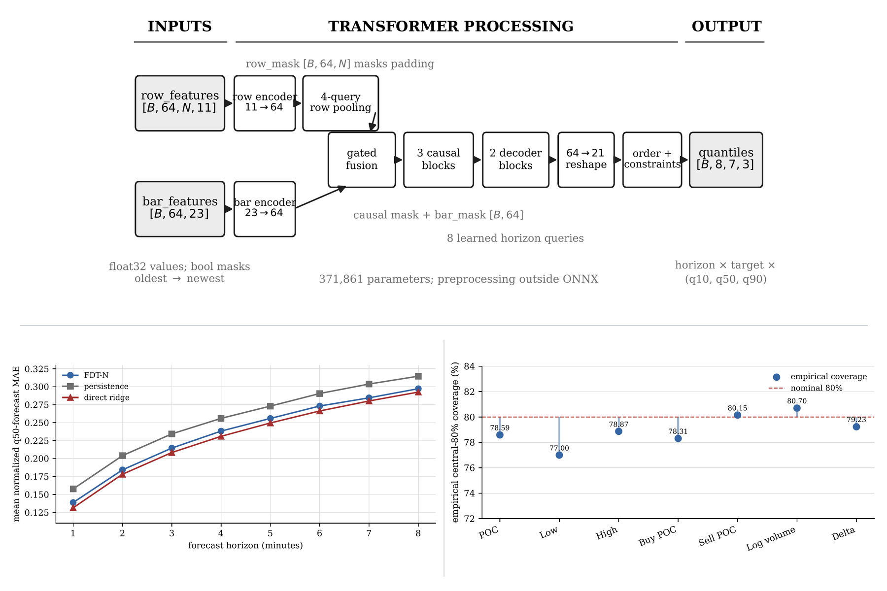
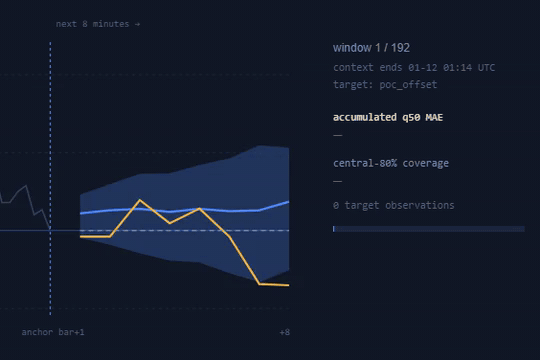
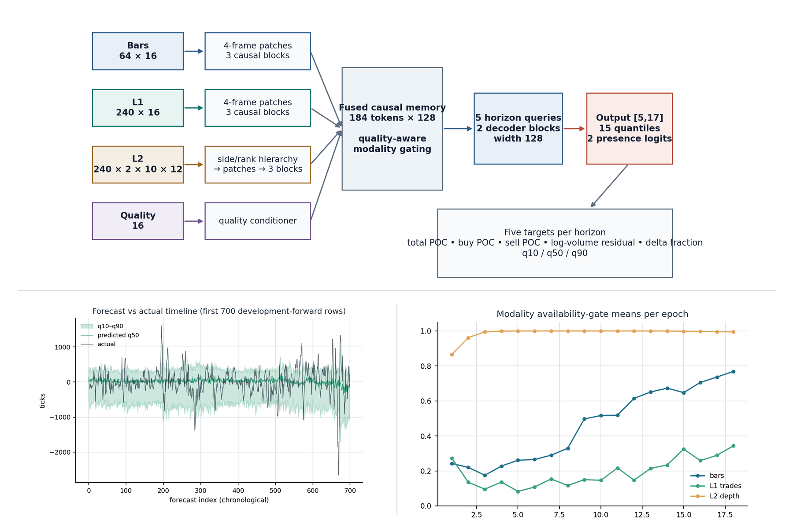

# DaxAlgo Research

Research code, papers, and frozen evidence for two numeric market transformers by
[Dhruv Sharma](https://dhruuvsharma.github.io) (dhruvsha.info@gmail.com).

Both programmes were run under fixed, hashed protocols with chronological splits, leakage controls, and
train-only baselines, and both are reported honestly, including where the model lost to a simpler
baseline.

## Papers

| Programme | Paper | LaTeX source |
|---|---|---|
| **FDT-N**: Footprint Distribution Transformer (Narrow) | [PDF](fdt-n/doc/reports/fdt-n-volume-footprint-transformer-final-submission.pdf) | [`fdt-n/doc/submission/`](fdt-n/doc/submission/) |
| **CHMT-Q**: Causal Hierarchical Market Transformer with Quantiles (failure analysis) | [PDF](chmt-q/doc/publication/chmtq-arxiv-manuscript.pdf) | [`chmtq-arxiv-manuscript.tex`](chmt-q/doc/publication/chmtq-arxiv-manuscript.tex) |
| **CHMT-Q**: architecture and tensor mechanics | [PDF](chmt-q/doc/publication/chmtq-transformer-architecture-paper.pdf) | [`chmtq-transformer-architecture-source/`](chmt-q/doc/publication/chmtq-transformer-architecture-source/) |

### FDT-N in one paragraph

A 372K-parameter ragged-set transformer that reads every price row of an order-flow footprint bar
and predicts direct multi-horizon quantiles. Across three seeds, with model selection on validation
loss only, held-out q50 MAE was 7.25% better than persistence but 2.68% worse than a train-only
ridge baseline, which won 55 of 56 horizon-target cells. It is reported as a negative result.

*The [offline visualizer](fdt-n/visualizer/) replaying the frozen model on real BTCUSDT windows.*

### CHMT-Q in one paragraph

A 2.1M-parameter transformer with separate bar, L1, and L2 order-book encoders, quality-aware
fusion, and monotone q10/q50/q90 heads, trained on content-hashed data with split-bound scalers
and walk-forward purge/embargo. Weighted pinball loss improved 2.26% over an empirical baseline, but
directional and cost-aware tests failed, so the model is documented as not deployable.

## Layout

| Path | Contents |
|---|---|
| `fdt-n/volume-footprint-transformer` | FDT-N model, data pipeline, training, evaluation, and instrument/timeframe screening |
| `fdt-n/visualizer` | Self-contained offline HTML dashboard for the seed-17 model |
| `fdt-n/doc` | Evidence ledger, research notes, LaTeX submission, rendered PDFs, and the reviewed ONNX model |
| `chmt-q/numeric-transformer` | CHMT-Q model, training, and evaluation code |
| `chmt-q/research-backtest` | CHMT-Q research backtest harness |
| `chmt-q/doc` | Specifications, architecture notes, audits, experiment protocols, and publications |

## Conventions

- Frozen result sets that back a published claim are committed, so the numbers stay reproducible.
- Raw datasets, checkpoints, and training runs are not committed; see `.gitignore`.
- Each programme keeps its own README describing how to reproduce its results.
- This is research code. Nothing here is a trading signal or investment advice.
