# From Counting Trades to Causal Attention

## An illustrated, first-principles research paper on the CHMT-Q numeric market transformer

**Audience:** curious beginners first; engineers, researchers, and reviewers second  
**Scope:** market data, tensors, attention, forecasting, uncertainty, evaluation, and safe deployment  
**Status:** educational synthesis and research design; not a trading promise and not an execution system  
**Repository boundary:** Professional/private material; do not copy into `public/`

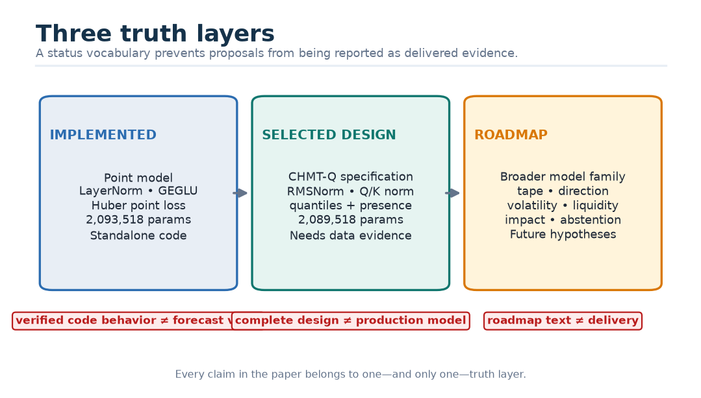
*Figure 1. The three truth layers used throughout this paper.*

## Abstract

This paper explains a numeric market transformer from the first act of counting to the last act of checking a forecast. It assumes no prior knowledge of markets, matrices, probability, or machine learning. The central idea is simple: at a decision time, collect only market facts that were genuinely available, arrange those facts into carefully labelled arrays of numbers, let a small transformer compare relevant moments and structures, and predict several possible future footprint outcomes together with honest uncertainty. The difficulty is not the slogan. The difficulty is preserving meaning, time, missingness, and evidence at every step.

The selected research design is the **Causal Hierarchical Market Transformer with Quantiles**, abbreviated **CHMT-Q**. It has three separate causal encoders for finalized bars, best-quote observations, and two-sided depth. It uses full attention because its sequences are short, a hierarchical level encoder because a book snapshot is not an ordinary row, hard-availability-aware quality gates because missing data must not masquerade as zeros, five direct horizon queries because recursive forecasts accumulate error, and monotone marginal quantiles because one sharp-looking number hides uncertainty. The designed model has width 128, four attention heads, a 184-token fused memory, five horizon queries, 17 raw values per horizon, and an exact design ledger of 2,089,518 trainable parameters.

Three kinds of truth are kept separate. The **implemented prototype** is a tested, standalone point-forecast model using LayerNorm, plain scaled dot-product attention, GEGLU, and Huber loss. The **selected CHMT-Q design** is a later research specification using RMSNorm, normalized queries and keys, learned attention temperatures, SwiGLU, LayerScale, quality-aware gates, and quantile/presence losses; it is not yet the implemented terminal model. The **roadmap model family** adds possible tape encoders, direction, volatility, liquidity, impact, and abstention heads; these are hypotheses, not delivered features. This distinction prevents a polished diagram from being mistaken for experimental proof.

The paper derives the principal equations, carries one attention calculation by hand, traces every important tensor shape, explains how labels and masks are built, and treats training, calibration, baselines, ablations, export, monitoring, and rollback as part of the model rather than afterthoughts. It also audits the 46-source research bibliography and an adjacent order-flow-filtration study. The conclusion is deliberately cautious: CHMT-Q is a coherent, testable candidate for causal multi-horizon footprint forecasting, but only leakage-safe data, untouched chronological evaluation, proper probabilistic scores, runtime parity, and shadow evidence can establish whether it is useful.

## How to read this paper

There are two simultaneous explanations.

- **Kid version** boxes give the picture before the symbols.
- **Math version** derives the same idea precisely.
- **Why?** boxes answer the design question that should be asked before any mechanism is accepted.
- **Danger** boxes identify ways a result can look impressive while being wrong.
- Status labels use **Implemented**, **Selected design**, and **Roadmap hypothesis** exactly as defined below.

You can read Parts I–III as a complete beginner’s course, then use Parts IV–VII as the engineering and research specification. Advanced readers may start with the architecture map and return to the derivations when a symbol is unclear.

## The honesty contract: three truth layers

| Layer | What is true now | What must not be claimed |
|---|---|---|
| **Implemented prototype** | Standalone Pro-private Python prototype; 64 bar tokens, 60 L1 patches, 60 L2 patches, five decoder queries, five point targets; tested shape/mask/export path where dependencies are installed | It is not integrated into the terminal, not a probabilistic CHMT-Q implementation, and not evidence of live forecasting value |
| **Selected CHMT-Q design** | A detailed candidate architecture, tensor contract, loss, parameter ledger, training protocol, evaluation gates, and isolated serving design, with remaining choices explicitly labelled | It is not yet validated on a genuine, leakage-audited training corpus and is not a promoted production model |
| **Roadmap hypothesis** | A broader family may later include tape/footprint encoders, direction, volatility, liquidity, impact, explanation, and abstention heads | These heads, benefits, and edition-parity experiences are not delivered merely because they appear in a roadmap |

> **Why? — Why start with status instead of architecture?** A diagram tells us how something could work. A test tells us a piece of code behaves as expected on the tested inputs. An experiment tells us how a model performed on a defined dataset. A live promotion record tells us it survived operational gates. Those are different claims. Mixing them is one of the fastest ways to turn research into advertising.

## Research question and non-claim

At a cutoff time \(c\), can a small, causally compiled numeric model use recent finalized bars, L1 quote state, L2 depth state, masks, and data-quality facts to issue calibrated distributions for five future completed Volume Footprint intervals?

The model predicts, for each horizon, total point of control, buy point of control when buy volume exists, sell point of control when sell volume exists, total volume, and delta fraction. It does **not** decide whether to trade, how much to trade, where to route, or where to place a stop. It does **not** promise profit. “Causal” here primarily means **no future information enters the feature computation**; it does not by itself prove an economic cause-and-effect relationship.

---

# Part I — What the market numbers mean

## 1. A market is a changing auction

Imagine a school fair where people trade collectible cards. Maya writes, “I will buy one card for £9.” Leo writes, “I will sell one for £11.” These are **limit orders**: each states a side, a price, and an amount. If someone is willing to sell immediately at Maya’s best buying price, a trade occurs. If nobody agrees, the offers wait in queues.

Electronic markets do this at high speed. The computer does not see a candle picture. It sees events such as:

1. add a buy order;
2. add a sell order;
3. change an order;
4. cancel an order;
5. execute a trade.

Every event needs an identity and several clocks. Without identity, reconnects can duplicate an event. Without clocks, a late-arriving message can be accidentally placed in the past. Without side, price, and quantity units, the same number can mean different things.

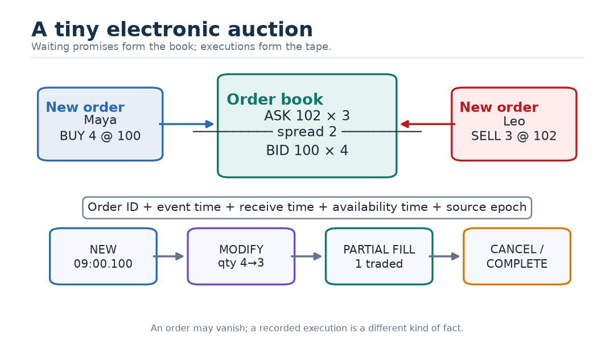
*Figure 2. A tiny electronic auction and the lifecycle of one order.*

> **Kid version — Book versus trade.** The order book is the list of promises still waiting. The trade tape is the list of deals that actually happened. A promise can vanish. A completed deal cannot be turned back into an unfilled promise.

### 1.1 Bid, ask, spread, and mid-price

The highest waiting buy price is the **best bid**, \(p_b\). The lowest waiting sell price is the **best ask**, \(p_a\). Their difference is the **spread**:

$$
s = p_a-p_b.
$$

A simple central reference is the mid-price:

$$
m = \frac{p_a+p_b}{2}.
$$

If the best bid is 100 ticks and the best ask is 102 ticks, the spread is 2 ticks and the mid-price is 101 ticks. A tick is the instrument’s minimum permitted price step. Keeping prices in ticks makes many comparisons exact and prevents a £0.01 step from being confused with a 0.25-point step in another instrument.

When best-side quantities \(q_b\) and \(q_a\) differ, a **microprice** moves the reference toward the thinner side’s price:

$$
\mu = \frac{p_aq_b+p_bq_a}{q_b+q_a}.
$$

This formula has a useful story. If the bid queue is much larger than the ask queue, the current ask may be easier to consume, so the weighted reference leans upward. That is a clue, not a law.

### 1.2 L1, L2, tape, bars, and footprint

**L1** normally describes the best bid and ask, their sizes, and derived facts such as spread, mid-price, imbalance, staleness, and change flags. **L2** describes multiple ranked prices and quantities on both sides. The **tape** records executions. A **bar** compresses a time interval into open, high, low, close, and volume. A **Volume Footprint** groups executed volume by price and often by aggressor side.

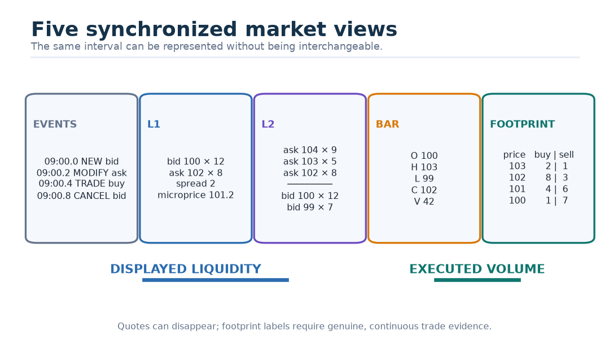
*Figure 3. Five views of the same market interval.*

These views answer different questions:

| View | Main question | What it cannot prove |
|---|---|---|
| L1 | What is waiting at the best prices now? | What is hidden, deeper, or guaranteed to trade |
| L2 | How is displayed depth arranged by side and rank? | Genuine intent or future execution |
| Tape | What executed, at what price and size? | The full waiting-book state before the trade |
| OHLCV bar | What broad range and activity occurred in the interval? | The exact within-bar order of events |
| Footprint | At which prices did classified buy/sell volume execute? | Unobserved or ambiguously classified activity |

> **Why? — Why can’t L2 be used as the footprint label?** Displayed orders can be cancelled, changed, hidden, swept, or missed during a feed gap. Footprint quantities describe executions. A model trained on quote depth pretending to be trades would learn a different target, even if the pictures sometimes resemble each other.

### 1.3 A ten-level book is a structured object

Suppose an L2 snapshot contains two sides and ten ranks. Rank 1 is nearest the spread; rank 10 is farther away. Swapping rank 1 and rank 10 changes the economic meaning. Swapping bid and ask changes the direction. Therefore an L2 snapshot is not merely a bag of 20 interchangeable rows.

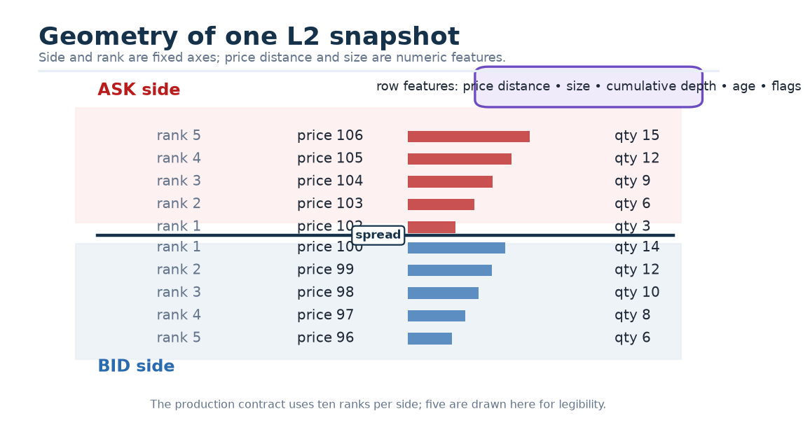
*Figure 4. Geometry of a two-sided, ten-level limit order book snapshot.*

For one observation time, CHMT-Q expects an L2 tensor with shape:

$$
[2,10,12] = [\text{side},\text{rank},\text{features}].
$$

Across 240 half-second slots and a batch of \(B\) examples, the shape becomes:

$$
[B,240,2,10,12].
$$

The axis names are part of the contract. A permutation that preserves the number of elements can still destroy the meaning.

## 2. Footprint targets and why uncertainty matters

Within a completed footprint interval, let \(v_p\) be eligible traded volume at price \(p\), and let \(\mathcal P^+=\{p:v_p>0\}\). When this set is nonempty, the **point of control** is the highest price among the maximizers:

$$
P = \max\!\left(\operatorname*{arg\,max}_{p\in\mathcal P^+} v_p\right).
$$

The buy POC \(P^{buy}\) and sell POC \(P^{sell}\) repeat the calculation on classified buy and sell volume, using the same higher-price tie-break. Total volume is

$$
V=\sum_p(v^{buy}_p+v^{sell}_p),
$$

and delta is

$$
D=\sum_p v^{buy}_p-\sum_p v^{sell}_p.
$$

CHMT-Q forecasts the bounded delta fraction \(D/V\) when positive volume and classification coverage are valid. In a complete interval with no eligible trades, \(V=0\), buy/sell presence is false, and total POC, buy/sell POC, and \(D/V\) are masked as undefined. The selected 17-output design has no separate total-volume-presence head; therefore the empty-interval rate is an explicit acceptance diagnostic, and a material rate requires revising the output distribution before promotion. If no eligible buy volume exists, buy POC is **missing**, not price zero. If the future tape has an unprovable gap, every affected label is unknown, not a quiet market.

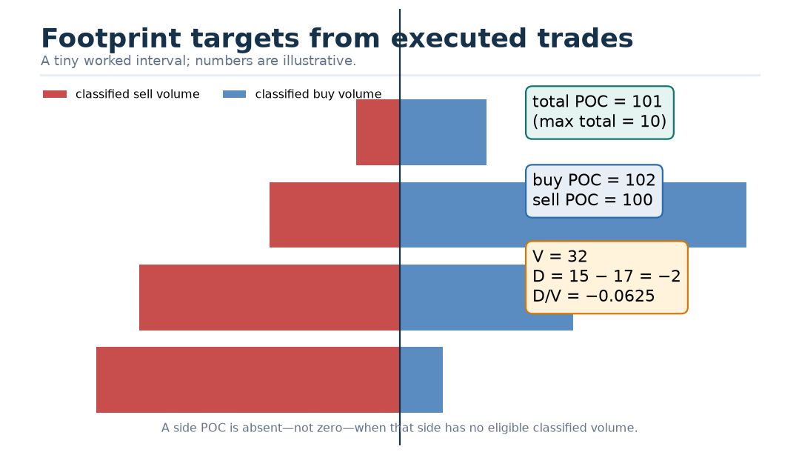
*Figure 5. How five footprint targets are obtained from executed volume.*

### 2.1 Residual targets

Raw prices drift across days and instruments. The model instead learns price offsets in ticks from a fresh causal reference price \(p_{ref}\), volume on a log-residual scale, and bounded delta fraction:

$$
\begin{aligned}
y_{h,0}=(P_h-p_{ref})/q,\\
y_{h,1}=(P^{buy}_h-p_{ref})/q,\\
y_{h,2}=(P^{sell}_h-p_{ref})/q,\\
y_{h,3}=\log(1+V_h)-\ell_{ref},\\
y_{h,4}=\operatorname{clip}(D_h/V_h,-1,1).
\end{aligned}
$$

Here \(q\) is tick size, \(\ell_{ref}\) is a trailing causal log-volume reference, \(h\in\{1,2,3,4,5\}\), and every \((h,k)\) pair has its own validity mask.

> **Why? — Why use offsets instead of raw price?** “Three ticks above a recent reference” has comparable meaning at price 100 and price 10,000. The transformation removes a large, mostly unhelpful level while preserving the local quantity the model must forecast.

### 2.2 One answer is not enough

If a weather model says “tomorrow will be exactly 18.3°C,” it hides how unsure it is. A market forecast is even noisier. CHMT-Q therefore predicts three marginal quantiles for every target:

- \(Q_{0.10}\): a lower value with about 10% of valid outcomes below it after calibration;
- \(Q_{0.50}\): the median;
- \(Q_{0.90}\): an upper value with about 90% of valid outcomes below it.

The interval \([Q_{0.10},Q_{0.90}]\) aims for 80% marginal coverage. It is not a guarantee, and five separate marginal intervals do not form one coherent future path.

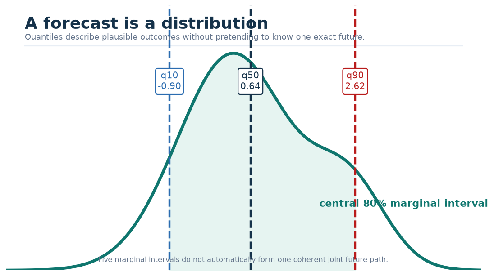
*Figure 6. A forecast is a distribution, not a dart at one number.*

---

# Part II — The mathematics toolkit

## 3. From one number to a tensor

A **scalar** is one number, such as a spread of 2 ticks. A **vector** is an ordered list, such as `[bid price offset, ask price offset, bid size, ask size]`. A **matrix** is a rectangular grid. A **tensor** is the general name for an array with any number of axes.

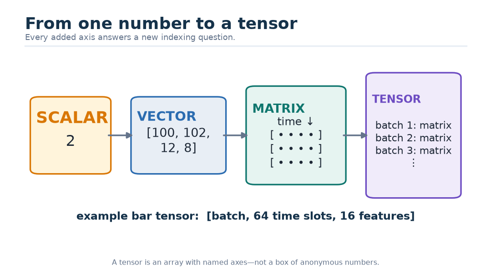
*Figure 7. Scalars, vectors, matrices, and tensors as nested boxes.*

For bars, the external tensor is

$$
X^{bar}\in\mathbb{R}^{B\times64\times16}.
$$

This notation says: \(B\) examples, 64 time slots per example, 16 features per slot. It does not say “a mysterious block of numbers.” Each axis has a name, unit, order, and mask.

### 3.1 Indexing is a sentence

The symbol \(X_{b,t,f}\) means “feature \(f\), at time slot \(t\), for batch example \(b\).” If \(X\) has shape `[32,64,16]`, then it contains

$$
32\times64\times16=32{,}768
$$

numeric cells. The shape alone is insufficient. We also need to know whether time is oldest-first, whether a price is in ticks, and whether a zero cell is valid or padded.

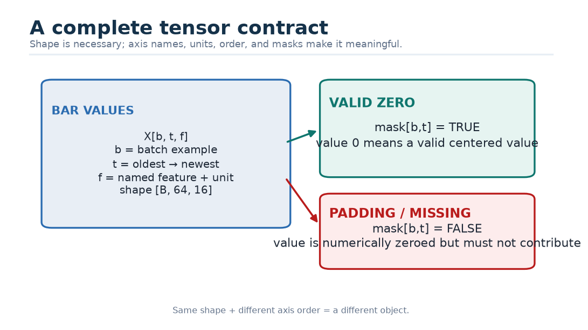
*Figure 8. Axis names, units, order, and masks complete a tensor contract.*

> **Danger — Same shape, wrong meaning.** A tensor transposed from `[time, feature]` to `[feature, time]` may contain the same numbers and even pass a weak size check. It is still a different object. Contracts and permutation tests are necessary.

## 4. Dot products: a weighted matching score

Given two vectors \(a=(a_1,\ldots,a_d)\) and \(b=(b_1,\ldots,b_d)\), their dot product is

$$
a\cdot b=\sum_{i=1}^{d}a_ib_i.
$$

For \(a=[2,1,-1]\) and \(b=[3,0,4]\):

$$
a\cdot b=2\times3+1\times0+(-1)\times4=2.
$$

Positive dimensions that line up add to the score; opposite signs subtract. Attention later uses a dot product to score how well a query matches a key.

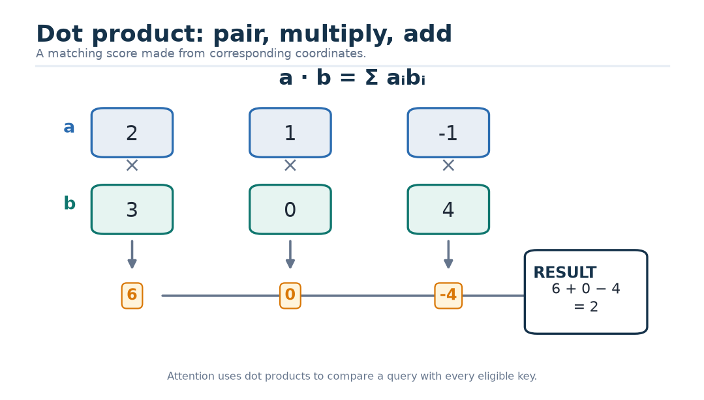
*Figure 9. A dot product as pair, multiply, and add.*

### 4.1 Why divide by \(\sqrt{d}\)?

Assume query and key components are independent, centered, and each has variance 1. A dot product sums \(d\) products. Its variance grows roughly like \(d\), so its typical size grows like \(\sqrt d\). Dividing by \(\sqrt d\) keeps attention logits in a comparable range:

$$
s(q,k)=\frac{q\cdot k}{\sqrt d}.
$$

Without this scaling, large logits can make softmax nearly one-hot early in training, causing tiny gradients for most choices.

## 5. Matrix multiplication: many dot products together

Let \(A\) have shape `[m,n]` and \(B\) have shape `[n,p]`. Their product \(C=AB\) has shape `[m,p]`, with

$$
C_{ij}=\sum_{k=1}^{n}A_{ik}B_{kj}.
$$

The inner dimensions must agree because row \(i\) of \(A\) and column \(j\) of \(B\) must have the same length.

For

$$
A=\begin{bmatrix}1&2\\3&4\end{bmatrix},\qquad
B=\begin{bmatrix}5&6\\7&8\end{bmatrix},
$$

the top-left result is \(1\times5+2\times7=19\), and the complete product is

$$
AB=\begin{bmatrix}19&22\\43&50\end{bmatrix}.
$$

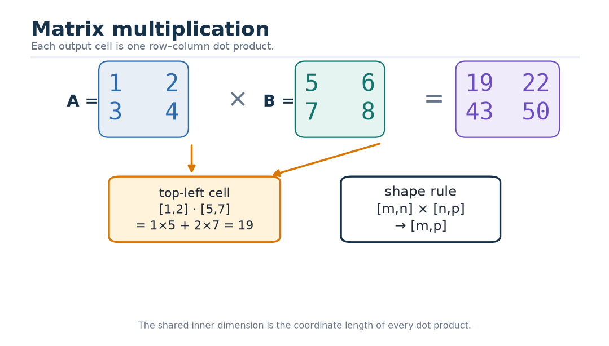
*Figure 10. Matrix multiplication cell by cell.*

### 5.1 A learned projection

A raw market row \(x\in\mathbb{R}^{16}\) is too small and semantically uneven for the main transformer. A learned matrix \(W\in\mathbb{R}^{16\times128}\) and bias \(b\in\mathbb{R}^{128}\) project it:

$$
z=xW+b.
$$

Each of the 128 output coordinates is a learned weighted combination of the 16 inputs. The projection does not invent new observations; it creates a workspace in which later layers can represent useful interactions.

> **Why? — Why 128 dimensions?** It is a fixed research choice balancing capacity, parameter count, head width, and batch-one CPU serving. It is not a magic number. Width must later compete in a controlled scaling study.

## 6. Functions used inside the network

### 6.1 Exponential and logarithm

The exponential \(e^x\) is always positive. The natural logarithm \(\log x\) reverses it for positive \(x\). We use `log(1+volume)` because raw volume is nonnegative and often strongly skewed. Adding 1 makes zero volume legal:

$$
g(V)=\log(1+V),\qquad g^{-1}(z)=e^z-1.
$$

### 6.2 Sigmoid and softplus

The sigmoid turns any real number into a value between 0 and 1:

$$
\sigma(x)=\frac{1}{1+e^{-x}}.
$$

It is used to express a probability-like output from a logit. Softplus turns any real number into a positive gap:

$$
\operatorname{softplus}(x)=\log(1+e^x).
$$

CHMT-Q uses positive gaps to guarantee ordered quantiles.

### 6.3 Hyperbolic tangent

The function

$$
\tanh(x)=\frac{e^x-e^{-x}}{e^x+e^{-x}}
$$

maps real numbers into \((-1,1)\). Because it is monotone, applying it to three already ordered delta-quantile values preserves their order.

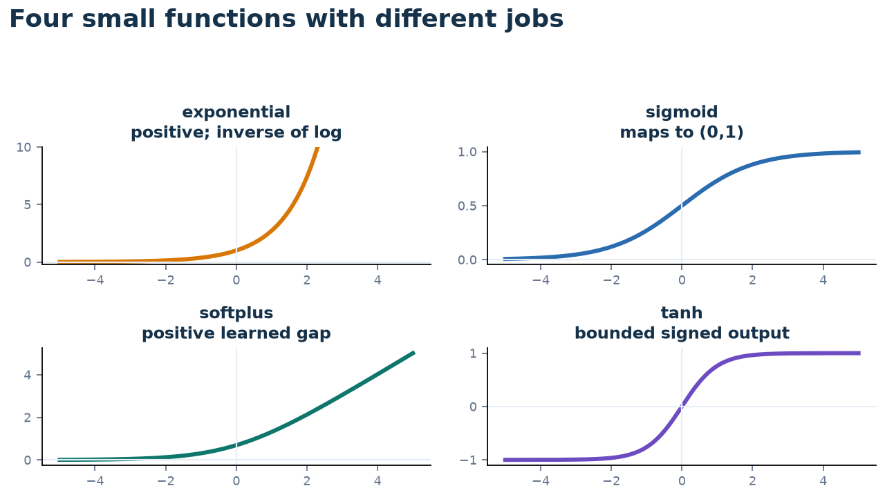
*Figure 11. Four small functions with different jobs.*

## 7. Softmax: turning scores into weights

For scores \(s_1,\ldots,s_n\), softmax is

$$
\operatorname{softmax}(s_i)=\frac{e^{s_i}}{\sum_{j=1}^{n}e^{s_j}}.
$$

Every weight is positive and the weights sum to 1. For numerical stability, subtract the largest score before exponentiating:

$$
\alpha_i=\frac{e^{s_i-s_{max}}}{\sum_j e^{s_j-s_{max}}}.
$$

Subtracting the same constant changes neither the ratios nor the result, but prevents overflow when a score is large.

If masked positions are replaced with \(-\infty\), their exponential becomes zero in ideal mathematics. Real software needs an additional all-masked rule because “maximum of no valid values” and `0/0` can create NaNs. CHMT-Q’s safe version returns an all-zero attention row when no key is valid, and a later hard modality gate prevents that absent branch from contributing.

## 8. Probability, quantiles, and calibration

A random variable \(Y\) represents an outcome not known yet. Its \(\tau\)-quantile \(Q_\tau\) is a value for which approximately a fraction \(\tau\) of outcomes lie at or below it:

$$
P(Y\le Q_\tau)\approx\tau.
$$

A forecast can be sharp but wrong, wide but safe, or both useful and calibrated. **Calibration** asks whether stated frequencies match observed frequencies. **Sharpness** asks whether distributions are concentrated. Sharpness is desirable only subject to calibration.

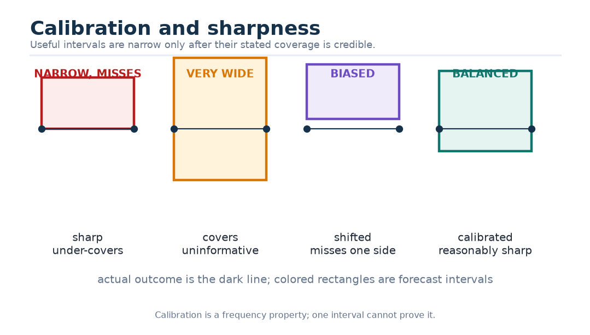
*Figure 12. Calibration and sharpness are different axes.*

> **Why? — Why not predict a mean and variance?** Market targets can be skewed, heavy-tailed, bounded, intermittently missing, and unlike a Gaussian bell curve. Direct quantiles make fewer distributional assumptions and map naturally to chart intervals. They remain marginal, so they do not solve joint-path modelling.

## 9. Loss functions: how the model is told it was wrong

### 9.1 Pinball loss derives a quantile

Let \(u=y-q\) be actual value minus predicted quantile. The pinball loss is

$$
\rho_\tau(u)=\max(\tau u,(\tau-1)u).
$$

If the actual value is above the prediction, \(u>0\), the loss is \(\tau u\). If it is below, \(u<0\), the loss is \((\tau-1)u\), which is positive. At \(\tau=0.9\), underpredicting is penalized nine times as steeply as overpredicting by the same distance. That asymmetry moves the optimum toward the 90th percentile.

To see why, consider the expected loss \(L(q)=E[\rho_\tau(Y-q)]\). Away from point masses, its derivative is

$$
\frac{dL}{dq}=F_Y(q)-\tau,
$$

where \(F_Y\) is the cumulative distribution. Setting the derivative to zero gives \(F_Y(q)=\tau\). Therefore an optimum is a \(\tau\)-quantile.

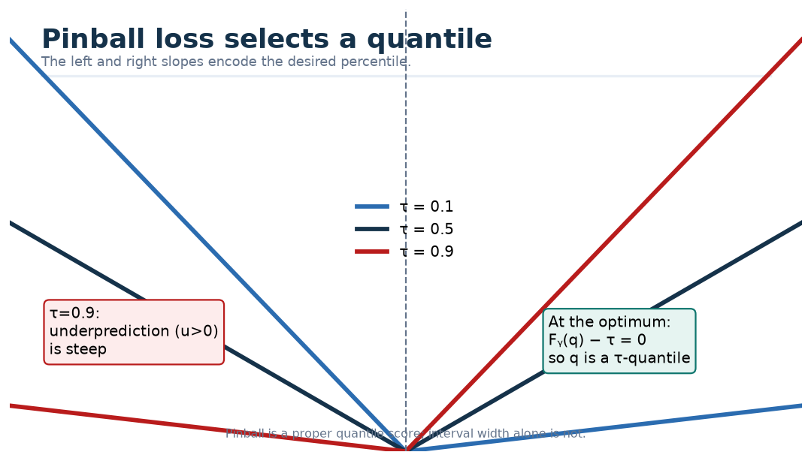
*Figure 13. Why asymmetric pinball loss selects a quantile.*

### 9.2 Huber loss stabilizes the median

For residual \(r\) and threshold \(\delta=1\) in normalized units:

$$
\operatorname{Huber}_\delta(r)=
\begin{cases}
\tfrac12r^2,&|r|\le\delta,\\
\delta(|r|-\tfrac12\delta),&|r|>\delta.
\end{cases}
$$

Near zero it behaves like squared error, providing a smooth gradient. Far away it grows linearly, limiting the influence of extreme observations. In CHMT-Q it is a secondary median stabilizer; pinball remains the principal proper quantile objective.

### 9.3 Binary cross-entropy handles presence

Buy and sell POC do not exist when the respective eligible side volume is absent. A separate logit \(z\) predicts presence label \(r\in\{0,1\}\). A stable binary cross-entropy form is

$$
\operatorname{BCE}(z,r)=\max(z,0)-zr+\log(1+e^{-|z|}).
$$

This is algebraically equivalent to the familiar log-probability loss but avoids directly taking `log(0)`.

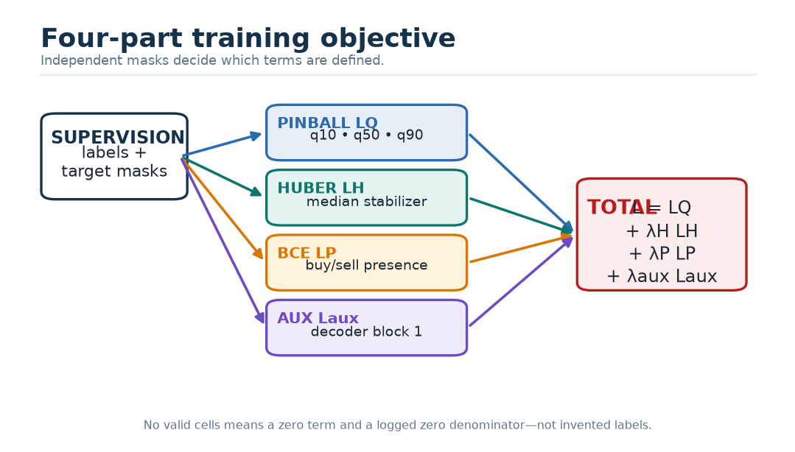
*Figure 14. The four-part training objective.*

## 10. Learning by gradients

The model contains parameters \(\theta\): every learned matrix, bias, embedding, temperature, gate, and scale. Training asks how a small change in each parameter would change the loss. That collection of slopes is the gradient \(\nabla_\theta L\).

A basic update is

$$
\theta_{new}=\theta_{old}-\eta\nabla_\theta L,
$$

where \(\eta\) is the learning rate. The chain rule carries blame backward through a composition. If \(L=f(g(x))\), then

$$
\frac{dL}{dx}=\frac{df}{dg}\frac{dg}{dx}.
$$

Backpropagation is an efficient bookkeeping method for applying this rule to the computational graph. AdamW keeps moving averages of gradients and squared gradients and applies decoupled weight decay. Gradient clipping limits the norm of an unusually large update. None of these guarantees generalization; they only define how the training objective is optimized.

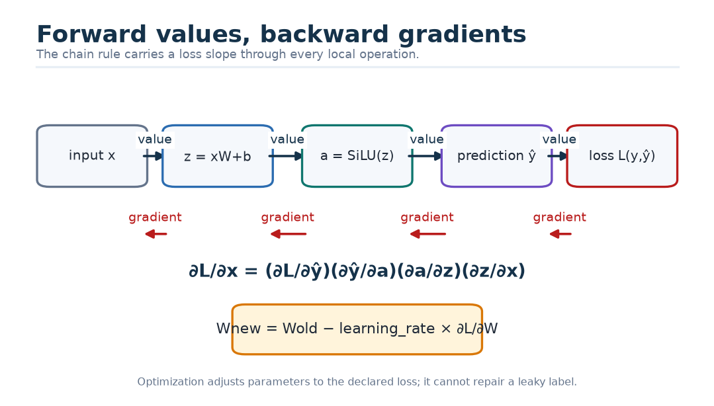
*Figure 15. Forward values and backward gradients through a tiny graph.*

> **Kid version — Learning is adjustment, not understanding.** The network makes a guess, measures a carefully defined kind of wrongness, and nudges millions of knobs. It does not know what a market is unless the data contract and objective make useful structure learnable.

---

# Part III — Building a causal training example

## 11. Five clocks, one legal cutoff

Market systems commonly contain several times:

- **event time:** when the venue says the event occurred;
- **receive time:** when the collector received it;
- **availability time:** when the feature compiler could legally use the accepted event;
- **decision cutoff:** the instant for which the forecast is issued;
- **target time:** a later interval whose outcome becomes the label.

The formal information set at cutoff \(c\) is

$$
\mathcal{F}_c=\sigma\!\left(x_i:t^{available}_i\le c\right).
$$

The model output is

$$
\widehat{Y}_{c,1:H}=f_\theta(\mathcal{F}_c,M_c),\qquad H=5,
$$

where \(M_c\) is immutable configuration and normalization state in stateless v1.

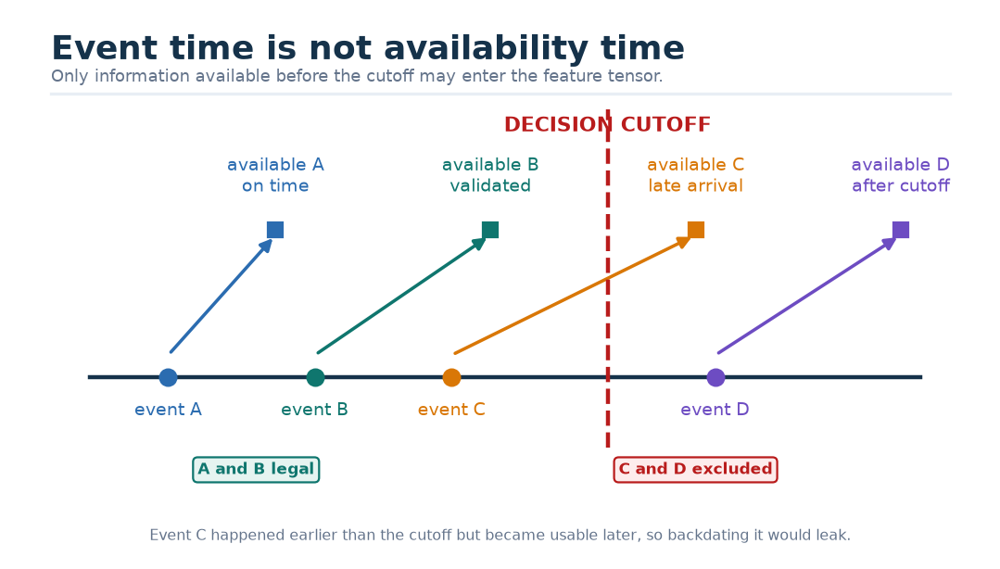
*Figure 16. Event time is not enough to prove causality.*

> **Danger — Backdating a late event.** If an event happened at 10:00:00.100 but arrived and became usable at 10:00:00.600, a forecast at 10:00:00.400 could not know it. Sorting only by event time silently leaks the future.

### 11.1 Identity, reconnects, and source epochs

Sequence numbers are usually meaningful only within an instrument, venue, channel, and source epoch. On reconnect, a feed may replay old messages or restart numbering. The ingestion layer must deduplicate identical events, reject conflicting duplicates, detect gaps, and version the exact policy. A missing source interval can invalidate both features and future labels.

## 12. The deterministic feature compiler

A model should not discover data-cleaning policy by accident. The feature compiler is versioned code that turns accepted raw records into one reproducible example.

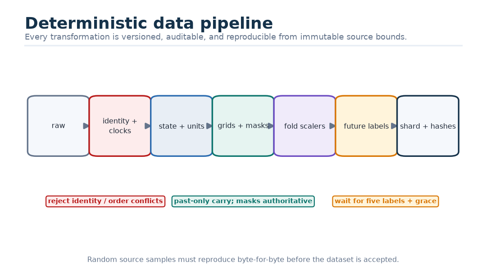
*Figure 17. Raw events become one auditable training example.*

For each cutoff, the compiler:

1. selects accepted events available no later than the cutoff;
2. reconstructs state in deterministic event order;
3. converts price and quantity to canonical units;
4. forms 64 finalized one-minute bar slots;
5. forms 240 half-second L1 slots covering 120 seconds;
6. forms 240 half-second L2 snapshots with two sides, ten ranks, and 12 level features;
7. constructs boolean masks and a 16-value quality vector;
8. applies normalization fitted only on the training portion of the current outer fold;
9. waits until all required future footprint intervals mature;
10. builds five-horizon targets and their independent validity masks;
11. writes data, policy, schema, and source hashes.

### 12.1 The external tensor contract

| Input | Training shape | Meaning |
|---|---:|---|
| `bars` | `[B,64,16]` | 64 consecutive finalized one-minute slots, oldest first |
| `bars_mask` | `[B,64]` | eligible finalized bar slots |
| `l1` | `[B,240,16]` | 120 seconds on a half-second quote grid |
| `l1_mask` | `[B,240]` | accepted and fresh L1 slots |
| `l2` | `[B,240,2,10,12]` | half-second, two-sided, top-ten depth grid |
| `l2_level_mask` | `[B,240,2,10]` | valid level rows |
| `l2_snapshot_mask` | `[B,240]` | accepted snapshots containing at least one valid level |
| `quality` | `[B,16]` | causal coverage, carry, gap, freshness, and anchor facts |

Export fixes \(B=1\). Every model input is numeric float32 data or a boolean validity mask. Strings, identifiers, raw timestamps, and enums stay outside the ONNX boundary.

## 13. Resampling without inventing the future

Events arrive irregularly; tensors use regular slots. For each half-second grid point, the compiler may carry forward the most recent accepted state whose availability precedes that point, subject to a freshness limit. It must never use the first later observation to fill an earlier gap.

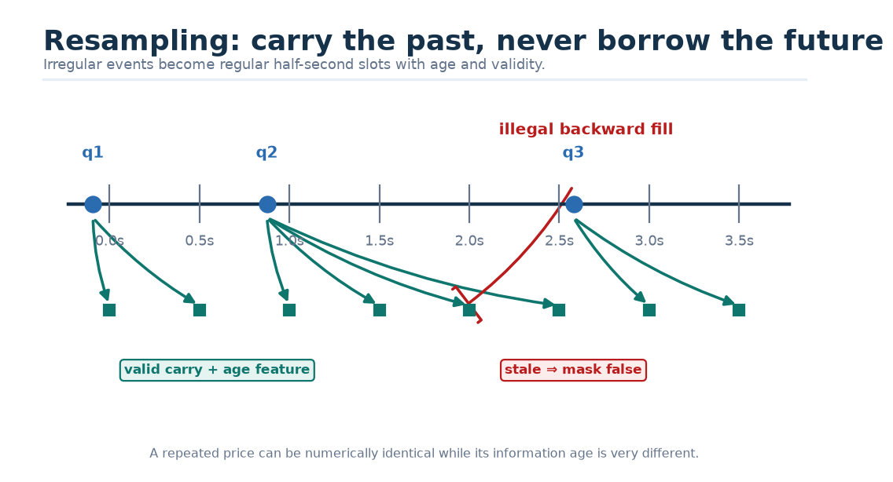
*Figure 18. Past-only carry-forward versus future leakage.*

A carried value and a newly observed value may share the same numeric price, yet they do not have the same information quality. Age, carry count, coverage, and masks therefore remain explicit.

### 13.1 Missing is not zero

After normalization, invalid rows are set numerically to zero to keep arithmetic finite. A separate mask says whether the row exists. The pair `(value=0, mask=true)` means a valid value equal to the training center. The pair `(value=0, mask=false)` means “do not use.” Conflating them trains the model to interpret outages as ordinary market states.

## 14. Robust, train-only normalization

For a feature \(x\), a robust transform can use the training median \(m\) and median absolute deviation:

$$
\operatorname{MAD}=\operatorname{median}(|x-m|),
$$

$$
\widetilde{x}=\operatorname{clip}\!\left(\frac{x-m}{1.4826\,\operatorname{MAD}+\epsilon},-c,c\right).
$$

The constant 1.4826 makes MAD comparable to standard deviation under a normal distribution. It does not make the data normal. Every center, scale, clipping bound, feature choice, and calibration constant is fitted inside the training fold and then frozen.

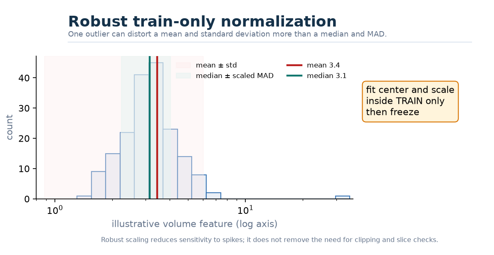
*Figure 19. Robust normalization resists a volume spike.*

> **Why? — Why not calculate statistics on the whole dataset?** A test-period median contains information about the distribution of the future. Even if no label appears in the formula, the model has been helped by data it was supposed to face unseen.

## 15. Label maturation and purged chronological splits

A cutoff at time \(c\) cannot be trained until its farthest target horizon completes and data-quality checks pass. Examples near a split boundary may have overlapping feature or label intervals. Randomly shuffling rows would put nearly identical neighborhoods on both sides.

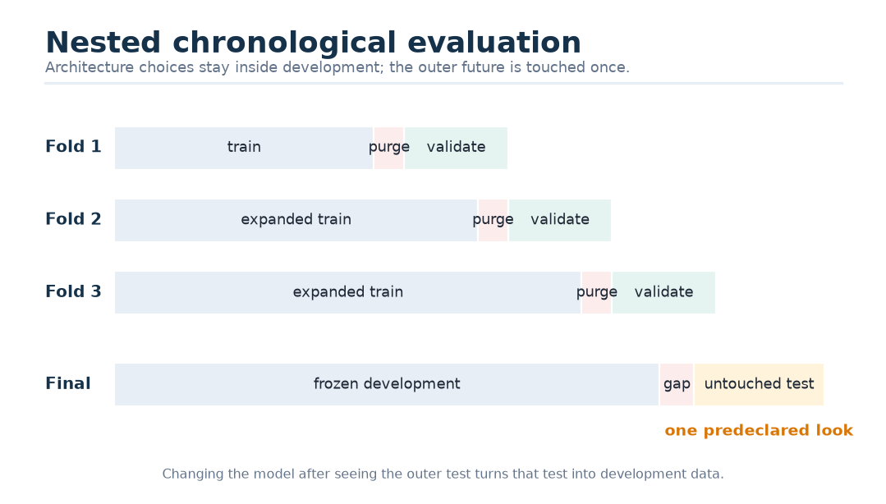
*Figure 20. Nested walk-forward evaluation with purge and embargo.*

The outer test is touched once for a predeclared comparison. Hyperparameters, early stopping, feature selection, thresholds, conformal adjustments, and ensemble choices use only inner training/validation and a calibration block. Purge length is at least the maximum forecast horizon plus label grace and execution latency. An embargo adds separation when dependence may persist.

> **Danger — “We only looked once.”** If a researcher changes the architecture after seeing the test result, the test has become development data. A new untouched period is then required for an honest final estimate.

## 16. Label validity is target-specific

For batch example \(b\), horizon \(h\), and target \(k\), let \(m_{bhk}\in\{0,1\}\) indicate validity. Total POC can be valid while buy POC is absent. Volume can be valid while delta fraction is invalid because aggressor classification coverage failed. A single row-level mask would discard useful labels or, worse, treat missing values as observed zeros.

The normalized quantile loss is

$$
\mathcal{L}_Q=
\frac{\sum_{b,h,k,\tau}m_{bhk}w_hv_k\rho_\tau(y_{bhk}-\widehat Q_{bhk\tau})}
{\sum_{b,h,k,\tau}m_{bhk}w_hv_k+\epsilon},
$$

with horizon weights \(w_h=1/\sqrt h\), target weights \(v=(1,1,1,0.5,0.5)\), and \(\tau\in\{0.1,0.5,0.9\}\). The denominator keeps the effective scale stable when the count of valid labels changes.

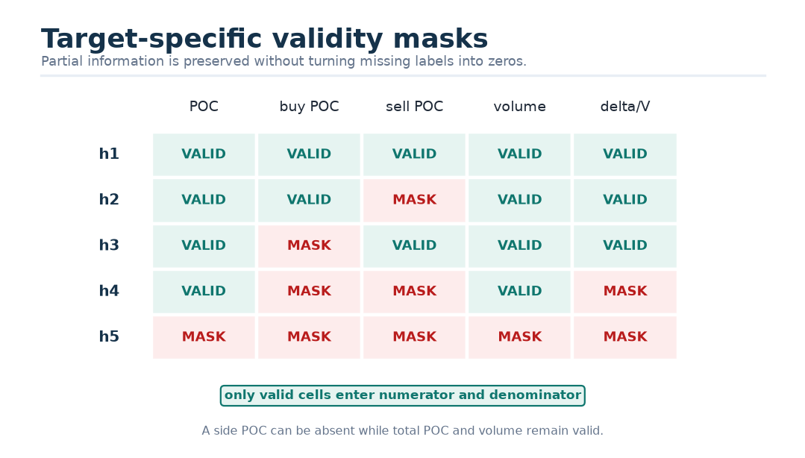
*Figure 21. Independent target masks preserve partial information.*

---

# Part IV — The CHMT-Q architecture, one layer at a time

## 17. The whole model before the pieces

The selected design preserves the native geometry of each input:

- bars are slow, regular summaries;
- L1 is a fast one-dimensional quote process;
- L2 is a fast process whose every snapshot is itself a two-sided ranked structure.

Each branch first learns within its own contract. Only then are the encoded memories fused. This is like asking three specialist witnesses to organize their notes before they enter the same meeting.

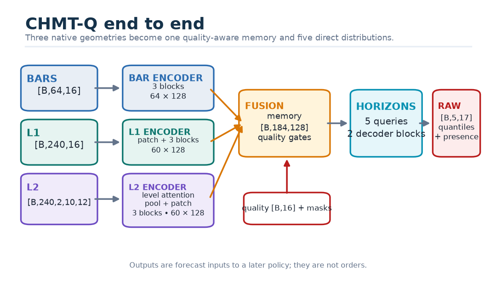
*Figure 22. End-to-end CHMT-Q architecture and tensor shapes.*

### 17.1 Fixed design dimensions

| Component | Selected value | Reason to test, not worship |
|---|---:|---|
| Main width | 128 | Compact capacity and straightforward four-head split |
| Main heads / head width | 4 / 32 | Several retrieval subspaces without tiny heads |
| Main SwiGLU hidden width | 256 | Two-times expansion in a small model |
| L2 level width | 32 | Cheap per-snapshot reasoning across 20 level rows |
| L2 level heads / head width | 4 / 8 | Four structural views inside one snapshot |
| Encoder blocks | 3 per temporal branch | Enough depth to test composition while controlling latency |
| L2 per-snapshot blocks | 1 | The operation repeats for 240 snapshots |
| Decoder blocks | 2 | Horizon coordination plus two retrieval/refinement stages |
| Patch size | four 500 ms frames = 2 s | Reduces 240 frames to 60 deterministic tokens |
| Fused memory | 64 + 60 + 60 = 184 tokens | Retains chronology instead of one-vector pooling |
| Horizon queries | 5 | Directly matches the forecast contract |
| Raw values per horizon | 17 | Five times three quantile parameters plus two presence logits |
| Training dropout | 0.10 | Regularization; disabled during inference |
| Designed parameters | 2,089,518 | Exact ledger for this specification, not the older prototype |

### 17.2 Shape trace

| Stage | Bars | L1 | L2 | Quality / decoder |
|---|---:|---:|---:|---:|
| External tensor | `[B,64,16]` | `[B,240,16]` | `[B,240,2,10,12]` | `[B,16]` |
| Initial projection | `[B,64,128]` | `[B,240,128]` | `[B×240,20,32]` | `[B,128]` |
| Structural encoding | unchanged | unchanged | `[B,240,128]` | gates `[B,3]` |
| Causal patching | unchanged | `[B,60,128]` | `[B,60,128]` | context `[B,128]` |
| Temporal encoding | `[B,64,128]` | `[B,60,128]` | `[B,60,128]` | memory `[B,184,128]` |
| Direct decoding | — | — | — | queries `[B,5,128]` |
| Raw head | — | — | — | `[B,5,17]` |

> **Why? — Why not flatten everything into one sequence?** Flattening hides side and rank semantics, creates far more padded tokens, lets the largest modality dominate by token count, and forces one clock to describe several sampling geometries. Hierarchy is not decorative; it is an explicit statement about the data.

## 18. Projection, time, modality, side, and rank

After robust normalization, a raw row is projected into the branch width. Learned structure and physical time are added, then invalid rows are forced to zero.

### 18.1 Continuous elapsed time

Text positions 1, 2, 3 have no physical duration. Market observations do. For nonnegative age \(a\) and fixed scales \(\tau_k\), CHMT-Q forms

$$
\phi(a)=\left[
\frac{a}{a_{max}},
\frac{\log(1+a)}{\log(1+a_{max})},
\sin(a/\tau_1),\cos(a/\tau_1),\ldots,
\sin(a/\tau_K),\cos(a/\tau_K)
\right].
$$

A small network maps this to width 128:

$$
e_t(a)=W_2\operatorname{SiLU}(W_1\phi(a)+b_1)+b_2.
$$

Bars use seven scales from 60 to 3,840 seconds. L1/L2 patches use eight scales from 0.5 to 64 seconds. The normalized age terms express broad distance; sine/cosine pairs give smooth resolution at several scales. Observation-age and availability-lag features remain in the input row because data freshness is not identical to logical token position.

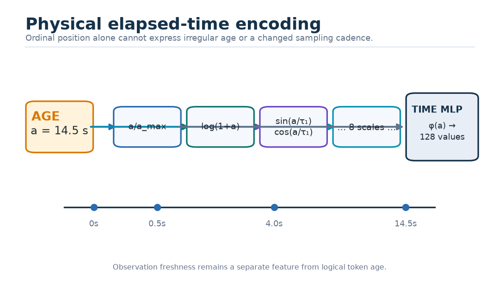
*Figure 23. Physical elapsed time becomes a learned vector.*

### 18.2 Structural embeddings

Every temporal token receives a learned bar, L1, or L2 modality vector. An L2 row additionally receives fixed-axis side and rank vectors:

$$
x^{(0)}_{t,s,r}=W_{level}z_{t,s,r}+e^{side}_s+e^{rank}_r.
$$

Side and rank are compile-time coordinates, not arbitrary market-supplied IDs. A learned rank embedding can say “nearest level” differently from “tenth level” without pretending that the difference between ranks is the same as a physical price distance. Actual price distance remains a numeric feature.

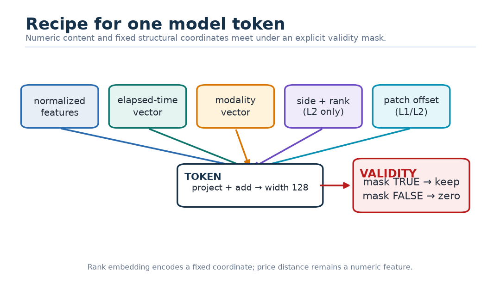
*Figure 24. Recipe for one encoded token.*

### 18.3 Relative elapsed-time bias

Attention also receives a head-specific recency prior. For eligible past key time \(t_l\) and query time \(t_i\):

$$
b^{(j)}_{i,l}=-\operatorname{softplus}(\gamma_j)
\log\!\left(1+\frac{t_i-t_l}{s_m}\right),\qquad t_l\le t_i.
$$

Here \(s_m\) is the fixed encoded-token grid scale for modality \(m\): 60 seconds for bars and 2 seconds for four-frame L1 or L2 patches. The coefficient is nonnegative because of softplus, so older keys receive a nonpositive penalty. Content can still overcome it. This is a learned preference, not a hard decay rule and not evidence that recent data always matters more.

## 19. Attention from scratch

An attention layer answers: for each query row, which eligible key rows should contribute, and what values should be collected from them?

Given input states \(X\in\mathbb{R}^{T\times d}\), learned projections create

$$
Q=XW_Q,\qquad K=XW_K,\qquad V=XW_V.
$$

For one head, score matrix \(S\in\mathbb{R}^{T\times T}\) compares every query with every key. A row-wise softmax gives weights \(A\), and the output is

$$
A=\operatorname{softmax}(S),\qquad O=AV.
$$

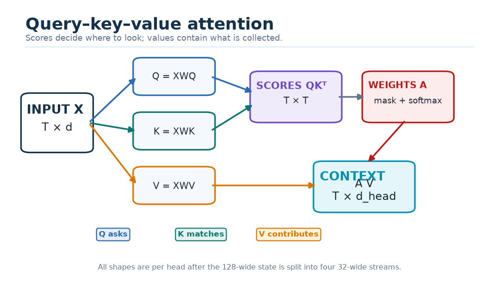
*Figure 25. Query, key, and value are three learned views of the same states.*

### 19.1 A complete two-dimensional calculation

Use three toy states and deliberately simple matrices:

$$
X=\begin{bmatrix}1&0\\0&1\\1&1\end{bmatrix},\quad
W_Q=\begin{bmatrix}1&0\\0&1\end{bmatrix},\quad
W_K=\begin{bmatrix}1&1\\0&1\end{bmatrix},\quad
W_V=\begin{bmatrix}1&2\\2&0\end{bmatrix}.
$$

Therefore

$$
Q=\begin{bmatrix}1&0\\0&1\\1&1\end{bmatrix},\quad
K=\begin{bmatrix}1&1\\0&1\\1&2\end{bmatrix},\quad
V=\begin{bmatrix}1&2\\2&0\\3&2\end{bmatrix}.
$$

For the third query \(q_3=[1,1]\), all three keys are in its past or present. Scaled scores with \(d_h=2\) are

$$
s_3=\frac{[q_3\cdot k_1,q_3\cdot k_2,q_3\cdot k_3]}{\sqrt2}
=\frac{[2,1,3]}{\sqrt2}
\approx[1.414,0.707,2.121].
$$

Softmax gives approximately

$$
a_3=[0.284,0.140,0.576].
$$

The collected value is

$$
o_3=0.284[1,2]+0.140[2,0]+0.576[3,2]
\approx[2.292,1.720].
$$

For the second query, the third key is in the future and must be masked. Its two eligible scores are equal, so the weights are `[0.5,0.5,0]` and

$$
o_2=0.5[1,2]+0.5[2,0]=[1.5,1.0].
$$

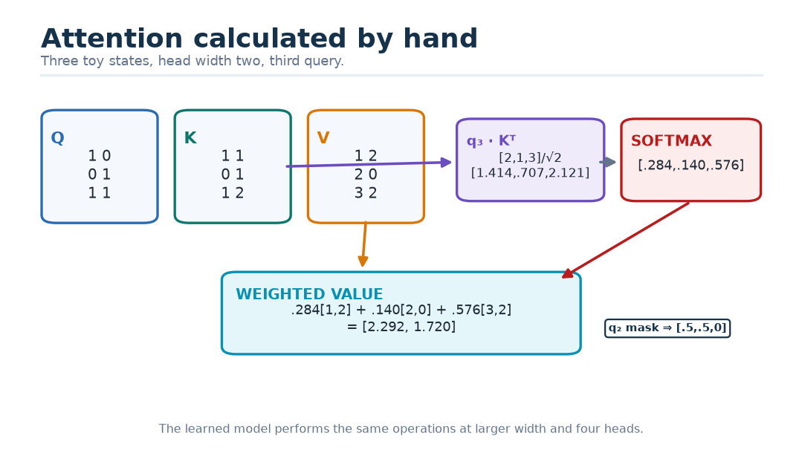
*Figure 26. One attention row calculated by hand.*

> **Kid version — Query, key, value.** A query is a question card, a key is a label card, and a value is the information inside the matching drawer. The match score chooses drawers; the values are what you actually take out.

### 19.2 Causal and validity masks

A temporal causal mask permits key \(l\) for query \(i\) only when \(l\le i\). A key-validity mask also requires that the observation exists. A query-validity mask requires the output row itself to exist.

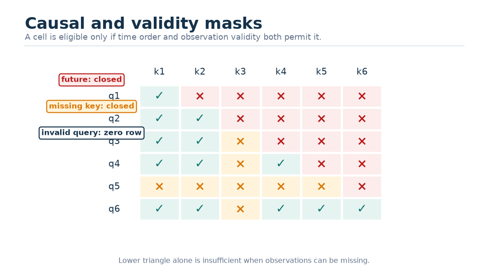
*Figure 27. Causal attention is a lower-triangular permission grid.*

Even when the whole input window lies before the final forecast cutoff, causal masks inside encoders prevent early intermediate states from reading later states in that window. This supports prefix representations and causal auxiliary tasks.

### 19.3 Safe masked softmax

Let \(m_{i,l}\) say whether key \(l\) is eligible for query \(i\), and let

$$
a_i=\bigvee_l m_{i,l}.
$$

For a row with at least one eligible key, define \(s_i^{max}=\max_{l:m_{i,l}=1}s_{i,l}\) and \(r_{i,l}=m_{i,l}\exp(s_{i,l}-s_i^{max})\). Then

$$
p_{i,l}=\begin{cases}
r_{i,l}\big/\sum_k r_{i,k},&a_i=1,\\
0,&a_i=0.
\end{cases}
$$

The maximum is evaluated only on eligible keys; the explicit zero-row branch handles an all-masked row. The output and final residual state are also zeroed for invalid queries. Tests must cover all-valid, partially masked, all-key-masked, invalid-query, and mixed-batch cases. A masked key must receive exactly zero probability within tolerance.

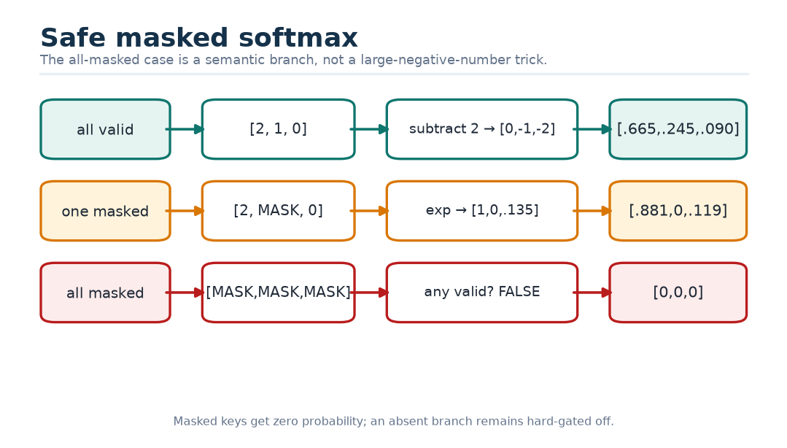
*Figure 28. Safe softmax handles an all-masked row without NaN.*

> **Why? — Why not rely on a very negative number?** A large negative sentinel makes ordinary masked exponentials tiny, but an all-masked row can still subtract an invalid maximum or divide zero by zero. The all-masked condition is a semantic case, not merely a floating-point trick.

## 20. Q/K-normalized multi-head attention

The main width 128 is split into four heads of width 32. Each head can learn a different retrieval pattern. After projection, CHMT-Q normalizes each query and key vector by its root mean square:

$$
\bar q=\frac{q}{\sqrt{d_h^{-1}\lVert q\rVert_2^2+\epsilon}},\qquad
\bar k=\frac{k}{\sqrt{d_h^{-1}\lVert k\rVert_2^2+\epsilon}}.
$$

For head \(j\), the score is

$$
s^{(j)}_{i,l}=e^{\theta_j}
\frac{\bar q^{(j)}_i\cdot\bar k^{(j)}_l}{\sqrt{d_h}}
+b^{(j)}_{i,l}+g^{(m(l))}+\mathcal{M}_{i,l}.
$$

Here \(\theta_j\) is a learned log temperature, \(b\) is optional elapsed-time bias, \(g\) is an optional log modality-gate bias in decoder cross-attention, and \(\mathcal M\) is the eligibility mask. Q/K normalization controls score growth; the explicit temperature restores learnable sharpness. Maximum logits are logged and non-finite or runaway values fail a run.

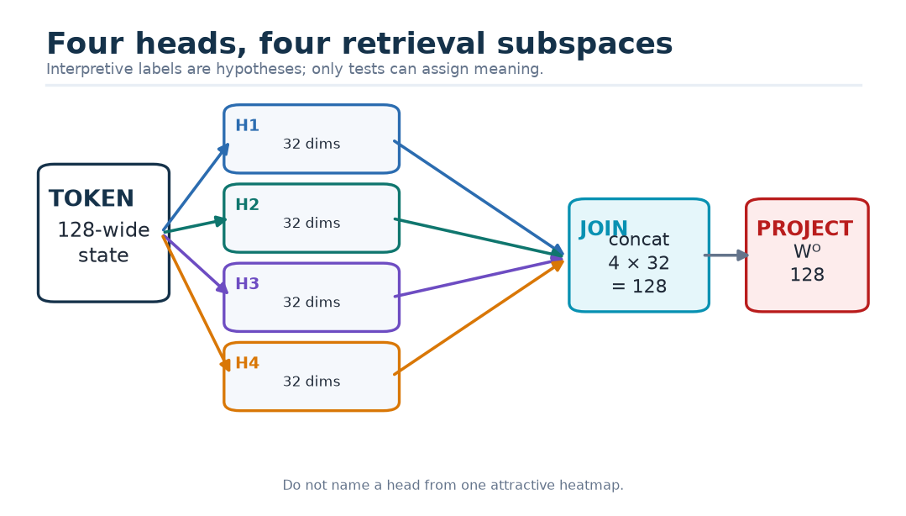
*Figure 29. Four attention heads inspect different relationships in parallel.*

> **Danger — Head labels are hypotheses.** A head is not proven to represent “imbalance” because a heatmap looks plausible. Intervention, permutation, stability, and task-specific tests are required before assigning meaning.

## 21. The custom CHMT block

The selected block uses only reviewable primitives: linear projections, reshapes, matrix multiplication, reductions, masks, softmax, pointwise functions, and residual addition. No framework transformer block defines the reference behavior.

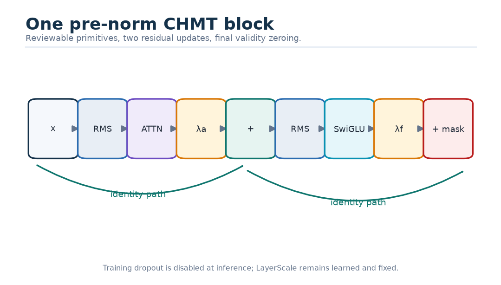
*Figure 30. One pre-norm CHMT block.*

### 21.1 RMSNorm

For width \(d\), learned gain \(g\), and small \(\epsilon\):

$$
\operatorname{RMSNorm}(x)=g\odot
\frac{x}{\sqrt{d^{-1}\sum_{k=1}^d x_k^2+\epsilon}}.
$$

If \(x=[3,4]\), its root mean square is \(\sqrt{(9+16)/2}=\sqrt{12.5}\approx3.536\). Before learned gain, the normalized vector is approximately `[0.849,1.131]`. RMSNorm controls scale but does not subtract the mean. The older prototype uses LayerNorm; that implementation fact must not be rewritten as CHMT-Q behavior.

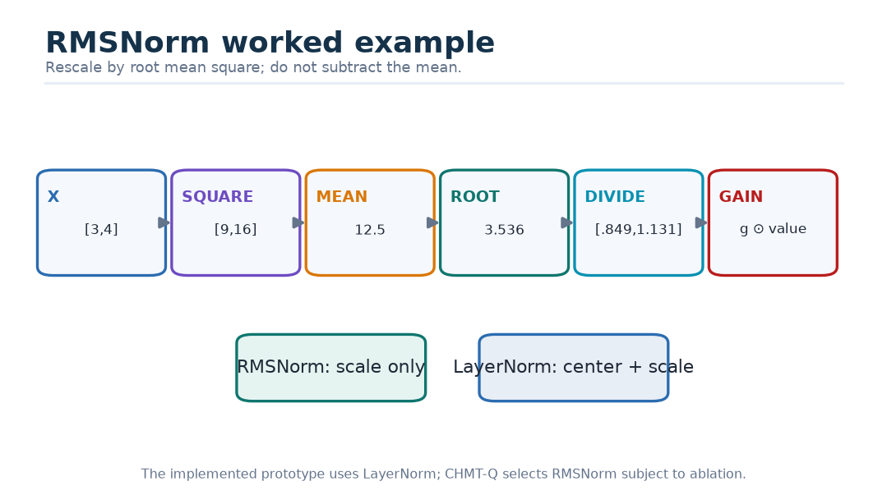
*Figure 31. RMSNorm rescales a vector without mean subtraction.*

### 21.2 SwiGLU

The feed-forward sublayer is

$$
\operatorname{FFN}(x)=W_o\left[
\operatorname{SiLU}(W_gx+b_g)\odot(W_ux+b_u)
\right]+b_o,
$$

with \(\operatorname{SiLU}(z)=z\sigma(z)\). One projection produces a gate, another produces content, elementwise multiplication selects content, and the output projection returns to the model width. The main block maps `128 → 256 → 128`; the level block maps `32 → 64 → 32`.

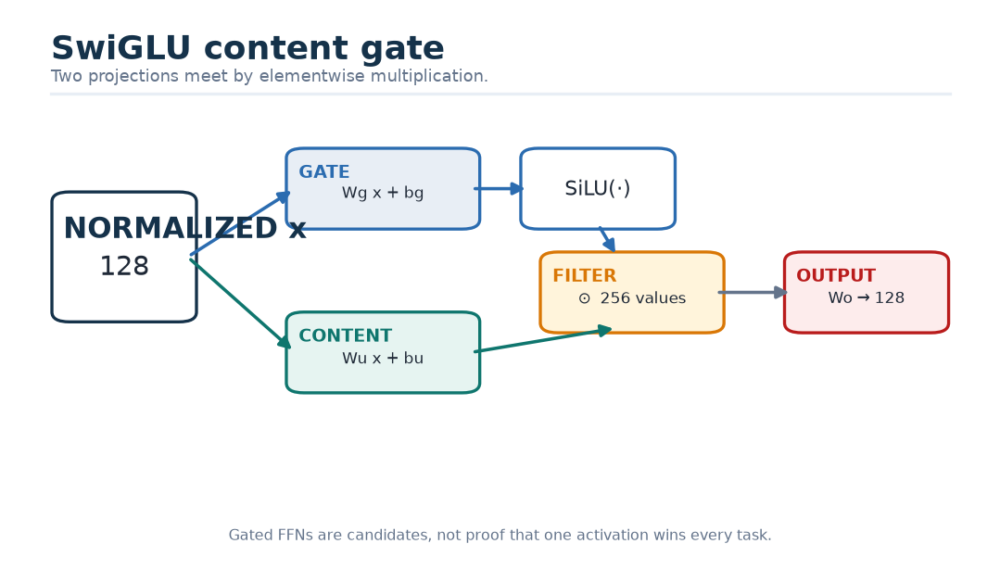
*Figure 32. SwiGLU is a learned content gate.*

### 21.3 Pre-norm residual and LayerScale

For learned scale vectors \(\lambda_a\) and \(\lambda_f\), initialized to 0.1:

$$
u=x+\lambda_a\odot\operatorname{Dropout}
(\operatorname{Attention}(\operatorname{RMSNorm}(x))),
$$

$$
z=u+\lambda_f\odot\operatorname{Dropout}
(\operatorname{FFN}(\operatorname{RMSNorm}(u))).
$$

The residual path lets a block begin near an identity transformation. LayerScale makes the learned contribution explicit and inspectable. It is not a confidence score. Dropout is active only during training.

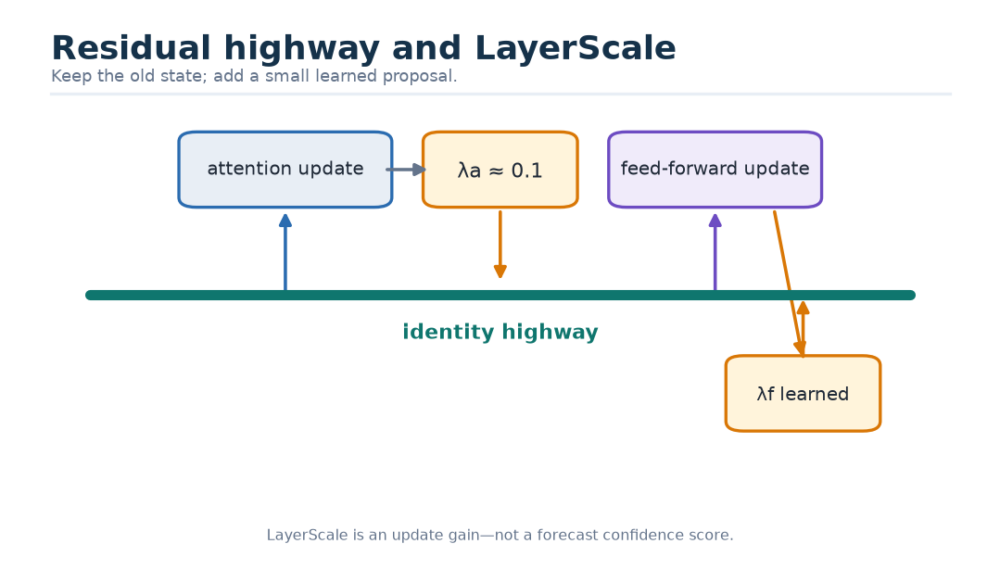
*Figure 33. A residual path keeps the old state while a scaled branch proposes a change.*

## 22. The three encoders

### 22.1 Bar encoder

Each valid 16-feature bar is projected to 128, receives bar modality and elapsed-time embeddings, and passes through three causal CHMT blocks. All 64 output states are retained. A decoder can retrieve a particular earlier regime instead of receiving only a single pooled summary.

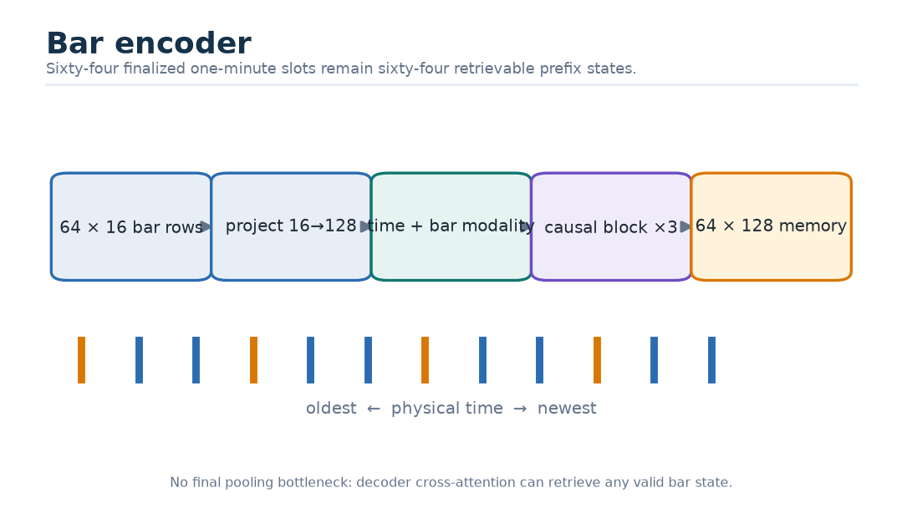
*Figure 34. The bar branch preserves 64 causal historical states.*

### 22.2 L1 causal patches

Four consecutive half-second frames form one two-second patch. A learned static offset distinguishes the four within-patch positions. A small masked scoring network computes

$$
r_j=w_2^\top\tanh(W_1x_j+b_1)+b_2,
$$

$$
\pi_j=\operatorname{SafeSoftmax}_j(r_j;m_j),\qquad
p=\sum_{j=0}^{3}\pi_jx_j.
$$

An all-invalid patch returns zero and false. Sixty patches receive endpoint time and L1 modality embeddings, then pass through three causal blocks.

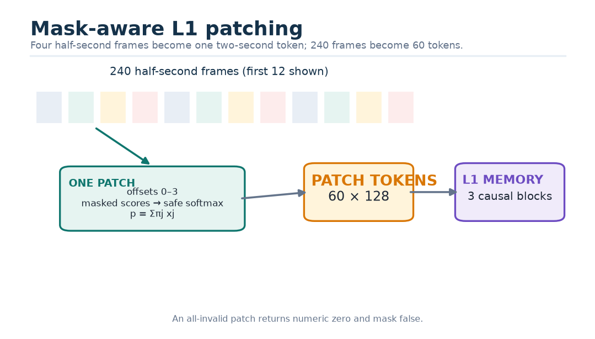
*Figure 35. Four half-second L1 frames become one mask-aware two-second token.*

> **Why? — Why non-overlapping patches?** They give a deterministic 60-token contract and low latency. An overlapping stride-two alternative may retain brief events better, so it is a registered ablation rather than an unrecorded tuning choice.

### 22.3 Hierarchical L2 encoder

For each of 240 snapshots, fixed side and rank axes flatten to 20 level rows. Each 12-feature row projects to width 32, receives side and rank embeddings, and enters one non-causal masked level-attention block. Non-causal is correct **within one snapshot** because all eligible levels share the same logical time.

A learned book query pools the eligible rows:

$$
a_{s,r}=\operatorname{SafeSoftmax}_{s,r}\left(
\frac{q_{book}^\top\operatorname{RMSNorm}(x_{s,r})}{\sqrt{32}};m_{s,r}
\right),
$$

$$
d_t=W_d\sum_{s,r}a_{s,r}x_{t,s,r}+b_d\in\mathbb{R}^{128}.
$$

The 240 book tokens then become 60 four-frame patches and pass through three causal temporal blocks.

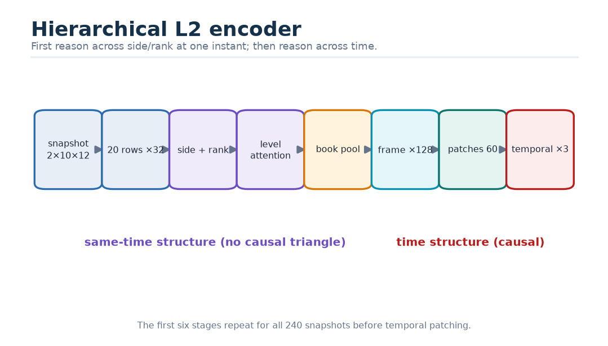
*Figure 36. L2 reasoning first crosses side and rank, then crosses time.*

> **Why? — Why not flatten 240 × 20 into 4,800 tokens?** One full attention matrix would contain about 23 million entries per head per layer, but cost is only half the problem. Flattening makes a level at the same instant compete structurally with a snapshot two minutes away. The hierarchy states which relation is being learned at each stage.

## 23. Quality-aware fusion

Let \(s_b,s_1,s_2\) be the latest valid prefix summaries from bars, L1, and L2; \(c_q\) be the quality-network output; and \(a_m\) be a hard availability bit. For modality \(m\):

$$
\widetilde g_m=a_m\,\sigma\!\left(w_{m,2}^\top
\operatorname{SiLU}(W_{m,1}[s_m;c_q]+b_{m,1})+b_{m,2}\right),
$$

$$
\alpha_m=\frac{\widetilde g_m}{\sum_n\widetilde g_n+\epsilon},\qquad
c=\operatorname{RMSNorm}\!\left(c_q+\sum_m\alpha_ms_m\right).
$$

The full memory is still retained:

$$
M=[M_{bar};M_{L1};M_{L2}]\in\mathbb{R}^{B\times184\times128}.
$$

Decoder scores receive \(\log(\alpha_m+\epsilon)\) according to each key’s modality. This shifts attention probability without multiplying memory content a second time. A hard-invalid modality has false key masks and cannot be revived by a learned gate. If all modalities are invalid, the host abstains before inference.

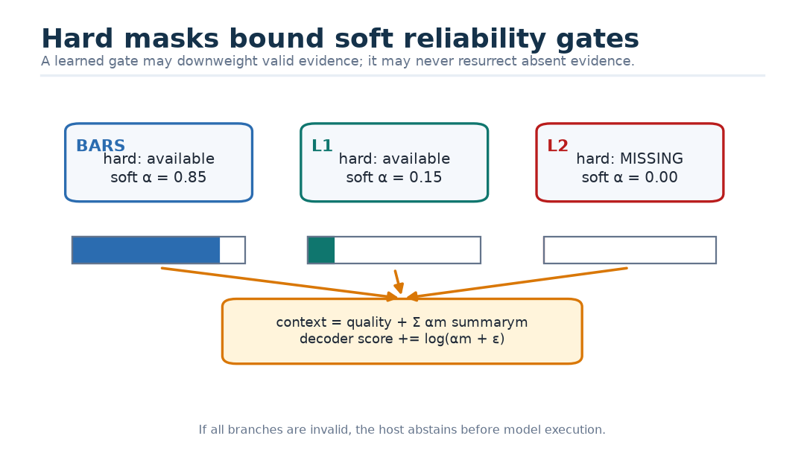
*Figure 37. Soft reliability gates operate inside hard availability boundaries.*

> **Why? — Are gates explanations?** No. A gate says how the network routed this input under its learned function. It does not prove what caused the market outcome or even which feature was indispensable. Diagnostic claims require stable ablations, permutations, and counterfactual tests.

## 24. Direct five-horizon decoder

Five learned base queries are combined with global context and numeric horizon features:

$$
q_h^{(0)}=e_h+W_cc+\operatorname{HorizonMLP}
\left[h/5,\log(1+h),h\Delta\right].
$$

Here \(\Delta\) is the configured footprint-interval duration. Each of two decoder blocks performs horizon self-attention, cross-attention to all 184 eligible memory tokens, and a SwiGLU update. Horizon self-attention has no causal triangle because all five forecasts are issued at the same cutoff. No future target is supplied.

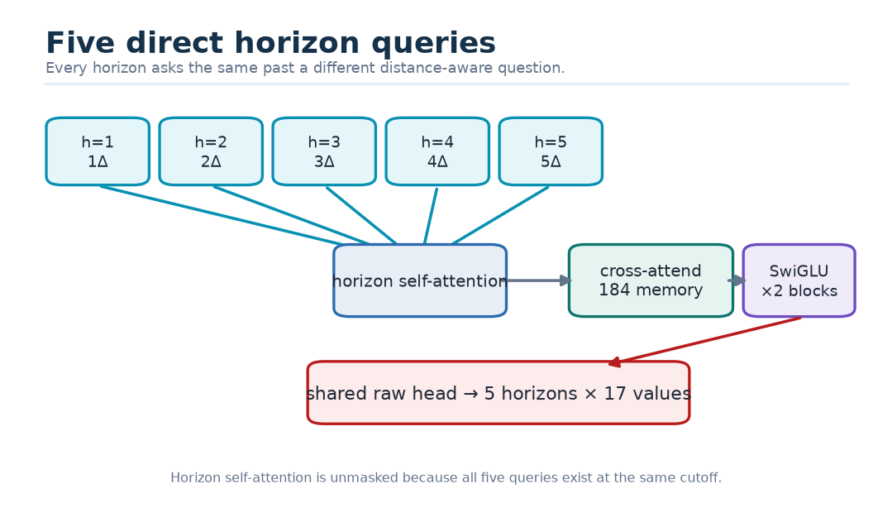
*Figure 38. Five horizon queries retrieve different evidence from one shared past.*

> **Why? — Why direct instead of recursive?** A recursive decoder would feed an uncertain first prediction into the second, repeat the error, require teacher-forcing choices during training, and perform five serial inference steps. Direct queries condition every horizon on the same known past while still allowing horizon coordination.

### 24.1 Safe deep supervision

The first decoder block also passes through the same output head during training. A lower-weight auxiliary loss encourages useful intermediate horizon states. The auxiliary output is discarded at inference. This is inspired by multi-token-prediction research [R08] but does not copy future-token inputs; no target enters the trunk.

## 25. Ordered outputs and runtime reconstruction

For each of five targets, the raw head emits center \(c\), lower-gap logit \(a\), and upper-gap logit \(b\):

$$
\widehat Q_{0.50}=c,\qquad
\widehat Q_{0.10}=c-\operatorname{softplus}(a),\qquad
\widehat Q_{0.90}=c+\operatorname{softplus}(b).
$$

The positive gaps guarantee \(Q_{0.10}\le Q_{0.50}\le Q_{0.90}\) up to numerical tolerance. Positions 0–14 contain five such triples; positions 15 and 16 are buy- and sell-POC presence logits.

For a numerical example, let \(c=2.0\), \(a=0.5\), and \(b=0.8\). Softplus gaps are approximately 0.974 and 1.171, so the transformed quantiles are approximately `[1.026, 2.000, 3.171]`.

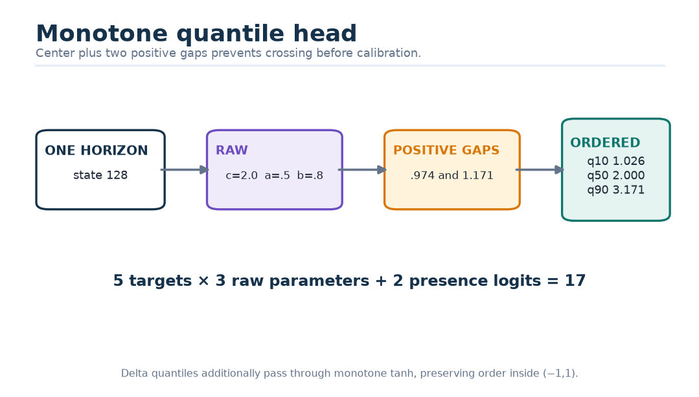
*Figure 39. Positive learned gaps prevent quantile crossing.*

After finite checks, frozen inverse normalization, and the monotone delta-fraction transform:

$$
\widehat P=p_{ref}+q\widehat y_{POC},\qquad
\widehat V=\max(0,e^{\ell_{ref}+\widehat y_V}-1),
$$

$$
\widehat f_D=\tanh(\widehat y_D),\qquad
\widetilde D=\widehat V_{0.50}\widehat f_{D,0.50}.
$$

The inverse transform is applied separately to every primitive marginal quantile. Price quantiles are snapped to the tick grid only afterward. The runtime checks finiteness, quantile order, nonnegative volume, bounded delta fraction, and \(|\widetilde D|\le\widehat V_{0.50}\). Buy/sell POC is omitted below its calibrated presence threshold. Any invariant violation rejects the entire five-horizon output.

The raw-delta value \(\widetilde D\) is only a plug-in point diagnostic formed from the two marginal medians. Multiplying volume and delta-fraction quantiles does **not** produce quantiles of raw delta and can even reverse endpoints when the fraction is negative. Therefore v1 exposes calibrated intervals for volume and delta fraction separately, not a claimed raw-delta interval. A raw-delta distribution would require direct supervision or a tested joint model.

> **Danger — Marginals are not a path.** The five horizon distributions are not guaranteed to describe one jointly possible price-volume trajectory. An 80% interval for each cell does not mean all cells are simultaneously covered 80% of the time, and separately calibrated marginals cannot be multiplied into a calibrated distribution for a derived quantity.

## 26. The complete forward pass

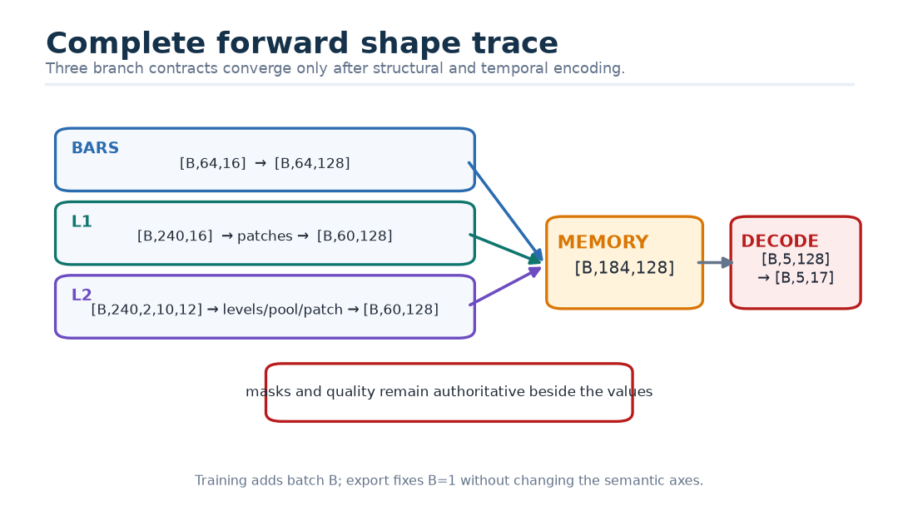
*Figure 40. Every important shape in one forward pass.*

In compact form:

1. validate tensor shapes, dtypes, finite values, and nested mask consistency;
2. normalize valid rows with frozen fold statistics and zero invalid rows;
3. encode 64 bars into `[B,64,128]`;
4. patch and encode 240 L1 frames into `[B,60,128]`;
5. encode each L2 snapshot across 20 levels, pool to 240 book frames, patch and encode to `[B,60,128]`;
6. derive hard availability, quality context, and three soft gates;
7. concatenate memory to `[B,184,128]` and its masks/modality IDs;
8. create five context-conditioned horizon queries `[B,5,128]`;
9. apply two decoder blocks with horizon self-attention and memory cross-attention;
10. map to `[B,5,17]`, construct ordered quantiles and presence probabilities;
11. reconstruct prices, volume, and delta in host units; validate or abstain.

### 26.1 Why full attention is the selected default

The temporal score matrices are small:

$$
64^2+60^2+60^2=11{,}296\text{ scores per encoder layer and head across branches}.
$$

Across three layers and four heads:

$$
3\times4\times11{,}296=135{,}552\text{ temporal scores}.
$$

Two decoder cross-attention layers add

$$
2\times4\times5\times184=7{,}360\text{ scores}.
$$

Sparse attention, linear recurrence, or compressed key/value state would add operators, state, and approximation risk to remove a cost that is already small. Such mechanisms become relevant if raw context grows into thousands of events and profiling—not fashion—shows attention is the bottleneck.

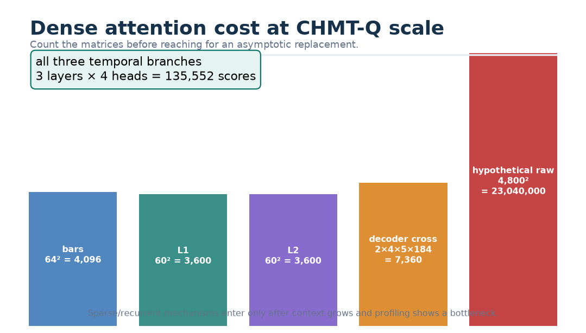
*Figure 41. At this scale, dense attention is a small, countable object.*

### 26.2 Parameter ledger and the prototype difference

The exact selected-design ledger totals 2,089,518 parameters. The standalone implemented prototype totals 2,093,518 because it implements an earlier point-model architecture with different normalization, activation, head, and loss choices. A previous approximate architecture note used about 2.12 million. These are not rounding variants of one artifact; they identify different specifications.

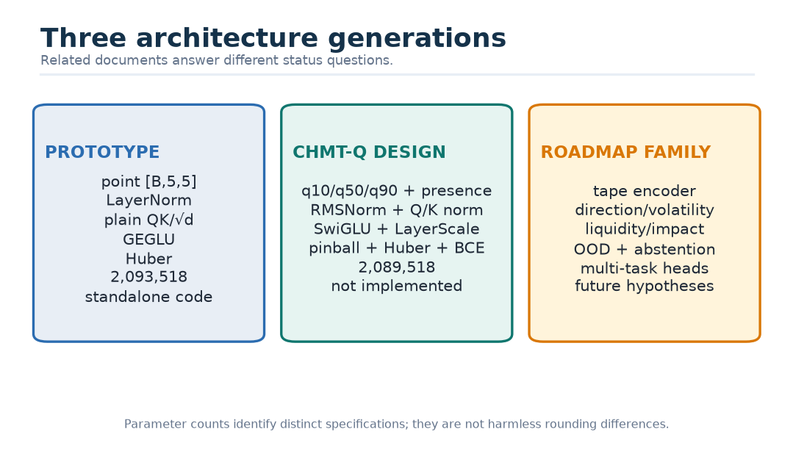
*Figure 42. Prototype, selected CHMT-Q, and roadmap family are related but distinct.*

---

# Part V — Training, testing, calibration, and serving

## 27. Training is a governed pipeline

A model file is the final product of many earlier choices. If capture, labels, splits, or scaling are wrong, a perfect optimizer only learns the wrong problem faster.

*Figure 43. The governed research lifecycle from capture to promotion.*

The lifecycle is:

1. append accepted source events with clocks, sequence identity, source epoch, adapter version, and immutable shard hashes;
2. build tensors and genuine-tape labels deterministically;
3. freeze a chronological split manifest before fitting any scaler;
4. develop with expanding walk-forward folds, registered baselines, and registered ablations;
5. freeze architecture, hyperparameters, stopping rule, calibration method, and promotion gates;
6. evaluate once on an untouched outer holdout;
7. export and prove training-runtime/ONNX/host parity;
8. run hidden shadow inference without user or order effect;
9. require explicit promotion approval or return to research with a new holdout.

Licensing is a separate gate. Permission to display a feed does not automatically grant permission to retain it, train on it, move it, or distribute derived artifacts.

## 28. One optimizer step

The initial training recipe is intentionally ordinary: AdamW; betas 0.9 and 0.95; epsilon \(10^{-8}\); peak learning rate \(3\times10^{-4}\); five-percent warm-up; cosine decay to \(3\times10^{-5}\); global gradient clip 1.0; effective batch 128; at most 50 epochs; early stopping after eight validations without improvement; and final-candidate seeds 17, 29, and 43. Matrix weights receive 0.05 weight decay; biases, norms, embeddings, and LayerScale do not.

These are starting hypotheses, not results. A learning-rate range test and other tuning remain inside development data.

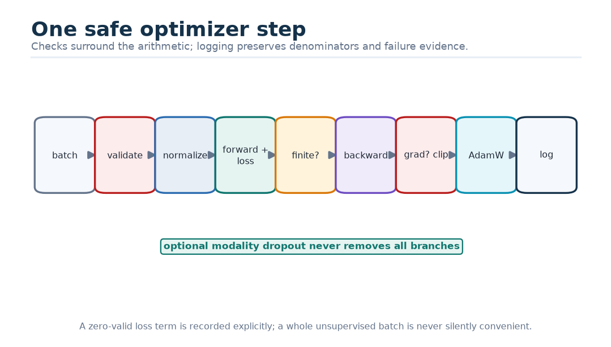
*Figure 44. One safe optimizer step with mixed precision and masks.*

For each step:

1. load examples from one permitted partition;
2. validate shapes, dtypes, finite valid values, and nested masks;
3. apply the fold-frozen normalization;
4. optionally mask one available modality using a registered training-only probability, never all modalities;
5. compute final and auxiliary predictions;
6. compute mask-normalized pinball, Huber, presence, and auxiliary terms;
7. reject a non-finite loss;
8. backpropagate, unscale mixed-precision gradients, and reject non-finite gradients;
9. clip the global norm and update at the accumulation boundary;
10. advance the scheduler and log denominators, per-horizon terms, gradient/update norms, attention logits, gates, mask fractions, throughput, and memory.

A loss term with no valid labels returns zero and logs a zero denominator. A batch with no supervised term is rejected by the sampler or explicitly counted; it is never silently convenient.

### 28.1 Training from scratch

“From scratch” means every CHMT-Q parameter is initialized for this numeric task. No tokenizer, vocabulary, word embedding, language checkpoint, or pretrained text transformer is loaded. Xavier or comparable variance-preserving initialization is used for linear weights; biases start at zero; RMSNorm gains at one; LayerScale at 0.1. Output centers and interval gaps may be initialized from training-target summaries only.

## 29. The total objective

Let \(\mathcal L_Q\) be masked pinball loss, \(\mathcal L_H\) median Huber loss, \(\mathcal L_P\) presence BCE, and \(\mathcal L_{aux}\) the same forecast losses on first-decoder-block states. A representative total is

$$
\mathcal L=\mathcal L_Q+\lambda_H\mathcal L_H+
\lambda_P\mathcal L_P+\lambda_{aux}\mathcal L_{aux}.
$$

The exact \(\lambda\) values are frozen inside development. Every reported component includes its valid count. A lower aggregate can hide a catastrophic long-horizon or thin-market regression, so aggregate selection never replaces the target-by-horizon table.

## 30. Metrics: ask the right question for each output

| Output | Primary measures | Important diagnostics |
|---|---|---|
| POC offsets | pinball; median MAE in ticks | RMSE, signed bias, within-one/two-tick rate |
| Log volume / reconstructed volume | pinball; log-space MAE | WAPE, RMSLE, extreme-volume slices |
| Delta fraction | pinball; MAE | sign accuracy, correlation, boundedness |
| Buy/sell presence | log loss; Brier score | precision/recall, PR-AUC, reliability |
| Intervals | empirical coverage plus mean width | coverage-width curve, interval score, slice coverage |
| Whole candidate | weighted pinball against best baseline | latency, abstention, seed variance, drift sensitivity |

For nominal 80% intervals, empirical coverage is

$$
\widehat{\operatorname{Cov}}_{0.8}=
\frac1N\sum_{i=1}^{N}
\mathbf 1\{\widehat Q_{0.1,i}\le y_i\le\widehat Q_{0.9,i}\}.
$$

Coverage without width is gameable: an interval spanning every possible price would cover almost everything and tell the user almost nothing. Proper quantile and interval scores reward honest distributions in expectation [R38]; they do not prove profitability.

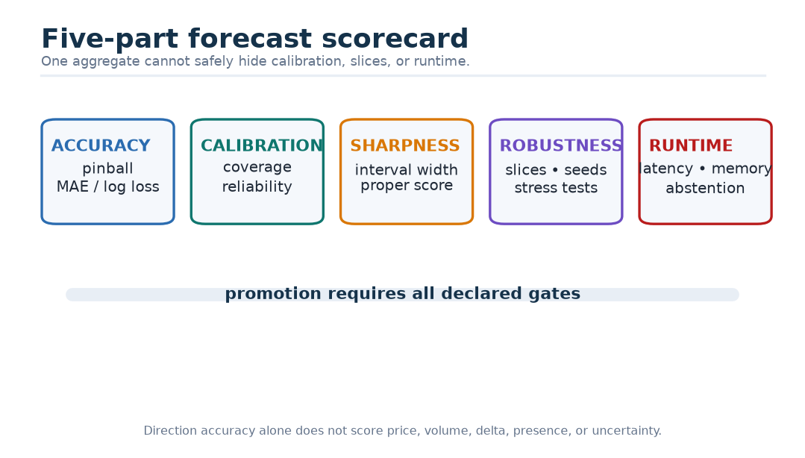
*Figure 45. A forecast scorecard keeps accuracy, calibration, sharpness, robustness, and runtime separate.*

> **Why? — Why not use only direction accuracy?** A model can guess the dominant class, ignore magnitude, and still appear accurate. The product needs prices, volume, delta, missing-side probability, and uncertainty. Every output requires a score that matches its declared meaning.

## 31. Baselines are competitors, not decorations

At minimum, CHMT-Q competes on identical cutoffs, labels, masks, target transforms, and folds against:

- last valid value, zero residual, and same-session seasonal value;
- robust historical median and exponentially weighted forecasts;
- ridge and elastic-net direct multi-horizon regression;
- DLinear and NLinear [R16];
- gradient-boosted trees on the same causal summary features;
- logistic models for presence or direction;
- a causal temporal convolutional network;
- a DeepLOB-like convolution plus temporal head [R18];
- the implemented older point-transformer configuration.

Simple linear forecasting has beaten more elaborate transformers on several generic benchmarks [R16]. Deep LOB results can weaken sharply under reproduction, new periods, or new stocks [R32]. Therefore “more modern” is not an acceptable promotion argument.

### 31.1 An ablation changes one question

An ablation holds folds, seeds, training budget, metrics, and thresholds constant while changing one registered factor.

| Question | Reference | Variant | Evidence required to keep complexity |
|---|---|---|---|
| Does L2 help? | bars + L1 | bars + L1 + L2 | proper-score gain across liquid and thin slices |
| Does hierarchy help? | 20-level hierarchy | summaries or flat levels | score/stability gain worth latency |
| Patch width? | four frames | two, eight, overlapping stride two | robust gain inside latency budget |
| Time mechanism? | elapsed MLP + bias | ordinal only / no bias | consistent gain, not one seed |
| Quality fusion? | hard masks + soft gates | hard masks only | degraded-data gain without clean-data harm |
| Block? | RMSNorm/QK norm/SwiGLU | LayerNorm/no QK norm/GEGLU | stability and forecast gain |
| Uncertainty? | monotone quantiles | point Huber / unconstrained quantiles | calibration with competitive median |
| Long context? | dense attention | Gated DeltaNet, KDA, Mamba | enter only after measured bottleneck |

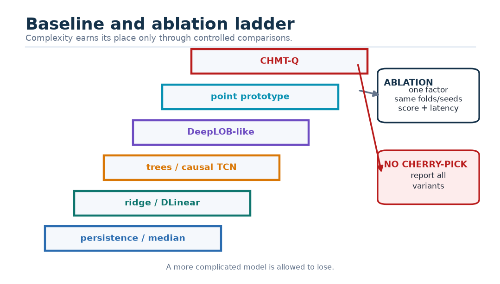
*Figure 46. Baseline and ablation ladder for a defensible architecture claim.*

> **Danger — Ablation soup.** Trying many variants and reporting only the winner turns random variation into a story. Register the comparison, report all seeds, and account for the number of choices.

## 32. Statistical uncertainty and slices

Overlapping market examples are not independent coins. Confidence intervals use sessions or days as blocks. Final candidates use at least three seeds. Report loss differences against the best baseline per block and the full seed spread.

Pre-registered slices include session phase, volatility, spread, depth, trade intensity, missingness, carried-data rate, sequence gaps, one-sided books, calendar windows, roll distance, instrument, period, and source-adapter version. A global average can conceal failure exactly where the forecast is most tempting to use.

Stress tests remove a modality, age quotes, create mask sparsity, introduce long gaps, push inputs to clipping bounds, simulate sequence resets and one-sided books, replay bursts, test empty-but-complete intervals, cross session and daylight-saving boundaries, and repeat inference across worker restarts.

## 33. Calibration and conformal expansion

Quantile heads are not automatically calibrated. On a dedicated chronological calibration slice, define for lower \(l_i\), upper \(u_i\), and actual \(y_i\):

$$
e_i=\max(0,l_i-y_i,y_i-u_i).
$$

Let \(q_e\) be the finite-sample-corrected empirical \((1-\alpha)\)-quantile of these scores. The expanded interval is

$$
[l_i-q_e,u_i+q_e].
$$

Use separate target/horizon adjustments when sample size permits, freeze them into the package, and evaluate them on later data. Conformalized quantile regression has a finite-sample marginal-coverage result under exchangeability [R34]. Financial time series violate that assumption, so CHMT-Q reports rolling empirical coverage—not an unconditional guarantee.

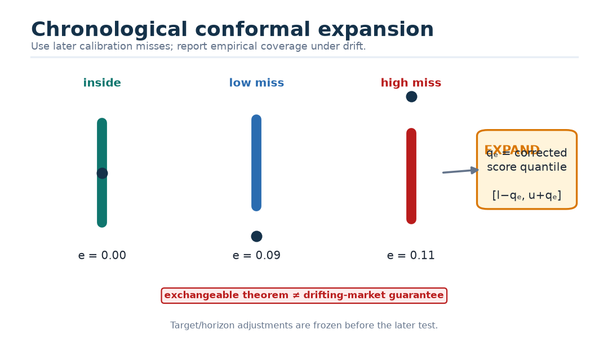
*Figure 47. Chronological conformal calibration expands intervals using miss distances.*

Adaptive conformal inference updates a target error level after observing outcomes [R35]. It is a shadow-only future experiment because each horizon’s label arrives later. Any update waits for that label and uses its own delayed queue. The cited method’s long-run frequency result is not a short-window conditional guarantee and does not by itself solve delayed/batched feedback.

## 34. Predeclared promotion gates

Before the outer holdout, a candidate may adopt initial gates such as:

| Gate | Initial research threshold |
|---|---|
| Weighted pinball | at least 5% better than the best registered non-neural baseline |
| Horizon regressions | no target/horizon over 2% worse without a documented trade-off |
| Nominal 80% interval | 76–84% overall and at least 70% in sufficiently populated critical slices |
| Seed stability | all three final seeds beat baseline; spread reported |
| ONNX parity | maximum absolute \(10^{-5}\) or relative \(10^{-4}\), with identical decisions |
| Batch-one latency | warmed worker p95 at most 25 ms on the declared target CPU |
| Worker memory | incremental steady state below 64 MiB |
| Safety replay | zero accepted non-finite outputs and zero invariant violations |

These thresholds are proposals. They can be tightened before the holdout but never relaxed after seeing a disappointing result. Passing them supports the next gate, not an order-placement claim.

### 34.1 Economic evaluation comes later

A later policy must be frozen on development data and tested with executable bid/ask prices, fees, slippage, latency, fill/queue assumptions, turnover, capacity, exposure, and drawdown. LOB studies show that high F1 or MCC can fail to align with forecast-implied entry/exit sequences, and neither measure establishes actual execution or profit [R31]-[R33]. A chart forecast can be useful without authorizing automation.

## 35. Export and parity

The reference graph uses common ONNX-friendly primitives: matrix multiplication, add/multiply/divide, square root, reductions, exponentials/logarithms, sine/cosine, sigmoid, softplus, tanh, conditional selection, softmax, reshape, transpose, concatenation, and gather. Fused attention is not required.

Parity fixtures cover normal, sparse-mask, one-modality, one-sided-book, all-invalid rejection, clipping boundaries, and extreme finite inputs. Compare the training runtime, raw ONNX graph, optional wrapped transforms, and host reconstruction. FP32 is the reference. Quantization is a separate candidate.

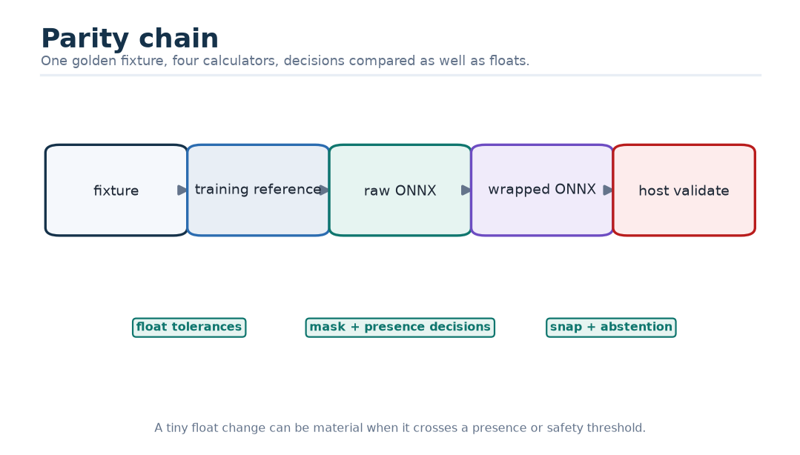
*Figure 48. One fixture must survive four numerically compared implementations.*

The package manifest binds model bytes and SHA-256; architecture/config hash; exact parameter count; tensor schema and compiler version; scaler/calibration hashes; applicability policy; code revision; dataset/fold/seed/metric evidence; runtime versions; target-CPU benchmark; limitations; approval; and rollback predecessor. Loading a model is not the same as promoting it.

## 36. Isolated serving and backpressure

Inference runs in a bounded local worker outside the UI and execution process. Requests contain a schema version, monotonic ID, instrument, cutoff, reference values, and fixed tensors. A latest-wins bounded queue per instrument drops stale requests instead of building a backlog. The provider discards a response if its request or cutoff no longer matches the chart.

*Figure 49. Safe local inference leaves the native chart intact on every failure.*

Worker crash, timeout, schema mismatch, non-finite result, stale reference, or quality rejection produces a reason-coded abstention. The median forecast is visually distinct from realized footprint data; uncertainty appears as a band or whisker; rejected buy/sell POC is absent; model version, cutoff, horizon, age, and unavailable reason remain visible.

## 37. Monitoring, immutable activation, and rollback

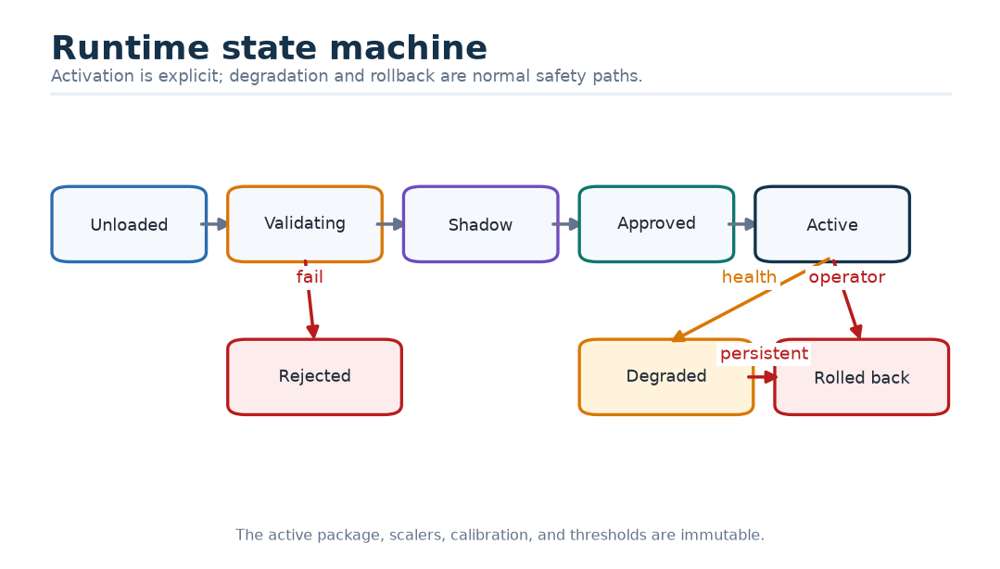
*Figure 50. Candidate packages move through explicit runtime states.*

Monitor request, acceptance, abstention, and reason counts; source ages; valid fractions; gate distributions; clipping; output width and presence; reconstruction rejections; latency percentiles; queue drops; timeouts; exceptions; memory/CPU; and active model hash. After labels mature, monitor proper scores, empirical coverage, median bias, and presence calibration by horizon and slice.

The active model, scalers, calibration, and thresholds are immutable. Retraining creates a new package that repeats every gate. Rollback atomically restores the previous approved package or disables the provider. Forecast failure never blocks native chart rendering or data capture.

---

# Part VI — What the research literature actually supports

## 38. Method of the evidence audit

The canonical bibliography contains 46 primary sources. This review checked the latest accessible paper versions in full, recorded mechanisms, datasets, strongest reported results, limitations, exact section/page anchors, and the narrow implication for CHMT-Q. Forty-four full papers were retrieved. Two access qualifications remain:

- **R15, RevIN:** the OpenReview PDF was blocked by an anti-bot challenge and no legitimate author-hosted copy was found. The audit therefore uses only venue metadata plus the official repository README and implementation, and makes no paper-result claim.
- **R30, Deep Order Flow Imbalance:** the 2023 Wiley version of record could not be retrieved. Mechanism, scale, and result statements come from the legitimate dated 2021 manuscript and are labelled accordingly.

An access problem is not permission to invent a result, copy from an unauthorized source, or promote a secondary summary into primary evidence.

*Figure 51. The 46-source evidence landscape.*

No single paper validates the full CHMT-Q stack. The exact irregular-time formula, four-frame patch, 20-level hierarchy, safe all-masked behavior, quality-gate design, non-crossing head, footprint targets, ONNX graph, batch-one CPU budget, or promotion thresholds are local hypotheses. They require local tests.

## 39. Transformer primitives: useful pieces, not one borrowed recipe

The original Transformer establishes scaled dot-product attention, multi-head projections, and causal masking [R01]. Relative-position attention establishes that pairwise relation information can enter attention edges [R02], but its learned token offsets are not physical seconds. RMSNorm supports scale control without mean subtraction [R03], but does not establish pre-norm placement, Q/K normalization, or LayerScale. GLU experiments support testing gated feed-forward variants under comparable capacity [R04]; in the source table GEGLU, not SwiGLU, has the best primary pretraining loss, and downstream results vary.

Therefore the honest attribution is separated:

| CHMT-Q element | Evidence supplied | Local hypothesis still requiring proof |
|---|---|---|
| dense causal attention | R01 | behavior on market tensors, masks, and CPU |
| pairwise relation bias | R02 | logarithmic elapsed-seconds formula and scales |
| RMSNorm | R03 | pre-norm placement and interaction with LayerScale |
| SwiGLU candidate | R04 | exact 128→256→128 trade-off |
| Q/K normalization + learned temperature | stability rationale and local design | score/calibration/latency benefit in this model |
| safe all-masked softmax | numerical necessity and local contract | exact implementation/export parity |

> **Why? — Why split citations so finely?** A bracket after a long sentence can make four papers appear to support every clause. Mechanism-by-mechanism attribution makes unsupported innovations visible, which is exactly where experiments are needed.

## 40. Scale-fit: impressive mechanisms can solve the wrong bottleneck

DeepSeekMoE, MLA, MTP, sparse attention, Kimi linear attention, Gated DeltaNet, Mamba, GLA, linear attention, and DeltaNet solve real problems [R05]-[R11], [R22], [R26]-[R28], [R39]-[R41]. Their strongest evidence generally involves billions of parameters, hundreds of billions or trillions of tokens, long autoregressive decoding, tens of thousands to one million context positions, and specialized accelerators.

CHMT-Q has 64/60/60 temporal tokens, 184 memory tokens, five non-autoregressive queries, about 2.09 million parameters, and a CPU/ONNX target. Dense score storage is countable and small. This mismatch does not make the larger methods bad; it makes immediate transfer unearned.

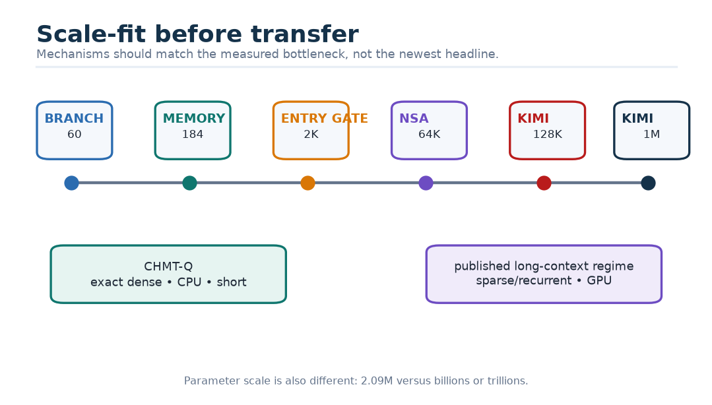
*Figure 52. Match the mechanism to the bottleneck.*

Specific decisions follow:

- **MLA/MoE [R05]-[R07]:** defer; KV cache and giant-model expert capacity are absent.
- **MTP [R07]-[R08]:** adapt only the causal multi-future supervision idea. R07’s sequential module uses a next-target-token embedding; R08’s parallel heads do not. CHMT-Q’s intermediate decoder loss is an original deep-supervision variant.
- **NSA/DSA [R09], [R26]:** defer; DSA’s indexer itself remains quadratic, and the reported sparse adaptation is nearly a trillion tokens.
- **KDA/Gated DeltaNet/Mamba/GLA/linear attention/DeltaNet [R10]-[R11], [R22], [R39]-[R41]:** preserve as long-context controls. Finite recurrent state can forget rare events or retain stale regimes; hybrid full attention is often strongest.
- **Muon/QK-Clip [R25], [R28]:** AdamW remains the reference. Muon is a training-only A/B; giant-model clipping thresholds are not copied.

The canonical R41 citation is Yang, Wang, Zhang, Shen, and Kim, “Parallelizing Linear Transformers with the Delta Rule over Sequence Length,” not the previously listed author/title combination.

## 41. Generic time-series evidence

PatchTST shows that temporal patches can reduce token count and work well on regular long-horizon datasets [R12]. Its strict channel independence, repeated-last padding, and overlapping patches are not CHMT-Q’s contract. iTransformer shows that attention across variables can help high-dimensional series [R13], while S-Mamba similarly mixes variable tokens [R44]. Neither gives arbitrary variables a natural order or validates a two-sided book hierarchy. TFT provides the strongest precedent for separating observed-past, known-future, and static inputs, using gates, and predicting several quantiles directly [R14]. TFT does not prevent quantile crossing; CHMT-Q’s positive-gap head is original.

The official RevIN code computes and detaches statistics from the **input window**, not a future target window [R15]. Its causal use does not inherently leak labels. The real questions are whether input-window centering erases absolute spread/depth/volatility regimes and whether masked irregular statistics are stable. This correction changes the rationale from “known leakage” to “ablation required.”

DLinear/NLinear provide mandatory simple baselines because linear models beat several transformer configurations on the authors’ benchmarks [R16]. TimesNet and TimeMixer provide periodic and multiscale slow-branch alternatives [R17], [R43], but no cited result proves that their pooling preserves queue bursts. Generic time-series results are portability clues, not market evidence.

## 42. Limit-order-book evidence

DeepLOB combines local price/volume structure before temporal LSTM modelling and reports results on FI-2010 plus a larger proprietary LSE dataset [R18]. TransLOB combines causal dilated convolutions with masked transformer blocks but is tested only on FI-2010 and explicitly notes tiny-data and tuning sensitivity [R19]. TLOB separately models temporal and feature/spatial relationships and its dual-axis ablation beats either single axis on its studied classification tasks [R20]. Multi-horizon DeepLOB variants support one shared representation for five horizons, although the paper uses autoregressive decoders [R21]. Together these studies motivate separate structural and temporal processing; they do not prove CHMT-Q’s exact rank-first encoder.

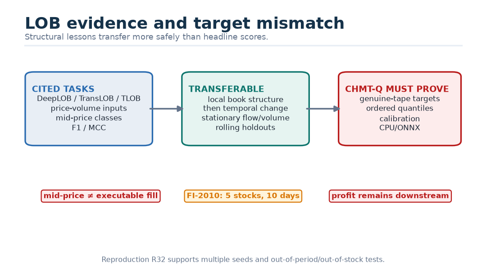
*Figure 53. What LOB papers predict versus what CHMT-Q proposes.*

The public FI-2010 benchmark covers five Helsinki stocks and ten days; roughly four million messages become 394,337 processed representations [R29]. A later reproduction study reports large declines for several published architectures and around half of its hyperparameter-search runs collapsing near chance [R32]. This supports multiple seeds, out-of-period and out-of-stock evaluation, and simple baselines. It does not prove every deep LOB model fails.

Deep order-flow-imbalance work uses 115 Nasdaq stocks, 100-observation histories, ten activity-scaled horizons, rolling evaluation, and MSE-relative out-of-sample \(R^2\); stationary order-flow inputs outperform raw LOB inputs across most stocks in the accessible manuscript [R30]. It has no fees, fills, impact, or P&L. A related predictability study finds useful information concentrated over limited event horizons and directly compares L1/L2/flow/volume representations [R31]. It uses a 100-event lookback with wall-clock horizons up to roughly half a second, so it does **not** validate CHMT-Q’s two-minute context.

The microstructural-guide study shows that high F1/MCC can disagree with a Jaccard-like score over forecast-implied entry/exit sequences [R33]. Those sequences are not executed fills. Sirignano and Cont show transfer across held-out stocks within one NASDAQ market [R42], not universality across markets, venues, assets, or targets.

## 43. Probabilistic forecasting and calibration evidence

Conformalized quantile regression supplies a finite-sample marginal-coverage result under exchangeability and shows how to expand learned intervals using calibration miss distances [R34]. Adaptive conformal inference controls a long-run empirical error frequency through an update after each revealed outcome [R35]. Neither supplies conditional coverage in a drifting market, and the adaptive paper explicitly leaves delayed/batched responses open.

DeepAR creates coherent joint sample paths by autoregressively feeding sampled values back into its state [R36]. MQTransformer predicts direct horizon-specific marginal quantiles and conditions horizon retrieval on target context [R37]. CHMT-Q chooses the simpler direct-marginal contract; if downstream simulation later needs coherent paths, it must add and separately score a joint model.

Proper scoring rules encourage truthful probabilistic reports in expectation [R38]. A narrow interval with the wrong misses can score worse than a slightly wider well-calibrated interval. Properness does not guarantee empirical calibration, uniqueness when a quantile is nonunique, or trading value.

## 44. Adaptive, merging, optimization, reasoning, and agent research

Transformer-Squared learns task-specific singular-value scaling and may search expert mixtures at inference [R23]. Reported gains are small and sometimes negative, two-pass adaptation is slow, and runtime weight mutation conflicts with frozen ONNX lineage. Evolutionary merging searches task-vector and data-flow recipes for pretrained language-model experts [R24]. CHMT-Q would consider only a much narrower same-base offline task-vector experiment after real experts exist.

Auxiliary-loss-free expert balancing matters only if a future CHMT-Q mixture-of-experts has a measured routing problem [R27]. Muon and Kimi K2’s QK-Clip inform optimizer and stability experiments, not the v1 inference graph [R25], [R28]. DeepSeek-R1’s reasoning-RL results concern verifiable language tasks and do not define a supervised numeric forecaster [R45]. The Darwin Gödel Machine evolves coding-agent implementations under benchmark evaluation; it does not update a live numeric model and reinforces the need for sandboxed, human-reviewed offline proposals [R46].

## 45. Adjacent study: order-flow filtration and OBI

The shared-core paper “Order-Flow Filtration and Directional Association with Short-Horizon Returns” studies three BANKNIFTY January 2023 futures days [L01]. It filters orders independently by lifetime, modification count, or modification timing, reconstructs book imbalance, and evaluates a ladder of Pearson correlation, discretized-regime association, and Hawkes cross-excitation. It also filters executed trades by their parent-order characteristics.

*Figure 54. The adjacent order-filtration study and its evidence boundary.*

For standing-book OBI, average residualized correlation moves only from 0.01018 unfiltered to 0.01133 under modification-time filtering; average Hawkes score moves from 8.9292 to 9.1745. Effects are small and heterogeneous. Parent-filtered trade OBI shows larger Hawkes differences: for example, 2 January lifetime filtering raises 10.9933 to 15.2172; 13 January raises 8.3639 to 15.8630; and 23 January modification-time filtering raises 11.5868 to 24.7352.

The study is explicitly diagnostic and specifies no forecasting or execution strategy. Its small three-day sample, top-five-change event recording, many model choices, and lack of external test period limit generalization. The text also requires clarification before operational reuse: modification-time is defined once as the time between the last two modifications but later described as entry-to-first-modification; a total-lifetime filter uses an order’s eventual exit and therefore needs a precise online/retrospective boundary; and early problem text discusses contemporaneous windows while the experiment uses a ten-second evaluation window followed by a one-second forecast window. These are reasons to reproduce definitions, not reasons to discard the paper.

For CHMT-Q, the lesson is narrow: order lifecycle, trade-parent provenance, filtered imbalance, and Hawkes diagnostics can become causal input features or auxiliary diagnostics **only after** their availability and threshold policies are frozen inside each fold. The paper does not validate the transformer, footprint targets, or a trading edge.

## 46. Source-by-source decision ledger

The table below records the disposition of every canonical bibliography source. “Adopt” means adopt a mechanism or invariant, not copy reported performance. “Adapt” means a local design differs materially. “Benchmark” means a fair comparator. “Defer” means the published bottleneck is absent. “Boundary” means the source mainly limits what may be claimed.

| Ref | Narrow lesson | CHMT-Q disposition | Principal caution |
|---|---|---|---|
| R01 | scaled dot-product attention; causal mask | Adopt | translation evidence; no CHMT stabilizers |
| R02 | pairwise relation information in attention | Adapt | token distance is not elapsed seconds |
| R03 | RMS scale normalization | Adopt + ablate | speed/stability are hardware and stack dependent |
| R04 | gated FFN variants | Benchmark SwiGLU/GEGLU | SwiGLU is not uniformly best |
| R05 | fine-grained shared/routed experts | Defer | giant-model capacity problem absent |
| R06 | compressed KV latent for decoding | Defer | no long autoregressive KV cache |
| R07 | sequential MTP with target-token input | Boundary | future target input is illegal in causal trunk |
| R08 | parallel multi-future heads from one past | Adapt | small-model benefit is uncertain |
| R09 | compressed/selected/local sparse attention | Defer | long GPU context and custom kernels |
| R10 | KDA recurrent state plus periodic full attention | Later benchmark | finite state can forget; huge context regime |
| R11 | forgetful delta-rule memory | First recurrent control | mixed extrapolation and recall |
| R12 | temporal patch tokens | Adapt | regular data, channel independence, repeated padding |
| R13 | variable-axis attention | Partial adapt | variable tokens can blur transients |
| R14 | information roles, gates, direct quantiles | Adapt | attention/gates are not causes; quantiles can cross |
| R15 | reversible input-window normalization | Ablate, not v1 | full paper inaccessible; absolute regimes may vanish |
| R16 | simple linear long-horizon models | Mandatory baseline | protocol-specific headline gains |
| R17 | FFT-selected periodic 2-D variation | Slow-branch baseline | unstable under irregular regimes |
| R18 | local LOB geometry before temporal model | Adopt principle | labels are smoothed mid-price direction |
| R19 | causal convolution plus masked attention | Baseline | FI-2010 only; not proof of rank-first hierarchy |
| R20 | separate temporal and feature attention | Adopt principle | larger model, extra features, no live/P&L evidence |
| R21 | shared multi-horizon LOB model | Adopt principle | autoregressive decoder and hardware-specific speed |
| R22 | selective state space / scan | Later benchmark | long GPU context, no short CPU evidence |
| R23 | singular-value expert adaptation | Offline only | two passes, mutable weights, small/mixed gains |
| R24 | evolutionary merging recipes | Offline only | pretrained-expert regime and search leakage risk |
| R25 | orthogonalized matrix optimizer | Training A/B | hybrid optimizer and mixed downstream results |
| R26 | sparse top-k MLA entries | Defer | quadratic indexer and near-trillion-token adaptation |
| R27 | loss-free MoE load bias | Defer | no v1 MoE or routing bottleneck |
| R28 | measured Q/K logit clipping | Stability reference | giant-model thresholds do not transfer |
| R29 | public FI-2010 benchmark | Smoke test | five stocks, ten days, processed labels |
| R30 | stationary flow, rolling multi-horizon OOS \(R^2\) | Feature/evaluation lesson | manuscript evidence; no execution/P&L |
| R31 | flow/volume representations and L1/L2 ablations | Adopt evaluation lesson | mid-price nontradable; sub-second event horizons |
| R32 | reproduction and out-of-period weakness | Adopt protocol | does not prove all deep models fail |
| R33 | forecast-sequence alignment metric | Diagnostic | not actual fills or proper score |
| R34 | conformalized quantile regression | Adapt chronologically | guarantee assumes exchangeability |
| R35 | adaptive long-run error control | Shadow-only future | needs revealed labels; delayed case open |
| R36 | autoregressive joint sample paths | Defer unless paths needed | teacher forcing and nonfinancial tasks |
| R37 | direct horizon-specific quantile queries | Adopt principle | marginal only; private retail evidence |
| R38 | proper quantile/interval scoring | Adopt | proper score is not calibration or profit |
| R39 | gated linear recurrent attention | Long-context control | finite state and recall deficit |
| R40 | kernelized recurrent sufficient statistics | Long-context control | ELU+1 replaces exact softmax |
| R41 | delta-rule corrective writes | Long-context control | slower, stale-state and recall concerns |
| R42 | cross-stock pooled representation | Adopt holdout lesson | one NASDAQ market, not cross-market universality |
| R43 | multiscale decomposition/mixing | Slow-bar baseline | no evidence on queue-burst preservation |
| R44 | bidirectional variable-token Mamba | Grouped-feature ablation | no natural variable order |
| R45 | separate base, objective, evaluation, deployment | Methodological boundary | reasoning RL is not numeric forecasting |
| R46 | sandboxed agent self-modification research | Governance boundary | one costly coding-agent run, safety risks |

*Figure 55. Published mechanism to promoted local model.*

---

# Part VII — Reality check, failure modes, and “why?”

## 47. What is implemented today

The repository’s standalone prototype is useful engineering evidence, but it is not the selected CHMT-Q implementation. It currently:

- accepts bars `[B,64,16]`, L1 `[B,240,16]`, and L2 `[B,240,2,10,12]`;
- makes 60 L1 and 60 L2 temporal patches;
- creates a 184-token, 128-wide memory;
- uses three causal blocks per branch and two decoder blocks;
- emits five queries × five point targets;
- uses LayerNorm, ordinary scaled dot-product Q/K scores, GEGLU, and Huber-only training;
- contains 2,093,518 trainable parameters;
- lives under `tools/numeric-transformer/` and is not wired to the desktop terminal.

At the audit point, 23 focused tests passed and three ONNX-dependent tests were skipped because optional export runtimes were absent. The tests cover important shape, causal-mask, missing-modality, loss, and synthetic-data behavior, but they do not prove forecast skill. Further gaps include small NumPy references for time bias, gates, and every loss term; adversarial dtype/device/non-finite/nested-mask cases; an exact count assertion; systematic modality permutations; and robust ONNX stress fixtures.

The selected CHMT-Q design changes the block and output contract. The roadmap extends the task family still further. A future implementation should either use a new versioned module or explicitly migrate the prototype with tests that demonstrate every changed invariant.

## 48. Failure modes and design responses

*Figure 56. Failure tree from bad source event to unsafe display.*

| Failure | Tempting wrong response | Required response |
|---|---|---|
| late event with early exchange time | insert it into an earlier feature window | gate by availability time and preserve audit clocks |
| reconnect duplicate with conflicting payload | keep the last row | reject conflict and version source epoch policy |
| missing row numerically zero | let the network “figure it out” | zero for arithmetic **plus** authoritative false mask |
| stale carried quote | treat it as a fresh repeat | include age/carry quality and enforce freshness limit |
| future tape gap | call it zero volume | mark affected target unknown |
| random row split | rely on large sample count | chronological folds, purge, embargo, outer holdout |
| quantile crossing | sort outputs after training | positive-gap parameterization and invariant tests |
| all keys masked | hope softmax is stable | explicit zero-row safe softmax and hard branch gate |
| attention logit explosion | copy a giant-model threshold | log first; ablate prevention/clip locally |
| one seed wins | publish the best checkpoint | multiple fixed seeds and block uncertainty |
| wide intervals cover everything | call coverage calibrated | report proper score and width together |
| ONNX differs slightly at a threshold | ignore “tiny” error | compare decisions, not only raw floats |
| worker response arrives late | display it anyway | monotonic request/cutoff match and latest-wins queue |
| output invariant fails | display valid-looking fields | reject the complete horizon bundle |
| model drifts | update weights online | abstain/rollback; retrain a new immutable candidate |
| attention heatmap looks intuitive | call it causality | use ablations/counterfactuals and cautious language |

## 49. Thirty practical “why?” questions

### 49.1 Why not use screenshots?

Pixels hide exact prices, quantities, clocks, masks, and provenance. Numeric tensors preserve the quantities the task actually depends on. A screenshot model may be a separate research task, not a substitute for canonical market data.

### 49.2 Why not put bars, L1, and L2 in one long list?

Their axes and clocks differ. Separate encoders keep regular bars, fast quotes, and same-snapshot side/rank geometry explicit.

### 49.3 Why keep 64 bar states instead of one pooled vector?

The decoder may need a particular earlier regime or transition. One vector forces all evidence through a narrow bottleneck before the target horizon is known.

### 49.4 Why patch L1 and L2?

Patching turns 240 half-second frames into 60 two-second tokens, reducing repeated temporal work while preserving a learned within-patch summary. Patch width remains an ablation.

### 49.5 Why learn a patch pool instead of averaging?

A quote change or brief depth withdrawal may matter more than an unchanged carried frame. Masked learned weights can emphasize eligible frames, while average pooling treats them equally.

### 49.6 Why use attention inside one L2 snapshot?

Bid/ask levels coexist at one time and interact through imbalance, gaps, and paired rank. The mask naturally handles missing ranks and one-sided books.

### 49.7 Why is within-snapshot attention non-causal?

Causality orders times, not levels observed at the same accepted logical instant. No later snapshot is visible in the level block.

### 49.8 Why is temporal encoder attention causal when the final cutoff is later than the whole window?

It keeps every intermediate state a valid prefix representation, supports causal auxiliary tasks, and avoids accidental future-within-window reuse.

### 49.9 Why full attention instead of Mamba or linear attention?

The sequences contain only 60–64 temporal tokens. Exact score matrices are small; approximation and recurrent-state risk are not yet buying a measured benefit.

### 49.10 Why four heads?

Four 32-wide heads offer several retrieval subspaces without making each head too narrow. The number is a controlled capacity choice, not a theorem.

### 49.11 Why normalize queries and keys?

Their length can otherwise drive logits independently of directional match. RMS normalization bounds scale, while a learned temperature restores head-specific sharpness.

### 49.12 Why still log attention logits?

Normalization reduces risk but does not prove numerical safety. Logs reveal drifting temperatures, bad inputs, or implementation mistakes.

### 49.13 Why RMSNorm instead of LayerNorm?

It removes mean subtraction and is simple to export. Whether that improves this task must be tested against the prototype’s LayerNorm.

### 49.14 Why LayerScale?

Small learned residual gains let blocks start close to identity and make contribution scale inspectable. They are not confidence estimates.

### 49.15 Why SwiGLU?

It gives a learned pointwise content gate and is a strong transformer candidate. GEGLU and ordinary activations remain fair ablations.

### 49.16 Why quality gates if masks already exist?

Masks make invalid data impossible to attend to. Soft gates express relative reliability among still-valid modalities. The hard boundary always wins.

### 49.17 Why not multiply memory values by gates?

Adding log-gate bias to attention scores changes selection probability without shrinking content twice. It also leaves the encoded state available for audit.

### 49.18 Why five direct queries?

They avoid recursive error accumulation and serial latency, while horizon self-attention lets the forecast term structure coordinate.

### 49.19 Why can horizon queries attend to each other without a causal triangle?

All five are computed at the same decision cutoff and contain no future observation. Their index denotes target distance, not observation time.

### 49.20 Why 17 raw values?

Five targets each need a center and two positive gap parameters: \(5\times3=15\). Buy and sell POC each need a presence logit: \(15+2=17\).

### 49.21 Why not sort three unconstrained quantiles afterward?

Sorting changes which output receives which gradient and can hide a poorly learned head. Positive gaps make order part of the model’s differentiable contract.

### 49.22 Why separate presence from value?

A buy POC is undefined when no eligible buy volume exists. Regressing a fake zero mixes “absent” with a real price offset.

### 49.23 Why pinball plus Huber?

Pinball elicits quantiles; Huber supplies a smooth local signal for the median while limiting outlier influence. The Huber weight must remain secondary and ablated.

### 49.24 Why chronological conformal calibration?

Raw quantiles can miscover. A later dedicated slice measures nonnegative miss distances without contaminating model selection. Financial dependence means coverage is reported empirically, not promised by exchangeable theory.

### 49.25 Why at least three seeds?

Optimization noise can change a small model’s apparent rank. A result that exists only for one seed is a fragile architectural claim.

### 49.26 Why use days as bootstrap blocks?

Adjacent cutoffs share events and labels. Treating them as independent would make uncertainty look much smaller than it is.

### 49.27 Why insist on simple baselines?

If a complex network cannot beat persistence, a linear map, or trees on the same legal inputs, its story and parameter count have not earned deployment complexity.

### 49.28 Why keep training outside the desktop process?

Training uses large mutable data, dependencies, checkpoints, and code. The desktop needs a small signed inference artifact with bounded resources and a clear rollback path.

### 49.29 Why abstain instead of always showing something?

A missing or stale modality, sequence gap, drift alarm, timeout, or invariant failure can make a forecast more misleading than silence. “Unavailable, because …” is a valid product result.

### 49.30 Why can’t a good forecast place an order?

Prediction, action, and execution are different problems. A policy must include cost, risk, position, liquidity, latency, fill, and capacity logic and must be evaluated separately.

## 50. A school-kid recap

1. A market is a fast auction with waiting promises and completed trades.
2. Bars, best quotes, depth, and footprint are different views of that auction.
3. We turn legal past facts into arrays whose axes have names.
4. Masks say whether a row exists; zero alone cannot say that.
5. A projection gives each row a larger learned workspace.
6. Attention compares question vectors with label vectors and collects information vectors.
7. Causal masks close every door to a later observation.
8. Three specialist encoders respect the different shapes of bars, L1, and L2.
9. Quality gates route only among sources that hard masks say are available.
10. Five queries ask five future-distance questions at once.
11. Quantiles say “here is a lower, middle, and upper outcome,” not “I know exactly.”
12. Losses teach the model what kind of error matters.
13. Chronological tests stop tomorrow from tutoring yesterday.
14. Baselines ask whether the complicated idea earns its keep.
15. Calibration asks whether uncertainty statements match later frequencies.
16. Export parity asks whether the deployed calculator is the same calculator we tested.
17. Shadow mode asks whether the system behaves safely before users depend on it.
18. Abstention and rollback are part of intelligence, not signs of failure.

## 51. Conclusion

CHMT-Q is a coherent candidate because it makes the problem’s geometry and uncertainty explicit: physical clocks instead of text positions, separate structures instead of a flattened stream, hard masks instead of magical zeros, hierarchy inside the book, exact attention at short length, direct horizon queries, ordered quantiles, genuine-tape labels, and an isolated immutable runtime.

The literature supports the ingredients unevenly. Transformer and time-series papers justify mechanisms worth testing; LOB papers justify structural priors and harsh evaluation; probabilistic papers justify proper scores and carefully qualified calibration; giant-model and agent papers mostly define deferred branches or governance boundaries. None establishes that the chosen footprint targets are predictable or profitable.

The decisive work is empirical and operational: capture a lawful, complete, provenance-rich corpus; freeze a deterministic causal compiler; beat strong baselines across folds, seeds, horizons, and slices; calibrate on later data; pass an untouched holdout; prove ONNX and host parity; meet batch-one resource limits; survive shadow serving; and abstain safely. Until those gates pass, CHMT-Q is a well-specified research design—not a production oracle.

---

# Appendix A — Complete input and output contracts

## A.1 Bar features: 16 values per minute slot

| Index | Field | Causal definition |
|---:|---|---|
| 0–3 | open/high/low/close offsets | ticks from previous valid close |
| 4 | log return | `log(close / previous_close)` for positive prices |
| 5–8 | range/body/upper/lower wick | tick distances |
| 9 | close location | `(close-low)/max(high-low,tick_size)` |
| 10 | log volume | `log(1+volume)` |
| 11 | log-volume EMA residual | value minus trailing causal EMA |
| 12 | availability age | `max(0, cutoff-available_time)` seconds |
| 13 | preceding missing slots | \(\log(1+\min(g,63))/\log(64)\) for consecutive missing-slot count \(g\) |
| 14–15 | session phase | sine/cosine of versioned exchange-session progress |

The axis is 64 clock slots, not the last 64 nonempty bars. One earlier eligible close may be retained only to calculate the oldest row’s return; it is not an input token.

## A.2 L1 features: 16 values per half-second slot

1. midpoint offset from cutoff reference price;
2. midpoint change;
3. spread;
4. log best-bid size;
5. log best-ask size;
6. size imbalance;
7. microprice offset;
8. best-bid change;
9. best-ask change;
10. bid-size log change, `log(1+bid_size_t)-log(1+bid_size_previous)`;
11. ask-size log change, `log(1+ask_size_t)-log(1+ask_size_previous)`;
12. observation age;
13. event-to-availability lag;
14. normalized sequence-gap magnitude, `min(missing_sequence_count,16)/16`;
15. carry-forward flag;
16. approximate-time flag.

Crossed, nonpositive, stale, or causally unavailable books are masked and counted in quality.

## A.3 L2 features: 12 values per side/rank row

1. signed distance from a fresh grid-time midpoint;
2. gap from the next better eligible level;
3. log size;
4. log cumulative size on the side;
5. local side share;
6. cumulative side share;
7. paired-rank imbalance;
8. snapshot age;
9. event-to-availability lag;
10. sequence gap;
11. carry-forward flag;
12. approximate-time flag.

The required nested invariant is

$$
m^{snapshot}_t=m^{accepted\ and\ fresh}_t\land
\bigvee_{s,r}m^{level}_{t,s,r}.
$$

A true snapshot with every level false is invalid. A one-sided book may keep valid rows on one side, mask the other, and set an explicit quality fact.

## A.4 Quality vector: 16 causal values

- valid fraction for bars, L1, L2 snapshots, and L2 levels (four values);
- carried fraction for L1 and L2 (two);
- approximate-time fraction for L1 and L2 (two);
- quote and depth sequence-gap rates (two);
- late-bar fraction (one);
- out-of-order rate (one);
- one-sided-book rate (one);
- crossed/rejected-book rate (one);
- reference-anchor-from-L1 flag (one);
- normalized session progress (one).

Every rate uses only observations available by the cutoff and the corresponding compiled input window: 64 bar slots or 240 L1/L2 slots. Event-rate denominators count eligible events in that window; an empty denominator yields zero together with the separate hard-availability fact, never a fabricated valid observation.

## A.5 Output positions

For each horizon, raw positions 0–14 are `(center, lower-gap logit, upper-gap logit)` for total POC, buy POC, sell POC, log-volume residual, and delta fraction. Position 15 is buy-presence logit; position 16 is sell-presence logit. The host exposes ordered q10/q50/q90 values and calibrated intervals for those primitive marginals, presence probabilities/decisions, reconstructed units, the plug-in raw-delta point diagnostic (never a derived delta interval), model identity, cutoff, and abstention state.

# Appendix B — Symbol table

| Symbol | Meaning |
|---|---|
| \(B\) | training batch size; exported batch is one |
| \(T\) | sequence length for a branch |
| \(d\) | main model width, 128 |
| \(d_h\) | main head width, 32 |
| \(H\) | number of forecast horizons, five |
| \(c\) | decision cutoff time; also local center variable when context is clear |
| \(\mathcal F_c\) | information legally available by cutoff |
| \(p_b,p_a\) | best bid and ask prices |
| \(q_b,q_a\) | best bid and ask sizes |
| \(p_{ref}\) | fresh causal reference price |
| \(q\) | instrument tick size |
| \(P,P^{buy},P^{sell}\) | total, buy, and sell point of control |
| \(V,D\) | total traded volume and classified delta |
| \(X\) | input-state matrix or tensor |
| \(Q,K,V\) | query, key, and value matrices; value symbol distinguished by context |
| \(S,A,O\) | attention scores, probabilities, and output |
| \(m\) | boolean validity mask |
| \(\alpha_m\) | normalized modality gate |
| \(M\) | fused historical memory `[B,184,128]` |
| \(Q_\tau\) | predicted quantile at probability level \(\tau\) |
| \(\rho_\tau\) | pinball loss |
| \(\theta\) | all trainable parameters; also per-head log temperature by context |
| \(\eta\) | learning rate |
| \(\epsilon\) | small positive numerical stabilizer |

# Appendix C — Glossary

**Ablation:** a controlled experiment changing one registered factor.  
**Ask:** lowest waiting sell price.  
**Attention:** weighted retrieval based on query–key scores and value aggregation.  
**Availability time:** earliest time an accepted observation could legally enter features.  
**Backpressure:** limiting queued work so stale requests do not accumulate.  
**Bar:** interval summary such as open, high, low, close, and volume.  
**Baseline:** simpler model that a complex candidate must beat fairly.  
**Batch:** examples processed together during training.  
**Bid:** highest waiting buy price.  
**Calibration:** agreement between forecast probability/interval statements and observed frequencies.  
**Causal mask:** rule preventing a query from using a later key.  
**Conformal calibration:** interval adjustment using miss distances on a held-out calibration set.  
**Cutoff:** instant at which the forecast’s legal information set closes.  
**Delta:** classified buy volume minus classified sell volume.  
**Embedding:** learned vector representing a fixed structural identity such as modality or rank.  
**Epoch:** one training pass over the selected examples.  
**Feature:** one numeric input field with a definition and unit.  
**Footprint:** executed volume arranged by price and often side.  
**Gate:** learned nonnegative routing weight, bounded by hard validity.  
**Gradient:** slope of loss with respect to a parameter.  
**Head:** one attention subspace with its own projections and temperature.  
**Holdout:** untouched later data used once after design is frozen.  
**Horizon:** future distance or interval being forecast.  
**L1:** best bid/ask quote state and derived features.  
**L2:** multiple ranked price/quantity levels on both sides.  
**LayerScale:** trainable residual-branch gain.  
**Leakage:** information unavailable at the decision time entering training or selection.  
**Logit:** unconstrained score later mapped by sigmoid or softmax.  
**Mask:** explicit boolean that says whether a row, key, or label is valid.  
**Microprice:** size-weighted quote reference.  
**Modality:** input family such as bars, L1, or L2.  
**ONNX:** portable inference graph format used by the isolated worker.  
**Patch:** small group of consecutive frames summarized into one token.  
**Pinball loss:** asymmetric loss whose optimum is a chosen quantile.  
**Point of control:** price with greatest eligible traded volume in an interval.  
**Proper score:** score designed to reward honest probabilistic reporting in expectation.  
**Quantile:** value below which a stated fraction of outcomes falls.  
**Residual:** difference from a reference or prediction.  
**RMSNorm:** scale normalization based on root mean square without centering.  
**Shadow serving:** live-data inference whose outputs have no user or order effect.  
**Softmax:** transformation from scores to nonnegative weights summing to one.  
**Spread:** best ask minus best bid.  
**Tensor:** array with named axes.  
**Tick:** minimum allowed price step.  
**Token:** one encoded row or patch presented to a sequence layer.  
**Trade tape:** ordered record of executions.  
**Walk-forward:** chronological training/validation with expanding past and later validation.  

# Appendix D — Reproducibility and review checklist

## D.1 Data and causality

- [ ] Every source event retains event, receive, and availability time plus source epoch/sequence identity.
- [ ] Duplicate, gap, replay, correction, and reconnect policies are versioned and tested.
- [ ] Every feature is reproducible from observations available by its cutoff.
- [ ] Tape continuity and aggressor-classification policy are sufficient for each valid label.
- [ ] Random samples reproduce from immutable source hashes byte-for-byte.
- [ ] Split manifest exists before fitting scalers or selecting features.

## D.2 Model and mathematics

- [ ] Every tensor axis, order, unit, dtype, and mask semantic is documented.
- [ ] Nested masks and all-masked behavior have exact reference tests.
- [ ] Time bias, gates, quantile transform, and losses match small NumPy calculations.
- [ ] Parameter ledger equals the instantiated model exactly.
- [ ] Prototype and CHMT-Q status are not conflated.

## D.3 Evaluation

- [ ] All baselines receive identical legal inputs, labels, folds, and target transforms.
- [ ] Hyperparameters and early stopping use development data only.
- [ ] Final candidates use fixed multiple seeds and session/day block uncertainty.
- [ ] Metrics are reported per target, horizon, fold, and critical slice.
- [ ] Coverage and width appear together; economic evaluation includes executable assumptions.
- [ ] Outer holdout gates were frozen before evaluation.

## D.4 Deployment

- [ ] Raw and wrapped ONNX outputs match reference across adversarial fixtures.
- [ ] Host reconstruction, presence decisions, snapping, and abstention are parity-tested.
- [ ] Model package hashes every executable and statistical dependency.
- [ ] Worker has bounded size, queue, time, memory, and process behavior.
- [ ] Stale responses cannot reach the chart.
- [ ] Native chart/data capture survive every forecast failure.
- [ ] Shadow, approval, activation, degradation, and rollback are audited states.

# Appendix E — Primary-source bibliography

1. **[R01]** Vaswani et al. “Attention Is All You Need.” NeurIPS 2017. arXiv:1706.03762.
2. **[R02]** Shaw, Uszkoreit, and Vaswani. “Self-Attention with Relative Position Representations.” NAACL 2018. arXiv:1803.02155.
3. **[R03]** Zhang and Sennrich. “Root Mean Square Layer Normalization.” NeurIPS 2019. arXiv:1910.07467.
4. **[R04]** Shazeer. “GLU Variants Improve Transformer.” 2020 technical report. arXiv:2002.05202.
5. **[R05]** Dai et al. “DeepSeekMoE: Towards Ultimate Expert Specialization in Mixture-of-Experts Language Models.” 2024. arXiv:2401.06066.
6. **[R06]** DeepSeek-AI. “DeepSeek-V2: A Strong, Economical, and Efficient Mixture-of-Experts Language Model.” 2024. arXiv:2405.04434.
7. **[R07]** DeepSeek-AI. “DeepSeek-V3 Technical Report.” 2024/2025. arXiv:2412.19437.
8. **[R08]** Gloeckle et al. “Better & Faster Large Language Models via Multi-token Prediction.” ICML 2024. arXiv:2404.19737.
9. **[R09]** Yuan et al. “Native Sparse Attention: Hardware-Aligned and Natively Trainable Sparse Attention.” 2025. arXiv:2502.11089.
10. **[R10]** Kimi Team. “Kimi Linear: An Expressive, Efficient Attention Architecture.” 2025. arXiv:2510.26692.
11. **[R11]** Yang et al. “Gated Delta Networks: Improving Mamba2 with Delta Rule.” ICLR 2025. arXiv:2412.06464.
12. **[R12]** Nie et al. “A Time Series is Worth 64 Words: Long-term Forecasting with Transformers.” ICLR 2023. arXiv:2211.14730.
13. **[R13]** Liu et al. “iTransformer: Inverted Transformers Are Effective for Time Series Forecasting.” ICLR 2024. arXiv:2310.06625.
14. **[R14]** Lim et al. “Temporal Fusion Transformers for Interpretable Multi-horizon Time Series Forecasting.” *International Journal of Forecasting*, 2021. DOI:10.1016/j.ijforecast.2021.03.012.
15. **[R15]** Kim et al. “Reversible Instance Normalization for Accurate Time-Series Forecasting against Distribution Shift.” ICLR 2022. OpenReview:cGDAkQo1C0p. Full-text access qualification stated in Section 38.
16. **[R16]** Zeng et al. “Are Transformers Effective for Time Series Forecasting?” AAAI 2023. arXiv:2205.13504.
17. **[R17]** Wu et al. “TimesNet: Temporal 2D-Variation Modeling for General Time Series Analysis.” ICLR 2023. arXiv:2210.02186.
18. **[R18]** Zhang, Zohren, and Roberts. “DeepLOB: Deep Convolutional Neural Networks for Limit Order Books.” *IEEE Transactions on Signal Processing*, 2019. DOI:10.1109/TSP.2019.2907260.
19. **[R19]** Wallbridge. “Transformers for Limit Order Books.” 2020. arXiv:2003.00130.
20. **[R20]** Berti and Kasneci. “TLOB: A Novel Transformer Model with Dual Attention for Price Trend Prediction with Limit Order Book Data.” 2025. arXiv:2502.15757.
21. **[R21]** Zhang and Zohren. “Multi-Horizon Forecasting for Limit Order Books: Novel Deep Learning Approaches and Hardware Acceleration using Intelligent Processing Units.” 2021. arXiv:2105.10430.
22. **[R22]** Gu and Dao. “Mamba: Linear-Time Sequence Modeling with Selective State Spaces.” COLM 2024. arXiv:2312.00752.
23. **[R23]** Sun, Cetin, and Tang. “Learning to Predict Structural Adaptations of Large Language Models.” 2025. arXiv:2501.06252.
24. **[R24]** Akiba et al. “Evolutionary Optimization of Model Merging Recipes.” *Nature Machine Intelligence*, 2025. DOI:10.1038/s42256-024-00975-8.
25. **[R25]** Liu et al. “Muon is Scalable for LLM Training.” 2025. arXiv:2502.16982.
26. **[R26]** DeepSeek-AI. “DeepSeek-V3.2: Pushing the Frontier of Open Large Language Models.” 2025. arXiv:2512.02556.
27. **[R27]** Wang et al. “Auxiliary-Loss-Free Load Balancing Strategy for Mixture-of-Experts.” 2024. arXiv:2408.15664.
28. **[R28]** Kimi Team. “Kimi K2: Open Agentic Intelligence.” 2025/2026. arXiv:2507.20534.
29. **[R29]** Ntakaris et al. “Benchmark Dataset for Mid-Price Forecasting of Limit Order Book Data with Machine Learning Methods.” *Journal of Forecasting*, 2018. DOI:10.1002/for.2543.
30. **[R30]** Kolm, Turiel, and Westray. “Deep Order Flow Imbalance: Extracting Alpha at Multiple Horizons from the Limit Order Book.” *Mathematical Finance*, 2023. DOI:10.1111/mafi.12413. Evidence qualification stated in Section 38.
31. **[R31]** Lucchese, Pakkanen, and Veraart. “The Short-Term Predictability of Returns in Order Book Markets: a Deep Learning Perspective.” *International Journal of Forecasting*, 2024. DOI:10.1016/j.ijforecast.2024.02.001.
32. **[R32]** Prata et al. “LOB-Based Deep Learning Models for Stock Price Trend Prediction: A Benchmark Study.” *Artificial Intelligence Review*, 2024. DOI:10.1007/s10462-024-10715-4.
33. **[R33]** Briola, Bartolucci, and Aste. “Deep Limit Order Book Forecasting: A Microstructural Guide.” *Quantitative Finance*, 2025. DOI:10.1080/14697688.2025.2522911.
34. **[R34]** Romano, Patterson, and Candès. “Conformalized Quantile Regression.” NeurIPS 2019. arXiv:1905.03222.
35. **[R35]** Gibbs and Candès. “Adaptive Conformal Inference Under Distribution Shift.” NeurIPS 2021. arXiv:2106.00170.
36. **[R36]** Salinas et al. “DeepAR: Probabilistic Forecasting with Autoregressive Recurrent Networks.” *International Journal of Forecasting*, 2020. DOI:10.1016/j.ijforecast.2019.07.001.
37. **[R37]** Eisenach et al. “MQTransformer: Multi-Horizon Forecasts with Context Dependent and Feedback-Aware Attention.” arXiv v4, 2022; first posted 2020. arXiv:2009.14799.
38. **[R38]** Gneiting and Raftery. “Strictly Proper Scoring Rules, Prediction, and Estimation.” *JASA*, 2007. DOI:10.1198/016214506000001437.
39. **[R39]** Yang et al. “Gated Linear Attention Transformers with Hardware-Efficient Training.” ICML 2024. arXiv:2312.06635.
40. **[R40]** Katharopoulos et al. “Transformers are RNNs: Fast Autoregressive Transformers with Linear Attention.” ICML 2020. arXiv:2006.16236.
41. **[R41]** Yang, Wang, Zhang, Shen, and Kim. “Parallelizing Linear Transformers with the Delta Rule over Sequence Length.” NeurIPS 2024. arXiv:2406.06484.
42. **[R42]** Sirignano and Cont. “Universal Features of Price Formation in Financial Markets: Perspectives from Deep Learning.” *Quantitative Finance*, 2019. arXiv:1803.06917.
43. **[R43]** Wang et al. “TimeMixer: Decomposable Multiscale Mixing for Time Series Forecasting.” ICLR 2024. arXiv:2405.14616.
44. **[R44]** Wang et al. “Is Mamba Effective for Time Series Forecasting?” *Neurocomputing* 619, 2025. DOI:10.1016/j.neucom.2024.129178.
45. **[R45]** DeepSeek-AI. “DeepSeek-R1: Incentivizing Reasoning Capability in LLMs via Reinforcement Learning.” arXiv v2, 2026; first posted 2025. arXiv:2501.12948.
46. **[R46]** Zhang et al. “Darwin Gödel Machine: Open-Ended Evolution of Self-Improving Agents.” ICLR 2026. arXiv:2505.22954.

**[L01]** Anantha, Jain, and Maiti. “Order-Flow Filtration and Directional Association with Short-Horizon Returns.” arXiv:2507.22712v2, 2025.

# Appendix F — Local authority and provenance

- **[P-ARCH]** [`architecture/numeric-market-transformer-architecture.md`](architecture/numeric-market-transformer-architecture.md): earlier architecture and engineering exploration.
- **[P-SPEC]** [`research-spec.md`](research-spec.md): selected CHMT-Q research specification, corrected by the primary-source audit.
- **[P-VIS]** [`visual-guide.md`](visual-guide.md): illustrated guide to the implemented older point-model architecture.
- **[P-PROT]** `tools/numeric-transformer/`: standalone tested prototype, not terminal-integrated.
- **[P-ROAD]** future product roadmap Part IV: broader model-family hypotheses, not delivered behavior.
- **[P-PAPER]** this document: beginner-first synthesis and evidence reconciliation; it does not supersede source code for implemented behavior.
