# CHMT-Q: Final Numeric Market Transformer Research Specification

**Version:** 1.0 research architecture decision<br>
**Date:** 21 July 2026<br>
**Scope:** OHLC bars, Level 1 quotes, Level 2 depth, and Volume Footprint forecasts<br>
**Status:** architecture selected; synthetic prototype exists; real-data training and production integration are not yet complete
**Boundary:** Pro-private research document. Nothing in this document is copied into `public/`.

---

## Executive decision

The recommended first production candidate is **CHMT-Q v1**, the Causal Hierarchical Market
Transformer with Quantile heads. It is a compact, approximately 2.09-million-parameter model built
from numeric primitives. It treats bars, L1 quotes, and L2 books as different structures; fuses them
only after independent causal encoding; predicts five future footprint horizons directly; and returns
monotone 10th, 50th, and 90th percentiles plus buy/sell-presence probabilities.

The research conclusion is deliberately conservative. The strongest ideas for this workload are not
the largest or newest language-model mechanisms. They are:

- hierarchical encoding of book levels before temporal encoding, supported by DeepLOB and later LOB
  Transformer work [R18]-[R21];
- causal patching of dense microstructure frames, adapted from PatchTST [R12];
- direct multi-horizon probabilistic decoding and data-quality gating, adapted from Temporal Fusion
  Transformers [R14];
- primitive dense attention and masking [R01], relative-relation bias as inspiration [R02], RMSNorm
  [R03], and SwiGLU feed-forward layers [R04]. Pre-norm placement, Q/K normalization, LayerScale,
  safe all-masked behavior, and the physical elapsed-time formula are CHMT-Q design hypotheses;
- an auxiliary intermediate-horizon loss inspired by multi-token prediction, without feeding future
  targets into the deployable network [R08]; and
- leakage-safe walk-forward development, strong linear and market baselines, calibration, shadow
  serving, and abstention.

DeepSeek MLA/MoE/sparse attention, Moonshot Kimi Delta Attention, Sakana runtime self-adaptation,
Mamba-style state-space layers, and evolutionary model merging are valuable research results, but
their published advantages address very long contexts, enormous models, autoregressive KV caches,
or families of pretrained checkpoints. None is justified in the first 64/60/60-token CPU/ONNX model.
They are documented as later experiments with explicit entry gates rather than silently imported.

The architecture does **not** claim that future footprint values are economically predictable. That
claim can only be earned on untouched chronological data after fees, latency, calibration, and drift
tests. A sophisticated model cannot repair incomplete tape, timestamp leakage, an ambiguous decision
cutoff, or labels reconstructed from L1/L2 instead of genuine trades.

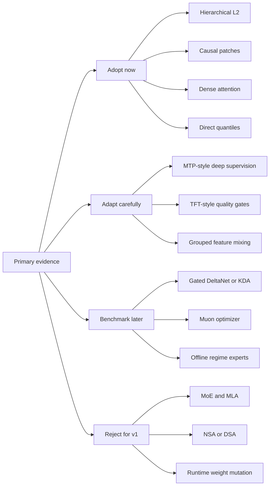

### The one-sentence architecture

At cutoff `c`, CHMT-Q independently turns 64 finalized one-minute bars, 240 half-second L1 frames,
and 240 hierarchical top-10-per-side L2 snapshots into 64, 60, and 60 causal tokens; quality-aware
gates fuse the 184 historical tokens; five learned horizon queries decode five future footprint bars;
and a monotone quantile head emits calibrated uncertainty without autoregressive rollout.

### Recommended first build

| Decision | CHMT-Q v1 choice | Reason |
|---|---|---|
| External inputs | Numeric float32 tensors plus boolean masks | Matches market data; no tokenizer or text vocabulary |
| Temporal attention | Full causal softmax, four heads, width 128 | Only 60-64 tokens per branch; exact recall is affordable |
| L2 representation | One masked Transformer across 20 side/rank levels per snapshot | Preserves cross-side and depth-rank geometry |
| High-rate compression | Four 500 ms frames per causal patch | Reduces 240 frames to 60 tokens without crossing cutoff |
| Fusion | Hard availability masks plus learned quality gates | Missing data remains missing, not a zero-valued observation |
| Decoder | Five direct non-autoregressive horizon queries | Avoids error accumulation and future-target teacher forcing |
| Forecast | q10/q50/q90 for five values plus two presence logits | Supplies point estimates, uncertainty, and missing-side semantics |
| Training | AdamW baseline, walk-forward folds, pinball plus median and presence losses | Simple, auditable, and supported across toolchains |
| Serving | Fixed batch-one ONNX; host reconstruction and abstention | Keeps UI and chart contracts deterministic |

---

## 1. What the model is solving

For each decision cutoff `c`, the model observes only information demonstrably available by `c` and
predicts the next five completed Volume Footprint intervals. For horizon `h` it forecasts:

1. total point of control `P_h`;
2. buy point of control `P_h^buy` when classified buy volume exists;
3. sell point of control `P_h^sell` when classified sell volume exists;
4. total traded volume `V_h`; and
5. delta fraction `D_h / V_h` when volume and classification coverage are valid.

The model is a **forecast provider**, not an order policy. It does not decide position, size, stop,
leverage, or execution venue. A later strategy may consume a forecast only after separate risk,
latency, and transaction-cost controls.

### 1.1 Formal causal information set

Every observation `x_i` has, at minimum, an event time, receive time, availability time, source epoch,
and sequence identity. Event time says when the market event occurred. Availability time says when the
feature compiler could legally know it. Causality is defined by availability:

$$
\mathcal{F}_c = \sigma\!\left( x_i : t^{\mathrm{available}}_i \le c \right).
$$

The forecast is a function of that information set and fixed model state:

$$
\widehat{Y}_{c,1:H} = f_{\theta}\!\left(\mathcal{F}_c, M_c\right), \qquad H=5.
$$

For stateless CHMT-Q v1, `M_c` contains only immutable configuration and normalization constants. A
future recurrent experiment may add market state, but that state must be instrument/venue-specific,
causally updated, and reset across discontinuities.

The target interval begins strictly after the decision boundary. If the application defines cutoff
as “after consuming event `e`,” the event may enter the features; if it defines cutoff as “immediately
before event `e`,” it may not. That convention is versioned and tested rather than inferred.

### 1.2 Forecast target transformation

Let `p_ref` be a fresh causal reference price, `q` the instrument tick size, and `ell_ref` a causal
trailing log-volume reference. The training targets are stationary residuals:

$$
\begin{aligned}
y_{h,0} &= (P_h-p_{\mathrm{ref}})/q,\\
y_{h,1} &= (P^{\mathrm{buy}}_h-p_{\mathrm{ref}})/q,\\
y_{h,2} &= (P^{\mathrm{sell}}_h-p_{\mathrm{ref}})/q,\\
y_{h,3} &= \log(1+V_h)-\ell_{\mathrm{ref}},\\
y_{h,4} &= \operatorname{clip}(D_h/V_h,-1,1).
\end{aligned}
$$

Each `(h,k)` pair has its own validity mask. Buy or sell POC is missing when the corresponding side
has no eligible classified volume. In a complete interval with no eligible trades, `V_h=0`, buy/sell
presence is false, and total/buy/sell POC plus `D_h/V_h` are masked as undefined. The selected
17-output design has no total-volume-presence head, so the empty-interval rate is an acceptance
diagnostic; a material rate requires revising the output distribution before promotion. An interval
with unprovable tape continuity is unknown, not a zero-volume example.

### 1.3 Why L1 and L2 are not footprint labels

Quotes and book updates describe displayed liquidity. Footprint POC, volume, and delta describe
executed trades. They can diverge because of cancellations, hidden liquidity, sweep behavior,
classification ambiguity, feed loss, and venue aggregation. Real labels therefore require genuine
tape/trade events covering the entire future interval. OHLC, L1, and L2 are model inputs; they are not
a substitute for the label source.

### 1.4 Success is probabilistic, not cosmetic

The chart can display a model only after all of the following are true:

- forecast loss beats persistence, seasonal, linear, tree, and DeepLOB-like baselines on untouched
  chronological data;
- interval coverage is close to nominal without unusably wide intervals;
- performance survives high/low volatility, spread, liquidity, missing-data, session, instrument,
  and calendar slices;
- ONNX outputs match the training runtime within declared tolerances;
- warmed batch-one latency and memory fit the target machine;
- shadow-serving error, abstention, and drift rates remain inside promotion bounds; and
- economic tests include fees, slippage, latency, capacity, and a policy fixed before the outer test.

---

## 2. Research method and evidence boundary

This specification uses primary papers, official technical reports, official repositories, and
peer-reviewed venue pages. The literature was not treated as a menu of fashionable components. Each
mechanism was mapped to this model's actual sequence length, parameter budget, training data,
inference hardware, ONNX operator surface, and error cost.

### 2.1 Decision labels

| Label | Meaning |
|---|---|
| Adopt | Place in the first production candidate because the mechanism fits the problem and budget |
| Adapt | Preserve the principle but change the mechanism for causal numeric forecasting |
| Benchmark | Implement only after the dense baseline; promote only on measured gain |
| Reject v1 | Published motivation does not match the present bottleneck or operational constraints |
| Watch | Too new, too weakly validated, or outside the immediate problem |

### 2.2 Scale-fit test

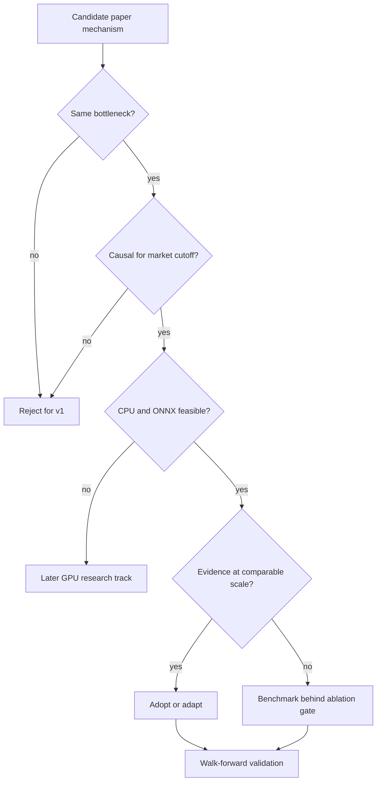

A reported result is not portable merely because both systems use matrices. Kimi Linear evaluates
128K-to-1M-token language contexts [R10]. DeepSeek MLA targets autoregressive KV-cache width, and
DeepSeek MLA/MoE results span multi-billion through hundreds-of-billions parameter models [R05]-[R07]. CHMT-Q has at most 64 tokens
in any temporal branch, 184 memory tokens, fixed five-query decoding, no token-by-token generation,
and a CPU/ONNX serving target. These are different bottlenecks.

### 2.3 Literature decision matrix

| Source family | Mechanism | Decision | Exact reason |
|---|---|---|---|
| Transformer [R01] | Scaled dot-product attention | Adopt | Exact content-addressed recall is inexpensive at 60-64 tokens |
| Relative positions [R02] | Pairwise relative bias | Adapt | Use actual elapsed seconds rather than token distance |
| RMSNorm [R03] | Root-mean-square pre-normalization | Adopt | Stable, simple, and ONNX-expressible |
| GLU variants [R04] | SwiGLU feed-forward | Adopt | Strong Transformer FFN default at the existing parameter budget |
| DeepSeek-V2/V3 [R05]-[R07] | MLA and MoE | Reject v1 | Solves KV cache and giant-model capacity, neither present here |
| Multi-token prediction [R08] | Auxiliary future-depth supervision | Adapt | Apply an auxiliary head to intermediate horizon states; never input future targets |
| NSA/DSA [R09] | Hardware-aligned sparse attention | Reject v1 | Specialized long-context kernels; more machinery than all dense attention here |
| Kimi Linear [R10] | KDA plus periodic MLA | Benchmark later | Fixed recurrent state helps very long streams, not a 60-token baseline |
| Gated DeltaNet [R11] | Forgetful delta-rule memory | First recurrent benchmark | Simpler than KDA if raw event context grows into thousands |
| PatchTST [R12] | Patching | Adapt | Four causal micro-frames per patch reduce temporal cost; noise reduction remains an ablation question |
| iTransformer [R13] | Variate tokens | Partial adapt | Use grouped feature projections; do not destroy book side/rank geometry |
| TFT [R14] | Gating and direct quantiles | Adapt | Quality-aware fusion and multi-horizon uncertainty fit the output contract |
| RevIN [R15] | Per-instance reversible normalization | Reject live v1 | Input-window centering may erase absolute regimes; masked irregular statistics require a dedicated ablation |
| DLinear [R16] | Linear decomposition baseline | Adopt as baseline | Any complex model must beat it |
| TimesNet [R17] | Periodic 2-D variation | Benchmark baseline | Useful only if stable periodic structure survives session-aware testing |
| DeepLOB/TLOB [R18]-[R21] | Local LOB structure plus temporal/feature processing | Adopt principle | Convergent evidence motivates, but does not prove, CHMT-Q's exact rank-first hierarchy |
| Mamba [R22] | Selective state-space sequence model | Benchmark later | Valuable only when measured context makes quadratic attention material |
| Transformer-Squared [R23] | Runtime singular-value expert adaptation | Offline idea only | Two-pass weight mutation complicates determinism, quantization, and audit |
| Evolutionary merging [R24] | Search over task-vector and data-flow merges | Offline idea only | CHMT-Q would restrict the selected task-vector route to same-base experts; no role in v1 |
| Muon [R25] | Orthogonalized matrix updates | Later optimizer A/B | Training-only benefit is unproven for a two-million-parameter numeric model |

---

## 3. Final architecture: CHMT-Q v1

CHMT-Q is hierarchical because the three inputs have different native geometry:

- bars are slow, regular, and already aggregated;
- L1 is a fast one-dimensional quote process with gaps and carry-forward state;
- L2 is a fast process whose individual observation is itself a structured two-sided ranked set.

Flattening them into one sequence would make side/rank semantics implicit, magnify padding, and allow
the largest modality to dominate. Collapsing each modality to one vector would erase useful temporal
evidence. Independent encoders plus gated memory retain both structure and traceability.

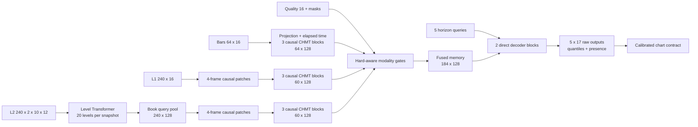

### 3.1 Fixed dimensions

| Component | Value |
|---|---:|
| Main width `d` | 128 |
| Main attention heads `n_h` | 4 |
| Main head width `d_h` | 32 |
| Main SwiGLU hidden width `d_ff` | 256 |
| L2 level width | 32 |
| L2 level heads / head width | 4 / 8 |
| L2 level SwiGLU width | 64 |
| Bar temporal blocks | 3 |
| L1 temporal blocks | 3 |
| L2 temporal blocks | 3 |
| L2 per-snapshot blocks | 1 |
| Decoder blocks | 2 |
| Microstructure patch | 4 frames x 500 ms = 2 s |
| Historical memory | 64 + 60 + 60 = 184 tokens |
| Horizon queries | 5 |
| Raw outputs per horizon | 17 |
| Dropout | 0.10 during training, disabled at inference |
| Exact designed parameter count | 2,089,554 |

### 3.2 End-to-end shape trace

| Stage | Bars | L1 | L2 | Quality / decoder |
|---|---:|---:|---:|---:|
| External tensor | `[B,64,16]` | `[B,240,16]` | `[B,240,2,10,12]` | `[B,16]` |
| Initial projection | `[B,64,128]` | `[B,240,128]` | `[B*240,20,32]` | `[B,128]` |
| Structural encoding | unchanged | unchanged | `[B,240,128]` | gates `[B,3]` |
| Causal patching | unchanged | `[B,60,128]` | `[B,60,128]` | context `[B,128]` |
| Temporal encoding | `[B,64,128]` | `[B,60,128]` | `[B,60,128]` | memory `[B,184,128]` |
| Direct decoding | - | - | - | queries `[B,5,128]` |
| Raw head | - | - | - | `[B,5,17]` |
| Stable median contract | - | - | - | `[B,5,5]` plus intervals/presence |

### 3.3 Why full attention wins at this scale

The total temporal score matrix per layer and head is small:

$$
64^2 + 60^2 + 60^2 = 11{,}296\text{ scores}.
$$

Across three layers and four heads, all three encoders materialize only:

$$
3 \times 4 \times 11{,}296 = 135{,}552\text{ temporal scores}.
$$

Two decoder cross-attention layers add only:

$$
2 \times 4 \times 5 \times 184 = 7{,}360\text{ scores}.
$$

Replacing this with a sparse indexer, recurrent scan, or compressed KV latent introduces operators,
state, and approximation risk while eliminating a cost that is already tiny. The expensive portion is
the dense projection/FFN work and the repeated per-snapshot L2 level encoder, not temporal score
storage. Complexity must be optimized from measured profiles, not from asymptotic slogans.

---

## 4. Numeric tensor contract

Training supports arbitrary batch `B`. Export fixes batch one. Every model input is float32 numeric
data or a boolean validity mask; no strings, text tokens, identifiers, timestamps, or enums cross the
ONNX boundary.

| Input | Training shape | ONNX shape | Meaning |
|---|---:|---:|---|
| `bars` | `[B,64,16]` | `[1,64,16]` | 64 consecutive one-minute slots, oldest first |
| `bars_mask` | `[B,64]` | `[1,64]` | eligible finalized slot |
| `l1` | `[B,240,16]` | `[1,240,16]` | 120 s half-second quote grid |
| `l1_mask` | `[B,240]` | `[1,240]` | accepted and fresh L1 observation |
| `l2` | `[B,240,2,10,12]` | `[1,240,2,10,12]` | half-second bid/ask top-ten book grid |
| `l2_level_mask` | `[B,240,2,10]` | `[1,240,2,10]` | valid level slots |
| `l2_snapshot_mask` | `[B,240]` | `[1,240]` | accepted snapshot with at least one valid level |
| `quality` | `[B,16]` | `[1,16]` | causal coverage, carry, gaps, and anchor quality |

The exported raw output is `[1,5,17]`. Host reconstruction exposes medians and lower/upper intervals
for the five primitive marginals, buy/sell presence probabilities, a plug-in raw-delta point diagnostic
(never a derived raw-delta interval), and an overall quality/abstention state. Invalid input rows are
numerically zero after normalization, but zero never means valid; masks remain authoritative.

### 4.1 Bar features

| Index | Field | Causal definition |
|---:|---|---|
| 0-3 | open/high/low/close offsets | ticks from the previous valid close |
| 4 | log return | `log(close / previous_close)` for positive prices |
| 5-8 | range/body/upper/lower wick | tick distances |
| 9 | close location | `(close-low)/max(high-low,q)` |
| 10 | log volume | `log(1+volume)` |
| 11 | log-volume EMA residual | value minus trailing causal EMA |
| 12 | availability age | `max(0,c-AvailableTimeUtc)` in seconds |
| 13 | preceding missing slots | `log(1+min(g,63))/log(64)` for consecutive missing-slot count `g` |
| 14-15 | session phase | sine/cosine of versioned exchange-session progress |

The axis is a clock grid, not “the last 64 non-empty bars.” The compiler retains one eligible earlier
close only to calculate the oldest token's return; it is not a hidden 65th input.

### 4.2 L1 features

All price offsets use the cutoff reference price. Fields are midpoint offset/change, spread, log bid
and ask size, size imbalance, microprice offset, bid/ask changes, signed log-size changes defined as
`log(1+size_t)-log(1+size_previous)`, observation age, event-to-availability lag, normalized sequence-gap
magnitude `min(missing_sequence_count,16)/16`, carry-forward flag, and approximate-time flag. Crossed,
non-positive, stale, or causally unavailable books are masked and counted in quality.

### 4.3 L2 level features

Each side/rank row contains signed distance from a fresh grid-time midpoint, better-level gap, log size,
log cumulative size, local and cumulative side share, paired-rank imbalance, snapshot age,
event-to-availability lag, sequence gap, carry-forward flag, and approximate-time flag. Bid/ask side
and rank 0-9 use learned **internal** embeddings over fixed axes; the market pipeline does not supply
arbitrary integer token IDs.

The nested mask invariant is mandatory:

$$
m^{\mathrm{snapshot}}_{t} = m^{\mathrm{accepted\_and\_fresh}}_t \land
\bigvee_{s,r} m^{\mathrm{level}}_{t,s,r}.
$$

A true snapshot with every level false is invalid input. A one-sided book can keep eligible levels on
one side while masking the other, with an explicit quality signal.

### 4.4 Quality vector

The 16 values are valid fractions for bars/L1/L2 snapshots/L2 levels; L1/L2 carried fractions;
approximate-time fractions; quote/depth sequence-gap rates; late-bar fraction; out-of-order rate;
one-sided and crossed/rejected rates; anchor-from-L1 flag; and normalized session progress. Every rate
uses only observations available by the cutoff and the corresponding compiled input window: 64 bar
slots or 240 L1/L2 slots. Event-rate denominators count eligible events in that window; an empty
denominator yields zero together with the separate hard-availability fact, never a fabricated valid
observation.

---

## 5. Causal feature compiler

Most catastrophic market-ML failures occur before the first matrix multiplication. The compiler is
therefore a versioned, testable component with the same importance as the model.

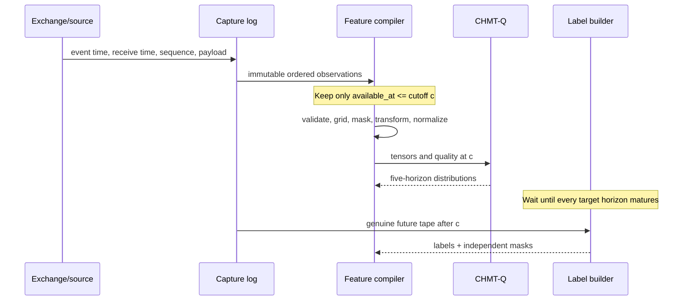

### 5.1 Clock and identity rules

Every capture row carries source, venue, instrument, feed epoch, native sequence when available,
event time, receive time, normalized availability time, and a payload checksum. Processing order is
deterministic: availability time, event time, feed epoch, stable stream rank, native sequence within
that epoch/stream, then payload identity as the final tie-break. A sequence from one stream is never
treated as globally comparable with another. The compiler never sorts solely by exchange event time
because late or corrected messages could then appear earlier than they were knowable.

Session schedules, tick sizes, contract rolls, trading halts, daylight-saving changes, and symbol
mapping are versioned reference data. A continuous contract must not splice price levels without an
explicit roll transform and a split boundary. Instrument identity never enters the model as an
uncontrolled string; either train a homogeneous model or use a fixed numeric instrument embedding
whose unseen-instrument behavior is defined.

### 5.2 Resampling without future fill

The 500 ms L1/L2 grids are sampled as-of each grid timestamp from observations already available at
that timestamp. Forward carry is allowed only while the source-specific freshness limit holds. It is
recorded in both row features and the quality vector. Back-filling from the first later observation is
forbidden. Clock slots remain present even when invalid so the age geometry is stable.

For grid time `g_j`, the selected observation index is:

$$
i^*(j)=\arg\max_i\left\{t^{\mathrm{available}}_i:
t^{\mathrm{available}}_i\le g_j\right\},
$$

subject to epoch continuity, sequence policy, acceptance checks, and maximum age. If that set is
empty or the chosen observation is stale, the row is masked.

### 5.3 Training-fold normalization

The default is robust fixed normalization fitted on valid values from the training partition only:

$$
z = \operatorname{clip}\!\left(
\frac{x-\operatorname{median}_{\mathrm{train}}(x)}
{1.4826\operatorname{MAD}_{\mathrm{train}}(x)+\epsilon},-8,8\right).
$$

If MAD degenerates, a versioned minimum scale applies. Bounded fractions, masks, and binary flags use
identity scaling. Invalid rows are zeroed **after** normalization. Target normalization is separately
fitted per horizon and target, excluding invalid labels, and inverted by the export wrapper.

RevIN [R15] is not in the v1 path. A past-window-only robust reversible variant may be tested, but it
must retain the removed level/scale as input features and must never pool future, batch-peer, masked,
or cross-instrument values. Absolute spread, depth, and volatility regimes can be predictive; blindly
normalizing them away is not invariance.

### 5.4 Leakage assertions

For every sample, automated tests establish:

$$
\max_i t^{\mathrm{available}}_i \le c
< \min_h t^{\mathrm{target\_open}}_h.
$$

They also establish that scaler-fit rows precede the evaluation partition, every bar was finalized by
cutoff, carried observations respect freshness limits, no target trade contributes to a feature, and
no sample crosses a session/roll/gap boundary prohibited by policy. Tests inject deliberately late,
out-of-order, missing, crossed, one-sided, and epoch-reset messages and expect masks or rejection.

### 5.5 Label construction

For each future interval `[open_h, close_h)`, the label builder selects eligible genuine trades,
classifies aggressor side with a versioned rule, buckets prices by instrument tick, and aggregates
total/buy/sell volume. POC is the highest-volume bucket; a deterministic tie chooses the higher price.
The exact tie and rounding convention must match chart semantics.

TapeCompletenessPolicy must prove continuity for the interval plus grace. It reconciles feed epoch,
sequence gaps, connection/subscription state, capture drops, writer drops, heartbeats, and session
coverage. When completeness cannot be proven, all dependent labels are masked even if no trade was
observed.

---

## 6. Numeric time, modality, side, and rank encoding

Text Transformers learn token positions because word sequences have no physical clock. Market
observations do. CHMT-Q uses actual elapsed seconds and preserves logical axes.

### 6.1 Continuous elapsed-time features

For nonnegative age `a` and fixed scales `tau_k`, define:

$$
\phi(a)=\left[
\frac{a}{a_{\max}},
\frac{\log(1+a)}{\log(1+a_{\max})},
\sin(a/\tau_1),\cos(a/\tau_1),\ldots,
\sin(a/\tau_K),\cos(a/\tau_K)
\right].
$$

Bars use `K=7`, scales 60, 120, 240, 480, 960, 1920, and 3840 seconds. Patched L1/L2 use `K=8`,
scales 0.5, 1, 2, 4, 8, 16, 32, and 64 seconds. The time MLP is:

$$
e_t(a)=W_2\operatorname{SiLU}(W_1\phi(a)+b_1)+b_2.
$$

Bar ages are fixed slot-close ages 3780 through 0 seconds. Patch ages are the 60 patch-end ages 118
through 0 seconds. Row-level observation age and availability lag remain input features; they describe
data freshness and do not replace logical token time.

### 6.2 Learned structural embeddings

A learned modality vector is added to every bar, L1, or L2 temporal token. The L2 level encoder also
adds fixed-axis lookup vectors for side and rank:

$$
x_{t,s,r}^{(0)}=W_{\mathrm{level}}z_{t,s,r}+e^{\mathrm{side}}_s+
e^{\mathrm{rank}}_r.
$$

The indices are compile-time axes, not market-supplied categorical IDs. This distinction prevents an
arbitrary numeric rank value from being treated as a meaningful continuous distance.

### 6.3 Relative elapsed-time bias

Temporal head `j` learns nonnegative decay `softplus(gamma_j)`. For a query at logical time `t_i` and
an eligible past key at `t_l`:

$$
b^{(j)}_{i,l}=-\operatorname{softplus}(\gamma_j)
\log\!\left(1+\frac{t_i-t_l}{s_m}\right), \qquad t_l\le t_i.
$$

`s_m` is 60 seconds for bars and 2 seconds for L1/L2 patches. This is a learnable recency prior, not a
hard exponential decay; content can still retrieve an older state. Causal and validity masks are
separate.

---

## 7. The custom CHMT attention block

No framework Transformer, `MultiheadAttention`, fused attention API, tokenizer, or third-party block
defines the reference path. The architecture is implemented from linear projections, reshape,
matrix multiplication, masks, softmax, pointwise functions, reductions, and residual addition. This
makes the math, mask behavior, and ONNX graph reviewable.

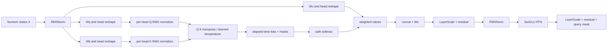

### 7.1 RMSNorm

For width `d`, gain `g`, and epsilon `eps`:

$$
\operatorname{RMSNorm}(x)=g\odot
\frac{x}{\sqrt{d^{-1}\sum_{k=1}^{d}x_k^2+\epsilon}}.
$$

RMSNorm removes the mean-subtraction step of LayerNorm while retaining scale control [R03]. All
reductions and accumulations use at least float32 in the reference implementation.

### 7.2 Q/K-normalized multi-head attention

For normalized input `U`, head `j`, and head width `d_h`:

$$
Q_j=UW^Q_j,\quad K_j=MW^K_j,\quad V_j=MW^V_j,
$$

where `M=U` in self-attention and `M` is fused memory in cross-attention. Normalize each query/key
vector without learned dimensions:

$$
\bar q=\frac{q}{\sqrt{d_h^{-1}\|q\|_2^2+\epsilon}},\qquad
\bar k=\frac{k}{\sqrt{d_h^{-1}\|k\|_2^2+\epsilon}}.
$$

Each head has a learned log temperature `theta_j`, initialized so the denominator equals
`sqrt(d_h)`. Scores are:

$$
s^{(j)}_{i,l}=e^{\theta_j}\frac{\bar q^{(j)}_i\cdot
\bar k^{(j)}_l}{\sqrt{d_h}}+b^{(j)}_{i,l}+g^{(m(l))}+\mathcal{M}_{i,l}.
$$

`b` is optional elapsed-time bias; `g` is optional log modality-gate bias in decoder cross-attention;
and `M` is zero for an eligible pair and a large negative finite constant otherwise.

Q/K normalization bounds score growth and makes the temperature explicit. It avoids adopting
MuonClip's LLM-scale threshold [R28] without evidence. Training still logs maximum logits per head;
non-finite or runaway logits fail the run.

### 7.3 Safe masked softmax

Naive softmax over an all-masked key row can emit NaN. Let `a_i` indicate whether query row `i` has
any eligible key. For a row with at least one eligible key, define
`s_i^max=max_(l:m_i,l=1) s_i,l` and `r_i,l=m_i,l exp(s_i,l-s_i^max)`:

$$
a_i=\bigvee_l m_{i,l},\qquad
p_{i,l}=\begin{cases}
r_{i,l}/\sum_k r_{i,k},&a_i=1,\\
0,&a_i=0.
\end{cases}
$$

The maximum is evaluated only on eligible keys; the explicit zero-row branch handles an all-masked
row. The context and final residual state are zeroed for invalid queries. Tests cover all-valid,
partially-masked, all-key-masked, invalid-query, and mixed-batch cases. Masked keys must receive
exactly zero probability within the comparison tolerance.

### 7.4 Attention output

$$
A_j=\operatorname{SafeSoftmax}(S_j),\qquad
O=\operatorname{Concat}_j(A_jV_j)W^O+b^O.
$$

Dropout applies to attention weights and projected residual branches during training only.

### 7.5 SwiGLU feed-forward network

$$
\operatorname{FFN}(x)=W_o\left[
\operatorname{SiLU}(W_gx+b_g)\odot(W_ux+b_u)
\right]+b_o.
$$

The main block maps `128 -> 256 -> 128`; the level block maps `32 -> 64 -> 32`. SwiGLU is selected
from the GLU-variant evidence [R04] and costs the same order as the previous GEGLU proposal.

### 7.6 Pre-norm residual with LayerScale

For learned vectors `lambda_a` and `lambda_f`, initialized to `0.1`:

$$
u=x+\lambda_a\odot\operatorname{Dropout}(\operatorname{Attention}(\operatorname{RMSNorm}(x))),
$$

$$
z=u+\lambda_f\odot\operatorname{Dropout}(\operatorname{FFN}(\operatorname{RMSNorm}(u))).
$$

Finally `z` is multiplied by the query-validity mask. LayerScale supplies an inspectable residual
gain and helps the small network begin near an identity mapping. Its value is trainable; it is not a
runtime confidence score.

---

## 8. The three causal encoders

### 8.1 Bar encoder

Each normalized 16-field bar row is projected to width 128, receives bar modality and elapsed-time
embeddings, is zeroed when invalid, and passes through three causal CHMT blocks. The output retains all
64 states rather than pooling to one regime vector.

The triangular mask is necessary even though the final forecast sees an entirely historical window.
It lets intermediate bar states represent only their own prefix, supports auxiliary causal tasks, and
prevents future-within-window information from leaking if states are reused for sequence training.
The final query may still retrieve any historical bar state through decoder cross-attention.

### 8.2 L1 causal patch encoder

L1 rows are first projected to width 128. Four consecutive half-second frames form one non-overlapping
two-second patch. A learned static within-patch offset vector is added to each of the four rows. Scores
come from a small masked pooling MLP:

$$
r_j=w_2^\top\tanh(W_1x_j+b_1)+b_2,\qquad j\in\{0,1,2,3\},
$$

$$
\pi_j=\operatorname{SafeSoftmax}_j(r_j;m_j),\qquad
p=\sum_{j=0}^{3}\pi_jx_j.
$$

An all-invalid patch returns zero and false. The patch receives its endpoint time embedding and L1
modality vector, then passes through three causal CHMT blocks. Patching is inspired by PatchTST [R12],
but strict channel independence is rejected because spread, prices, sizes, imbalance, and freshness
interact physically.

Non-overlapping patches are chosen for deterministic low latency and a fixed 60-token contract. An
overlapping stride-two variant is a registered ablation, not a silent tuning option.

### 8.3 Hierarchical L2 encoder

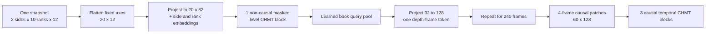

Within a single accepted snapshot, bid/ask ranks coexist at the same logical time, so the level block
uses a validity mask but no causal triangle. It captures cross-side imbalance, local gaps, cumulative
shape, and rank interactions. A learned query pools eligible level states:

$$
a_{s,r}=\operatorname{SafeSoftmax}_{s,r}\left(
\frac{q_{\mathrm{book}}^\top\operatorname{RMSNorm}(x_{s,r})}{\sqrt{32}};
m_{s,r}\right),
$$

$$
d_t=W_d\sum_{s,r}a_{s,r}x_{t,s,r}+b_d\in\mathbb{R}^{128}.
$$

The 240 depth-frame tokens then use the same four-frame patch mechanism and three temporal CHMT
blocks as L1, with independent weights.

This hierarchy is essential. Flattening 240 snapshots times 20 levels would create 4,800 temporal
tokens and approximately 23 million score entries per head per layer. More importantly, it would make
temporal order compete with same-snapshot price-rank geometry. DeepLOB, TransLOB, and TLOB all support
the principle that spatial/feature structure and temporal evolution deserve distinct processing
[R18]-[R20].

### 8.4 Why no convolution in the selected v1

DeepLOB's convolutional stem is a mandatory baseline and a strong optional ablation. CHMT-Q itself
uses level attention because missing ranks, one-sided books, and explicit side/rank masks are easier to
represent without pretending every ladder cell is present. If a shallow depthwise causal convolution
or DeepLOB-like stem wins on the same folds without harming ONNX parity, it may be added in v1.1; it is
not required to call the current design a custom Transformer.

---

## 9. Quality-aware fusion

The latest valid state from each causal encoder summarizes that modality's prefix. Let these be `s_b`,
`s_1`, and `s_2`; let `c_q` be the quality MLP output; and let `a_m` be a hard indicator that modality
`m` contains at least one valid token.

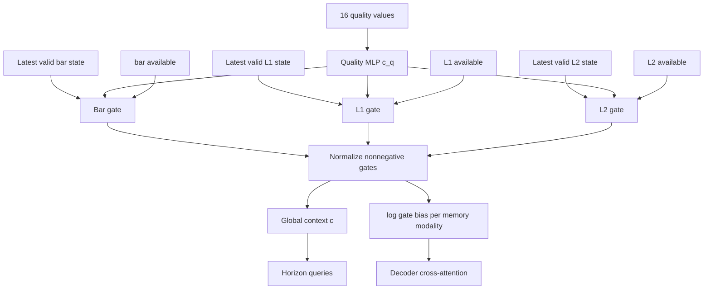

Each modality has an independent two-layer gate:

$$
\tilde g_m=a_m\,\sigma\!\left(w_{m,2}^{\top}
\operatorname{SiLU}(W_{m,1}[s_m;c_q]+b_{m,1})+b_{m,2}\right),
$$

$$
\alpha_m=\frac{\tilde g_m}{\sum_n\tilde g_n+\epsilon},\qquad
c=\operatorname{RMSNorm}\!\left(c_q+\sum_m\alpha_ms_m\right).
$$

The historical memory is the concatenation of all encoded token sequences:

$$
M=[M_{\mathrm{bar}};M_{\mathrm{L1}};M_{\mathrm{L2}}]
\in\mathbb{R}^{B\times184\times128}.
$$

The gate does not multiply memory values a second time. Instead, decoder score entries receive
`log(alpha_m + epsilon)` according to the key's modality. This shifts attention probability without
erasing content magnitude. Hard invalid branches have false key masks and cannot be resurrected by a
learned gate. If every modality is invalid, the host abstains before model execution.

The gates are reliability routing, not interpretation. Their values can be logged, but they do not
prove feature causality or explain a forecast. Permutation, ablation, counterfactual data-quality, and
stability tests are needed for diagnostic claims.

---

## 10. Direct five-horizon decoder

CHMT-Q predicts all horizons simultaneously. It does not generate horizon 2 from its prediction for
horizon 1. That avoids teacher-forcing mismatch, error propagation, and five serial inference steps.

For horizon index `h` and interval seconds `Delta`, construct:

$$
q_h^{(0)}=e_h+W_c c+\operatorname{HorizonMLP}
\left[h/5,\log(1+h),h\Delta\right].
$$

Five learned base queries `e_h` distinguish horizons; the numeric features preserve distance. Each of
two decoder blocks performs pre-RMSNorm horizon self-attention, cross-attention to all valid historical
memory, and a SwiGLU FFN, each with its own LayerScale residual.

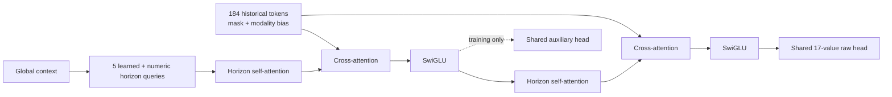

Horizon self-attention has no causal triangle because all five queries represent forecasts made at
the same cutoff. It learns coherent term structure; it does not reveal future observations.

### 10.1 MTP-inspired deep supervision

DeepSeek-V3 multi-token prediction supplies the next target-token embedding to an auxiliary sequential
module during language-model training [R07]. Gloeckle et al. instead use independent heads to predict
several future tokens in parallel from the same causal past representation, without future-token input
[R08]. CHMT-Q follows the latter information boundary but makes an original deep-supervision
adaptation: it applies the **same output head** to the first decoder block's five states and adds a
lower-weight auxiliary loss. The deployable input graph remains unchanged, and the auxiliary output
is discarded at inference.

This is conceptual adaptation, not a claim that CHMT-Q implements DeepSeek MTP. It encourages useful
multi-horizon states earlier in the network while preserving strict causality.

---

## 11. Monotone probabilistic output

One point forecast hides uncertainty and encourages false precision on a chart. CHMT-Q emits three
ordered marginal quantiles for each target plus explicit buy/sell-presence logits.

For target `k`, the raw head supplies center `c`, lower gap logit `a`, and upper gap logit `b`:

$$
\widehat Q_{0.50}=c,\qquad
\widehat Q_{0.10}=c-\operatorname{softplus}(a),\qquad
\widehat Q_{0.90}=c+\operatorname{softplus}(b).
$$

This guarantees `Q_0.10 <= Q_0.50 <= Q_0.90` before numerical tolerance. For delta fraction, apply
the monotone `tanh` function to all three ordered values. Price and log-volume targets are inverse-
normalized by frozen training statistics. The 17 raw outputs per horizon are:

| Positions | Meaning |
|---:|---|
| 0-14 | three raw quantile parameters for each of five targets |
| 15 | buy-POC presence logit |
| 16 | sell-POC presence logit |

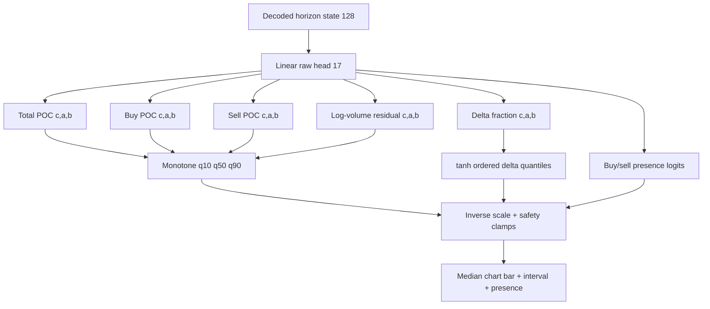

### 11.1 Runtime reconstruction

After finite checks, inverse target scaling, and the monotone delta-fraction transform:

$$
\widehat P=p_{\mathrm{ref}}+q\widehat y_{\mathrm{POC}},\qquad
\widehat V=\max\!\left(0,\exp(\ell_{\mathrm{ref}}+\widehat y_V)-1\right),
$$

$$
\widehat f_D=\tanh(\widehat y_D),\qquad
\widetilde D=\widehat V_{0.50}\widehat f_{D,0.50}.
$$

The inverse transform is applied separately to each primitive marginal quantile. POC values are snapped
to the instrument tick only afterward. Every primitive quantile is checked for finite values, order,
volume nonnegativity, and bounded delta fraction; the plug-in point diagnostic must satisfy
`|D_tilde| <= V_hat_0.50`. Buy/sell POC is omitted when its calibrated presence probability is below
the frozen threshold. A violation rejects the entire five-horizon result; partial corrupted output
never reaches the chart.

### 11.2 What these quantiles do not mean

The five horizons are marginal distributions, not a coherent joint price/volume path. The 80% interval
does not mean that all five values or all five horizons jointly fall inside their intervals 80% of the
time. Multiplying separately calibrated volume and delta-fraction quantiles does not produce raw-delta
quantiles and can reverse endpoints when the fraction is negative. `D_tilde` is therefore only a plug-in
point diagnostic; v1 exposes no claimed raw-delta interval. If downstream simulation requires derived
distributions or joint paths, it needs a directly supervised target, conditional copula, or sample
decoder evaluated with proper multivariate scores. Those are intentionally outside v1.

This direct marginal design is closer to MQTransformer's horizon-specific quantiles [R37] than to
DeepAR's autoregressive sample paths [R36]. Pinball loss is a proper quantile score; model comparisons
must preserve that property rather than selecting visually narrow intervals [R38].

---

## 12. Training objective

### 12.1 Pinball loss

For quantile level `tau`, error `u=y-q`, and prediction `q`:

$$
\rho_{\tau}(u)=\max(\tau u,(\tau-1)u).
$$

With horizon weights `w_h=1/sqrt(h)`, target weights `v=(1,1,1,0.5,0.5)`, quantile set
`T={0.1,0.5,0.9}`, and independent mask `m_bhk`, the normalized forecast loss is:

$$
\mathcal{L}_{Q}=
\frac{\sum_{b,h,k,\tau}m_{b,h,k}w_hv_k
\rho_{\tau}(y_{b,h,k}-\widehat Q_{b,h,k,\tau})}
{\sum_{b,h,k,\tau}m_{b,h,k}w_hv_k+\epsilon}.
$$

### 12.2 Median Huber stabilization

For residual `r` and threshold `delta=1` in normalized target units:

$$
\operatorname{Huber}_{\delta}(r)=
\begin{cases}
\tfrac12r^2,&|r|\le\delta,\\
\delta(|r|-\tfrac12\delta),&|r|>\delta.
\end{cases}
$$

The masked, weighted median loss `L_H` uses `r=y-Q_0.50`. It supplies smooth local gradients while
pinball loss remains the proper quantile objective.

### 12.3 Presence loss

Buy and sell presence are known only when interval tape continuity and classification coverage pass.
For label `r` and logit `z`, use numerically stable binary cross-entropy:

$$
\mathcal{L}_{P}=\operatorname{mean}_{\mathrm{valid}}
\left(\max(z,0)-zr+\log(1+e^{-|z|})\right).
$$

Class-balanced sampling or positive weights may be used only if derived inside each training fold and
recorded in the run configuration. Thresholds are selected on calibration data for the declared cost,
never on the outer test.

### 12.4 Total loss

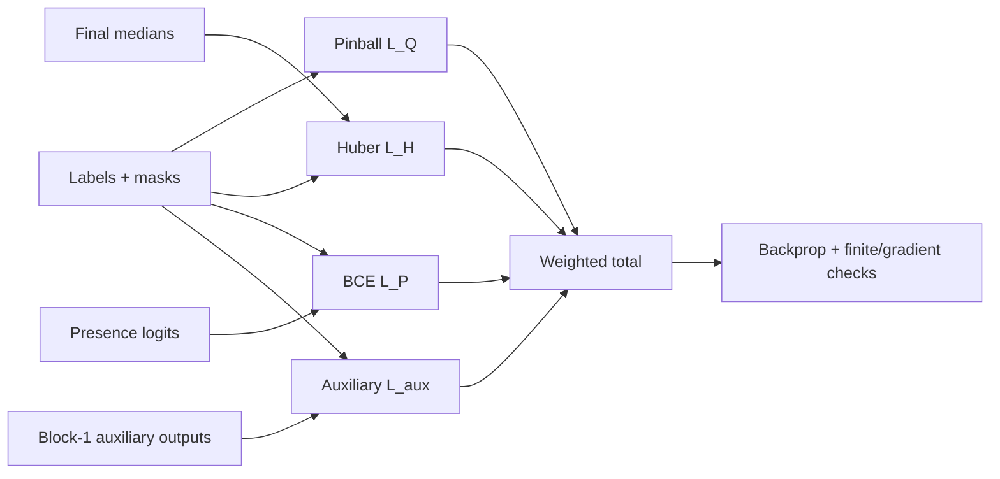

The baseline objective is:

$$
\mathcal{L}=\mathcal{L}_Q+0.25\mathcal{L}_H+0.20\mathcal{L}_P+
\lambda_{\mathrm{aux}}\mathcal{L}_{\mathrm{aux}}.
$$

`L_aux` repeats the quantile, Huber, and presence objective on decoder block 1. Set
`lambda_aux=0.25` for the first 60% of optimizer steps, linearly decay it to `0.05` by 90%, and hold
there. These coefficients are hypotheses frozen before a fold, not universal constants. The ablation
must compare `lambda_aux=0`.

No loss term directly optimizes backtest PnL in v1. PnL objectives are unstable, policy-dependent, and
easy to exploit through turnover or exposure. Proper forecast scores train the model; a separate,
frozen policy evaluates economic usefulness.

### 12.5 Optional causal auxiliary tasks

Only after the supervised baseline is stable, training may add discarded heads for next-bar return,
next L1 spread/imbalance change, or next L2 shape change. Their inputs are historical states and their
labels begin after each state's local cutoff. They may improve representation learning on abundant
unlabeled capture, but they require separate leakage tests and an ablation. Random bidirectional mask
reconstruction is not the default because it teaches a representation with access patterns unavailable
at inference.

---

## 13. Exact parameter and compute ledger

The parameter count below follows the stated biased linear layers, learned embeddings, RMSNorm gains,
two 128-element LayerScale vectors per encoder block, three per decoder block, and one learned Q/K
temperature per attention head. It is a design ledger; the implementation must assert equality.

| Component | Parameters |
|---|---:|
| Bar, L1, and level projections | 4,768 |
| Quality MLP | 18,688 |
| Bar time MLP | 4,768 |
| L1 patch-time MLP | 4,832 |
| L2 patch-time MLP | 4,832 |
| Modality embeddings | 384 |
| L2 side/rank embeddings | 384 |
| L2 level CHMT block | 10,660 |
| Book query, pool norm, and 32-to-128 projection | 4,288 |
| L1/L2 within-patch embeddings and pool MLPs | 9,346 |
| Nine temporal CHMT blocks | 1,489,608 |
| Two decoder blocks | 463,632 |
| Three modality gate MLPs | 49,539 |
| Fusion norm and context projection | 16,640 |
| Horizon queries and horizon MLP | 4,992 |
| Shared 128-to-17 output head | 2,193 |
| **Total** | **2,089,554** |

The corrected total includes the 36 learned per-head temporal Q/K temperatures that the earlier
arithmetic omitted while already counting the independent 36 elapsed-time decay parameters.

FP32 weights occupy approximately 7.97 MiB before graph/container overhead. The packaging target is
below 12 MiB for the ONNX file and below 64 MiB incremental worker memory, both measured on the target
runtime.

Approximate batch-one work is about 160-180 million multiply-accumulates depending on how the exporter
fuses masked operations. The repeated 240-snapshot L2 level encoder and the nine FFNs dominate. The
full attention score operations do not. Acceptance uses measured p50/p95/p99 latency, not this estimate.

### 13.1 Why the model is not larger

Market labels are noisy, nonstationary, and expensive. A large network can memorize sessions,
instruments, and feed artifacts while improving random validation. Width 128 supplies four 32-wide
heads and enough capacity for three modalities; depth three supplies local-to-window abstraction;
two decoder layers supply horizon coordination. Scaling begins only after data-size curves show
underfitting on multiple chronological folds and a larger model wins net of latency and calibration.

### 13.2 Why the model is not smaller

The L2 branch must represent within-snapshot book geometry and temporal evolution separately. The
three encoders must not share weights because bar, quote, and depth distributions differ. A one-vector
fusion loses event chronology, and a single shared decoder cannot express horizon-specific retrieval.
The baseline suite determines whether this extra capacity is actually earned.

---

## 14. End-to-end training workflow

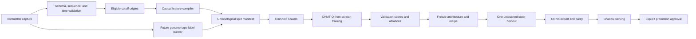

### 14.1 Stage 0: capture and provenance

Write append-only source events before building training examples. Record adapter/source version,
instrument metadata, session calendar version, capture host clock diagnostics, connection epochs,
native sequences, drops, and corrections. Hash immutable shards. Training manifests reference shard
hashes and row/time bounds; copying a mutable “latest” file is forbidden.

Licensing matters independently of engineering. The project must document whether stored L1/L2/tape
can be retained, transformed, used for model training, moved across machines, or embedded in derived
artifacts. A trained model is not automatically exempt from feed terms.

### 14.2 Stage 1: deterministic dataset build

For each eligible cutoff:

1. resolve instrument/session/tick metadata;
2. establish the exact decision boundary and reference price;
3. compile fixed bar, L1, L2, mask, and quality tensors from `F_c`;
4. wait until all five future intervals plus completeness grace have matured;
5. build each target and independent mask from genuine tape;
6. reject impossible nested masks, non-finite values, missing anchors, and prohibited boundaries;
7. write a versioned example shard plus a compact audit record containing source bounds and reasons;
8. reproduce a random sample from source events byte-for-byte before accepting the dataset.

The split manifest is generated before scaler fitting. Dataset code never chooses random row splits.

### 14.3 Stage 2: nested chronological development

Use an outer chronological holdout once, after architecture and hyperparameters are frozen. Inside the
earlier development period, use expanding walk-forward folds.

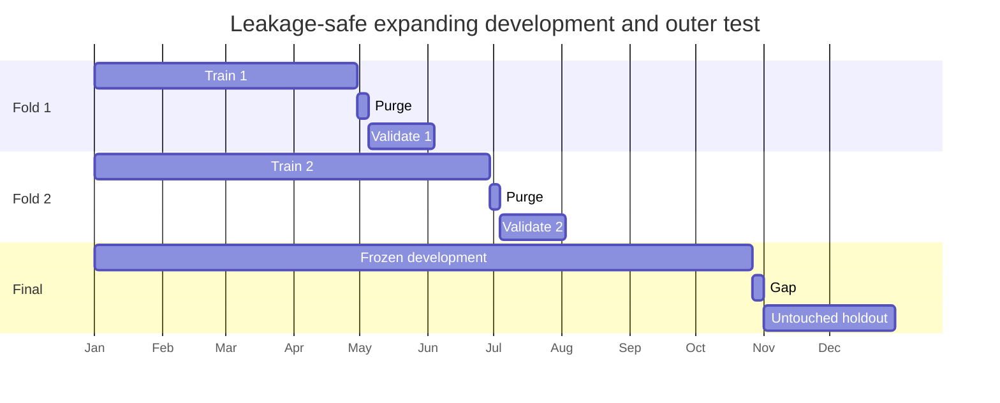

The dates above illustrate ordering, not a mandatory calendar. Actual boundaries align to complete
sessions and contract regimes. For an evaluation origin `c_v`, no training label may close after the
purge boundary. The minimum purge is maximum forecast horizon plus label grace and execution latency.
If the experiment requires disjoint raw input windows, add a lookback embargo as well.

All preprocessing choices—including missingness limits, clipping, target scaling, label thresholds,
calibration, and feature selection—are fitted inside the training side of each fold. The outer holdout
is never used for architecture selection, early stopping, calibration design, or a persuasive chart.

### 14.4 Stage 3: reference training recipe

The first recipe is intentionally conventional:

| Item | Initial value |
|---|---:|
| Optimizer | AdamW |
| `beta1`, `beta2`, `epsilon` | 0.9, 0.95, `1e-8` |
| Peak learning rate | `3e-4` |
| Weight decay | 0.05 on matrix weights; none on biases, norms, embeddings, LayerScale |
| Warm-up | 5% of optimizer steps |
| Decay | cosine to `3e-5` |
| Global gradient norm clip | 1.0 |
| Effective batch | 128 examples, using accumulation if required |
| Precision | bf16 activations where supported; FP32 norms, softmax, loss, optimizer master weights |
| Maximum epochs | 50 |
| Early stopping | 8 validations without primary-score improvement |
| Seeds | at least 17, 29, and 43 for final candidates |
| Checkpoint selection | weighted validation pinball, tie-broken by calibration and median MAE |

These are starting hypotheses. A learning-rate range test may be run entirely inside development data.
The final recipe and stopping rule are frozen before the outer holdout.

### 14.5 One optimizer step

1. Load examples without crossing their assigned chronological partition.
2. Validate shapes, dtypes, nested masks, and finite valid values.
3. Apply frozen training-fold normalization.
4. Optionally perform registered modality dropout while preserving at least one valid branch.
5. Run the CHMT-Q forward pass and auxiliary block-1 head.
6. Compute mask-normalized quantile, Huber, presence, and auxiliary losses.
7. Reject non-finite loss before backward.
8. Backpropagate, unscale mixed precision, and verify finite gradients.
9. Clip global gradient norm and take the AdamW step on accumulation boundary.
10. Advance the warm-up/cosine scheduler.
11. Log loss denominators, per-target/horizon terms, gradient/update norms, attention logits, gates,
    mask fractions, throughput, and memory.
12. Periodically run deterministic validation with dropout disabled.

No batch is silently skipped because a target is inconvenient. If a loss denominator is zero, that
specific term returns zero and records a zero-count metric. A batch with every supervised term absent
is rejected by the sampler or logged and skipped explicitly.

### 14.6 Sampling and augmentation

Uniform sampling over highly overlapping cutoffs can overrepresent long quiet sessions. The default
samples at a fixed decision cadence and caps examples per session/instrument. Optional training-only
weights may balance regimes defined from **past-only** volatility, spread, and liquidity; weights are
fitted in the fold and evaluation remains unweighted.

Safe optional augmentation is modality dropout: with a small registered probability, mask an
available modality and update quality consistently, never dropping all branches. It trains graceful
degradation but cannot simulate arbitrary feed faults. Price translation is already removed by tick
offsets. Time reversal, future-window cropping, random book-rank permutation, synthetic target noise,
and unverified bid/ask mirroring are prohibited defaults because they break market semantics.

### 14.7 Training from scratch

All trainable CHMT-Q parameters are initialized for this numeric task. No pretrained text model,
token embedding, vocabulary, or language checkpoint is loaded. Linear weights use variance-preserving
truncated normal or Xavier initialization appropriate to their fan-in; biases are zero; RMSNorm gains
are one; LayerScale is 0.1; output centers may initialize to training-target medians and interval gaps
to empirical central widths from training data only.

---

## 15. Evaluation and calibration

### 15.1 Required forecast metrics

Report every metric per target, horizon, instrument group, and fold before aggregating.

| Output | Primary metrics | Diagnostic metrics |
|---|---|---|
| POC offsets | pinball; median MAE in ticks | RMSE, within-1/2-tick rate, signed bias |
| Log volume / volume | pinball; log-space MAE | WAPE, RMSLE, extreme-volume slices |
| Delta fraction | pinball; MAE | sign accuracy, correlation, boundedness |
| Buy/sell presence | log loss; Brier score | precision/recall, PR-AUC, reliability/ECE |
| Intervals | empirical coverage and mean width | coverage-width curve, Winkler score, slice coverage |
| Whole model | weighted pinball versus baselines | latency, abstention, seed variance, drift sensitivity |

Quantile coverage is checked directly:

$$
\widehat{\operatorname{Cov}}_{0.8}=\frac1N\sum_i
\mathbf{1}\{\widehat Q_{0.1,i}\le y_i\le\widehat Q_{0.9,i}\}.
$$

Do not celebrate nominal coverage without interval width. A trivially wide interval is safe but
useless. Do not aggregate horizons before inspecting horizon-specific failures.

### 15.2 Baseline suite

At minimum, CHMT-Q competes with:

- last valid value / zero residual / seasonal same-session value;
- robust historical median and exponentially weighted residual forecasts;
- ridge and elastic-net direct multi-horizon regression;
- DLinear and NLinear [R16];
- gradient-boosted trees on the same causal summary features;
- logistic models for POC presence/direction;
- a causal TCN;
- a DeepLOB-like convolution plus LSTM/temporal head [R18]; and
- the existing point-estimate Transformer configuration.

Every baseline receives the same cutoffs, labels, masks, training partitions, and target transforms.
The point is not to make the baseline weak enough to beat.

### 15.3 Calibration

Quantile heads are not automatically calibrated. Fit conformal expansion on a dedicated chronological
calibration slice after model selection. For lower/upper quantiles `l_i,u_i` and target `y_i`, use
[R34]:

$$
e_i=\max(0,l_i-y_i,y_i-u_i).
$$

Let `q_e` be the finite-sample corrected empirical `(1-alpha)` quantile of calibration scores. Return
`[l-q_e,u+q_e]`, separately by target and horizon when sample size permits. Freeze `q_e` into the
candidate package before outer evaluation.

Financial data are not exchangeable. Therefore this is reported as **empirical rolling coverage**,
not an unconditional finite-sample guarantee. Adaptive conformal updates [R35] are a later shadow-only
experiment. Any online update must wait until the corresponding horizon label is complete and use a
separate delayed queue per horizon.

### 15.4 Slice and stress evaluation

Pre-register slices for session phase, volatility, spread, depth, trade intensity, missingness,
carried-data rate, sequence gaps, one-sided books, news/calendar windows, contract roll distance,
instrument, year/quarter, and source adapter version. Stress tests deliberately:

- remove one modality;
- age L1/L2 within and beyond accepted limits;
- introduce valid mask sparsity and long gaps;
- shift input scales to clipping boundaries;
- simulate crossed/one-sided books and sequence resets;
- replay high-volume bursts and empty-but-complete intervals;
- test cutoff timestamps around session open/close, halt, roll, and daylight-saving boundaries; and
- run bit-identical repeated inference under process restart.

### 15.5 Statistical uncertainty

Report three or more training seeds and block-bootstrap confidence intervals with sessions or days as
blocks, not individual overlapping examples. Compare loss differences against the best baseline per
block. A single lucky seed or a confidence interval spanning zero is not a robust architectural win.

### 15.6 Promotion gates

Before seeing the outer holdout, freeze numerical gates such as:

| Gate | Initial candidate threshold |
|---|---|
| Weighted pinball | at least 5% better than the best registered non-neural baseline |
| Horizon regressions | no target/horizon more than 2% worse without a documented trade-off |
| Nominal 80% interval | 76%-84% overall and at least 70% in each sufficiently populated critical slice |
| Seed stability | all three final seeds beat baseline; relative spread reported |
| ONNX parity | max absolute `1e-5` or relative `1e-4`, plus identical masks/presence decisions |
| Batch-one latency | warmed worker p95 at most 25 ms on the declared target CPU |
| Worker memory | incremental steady state below 64 MiB |
| Safety | zero non-finite accepted results and zero invariant violations in stress replay |

The numbers are proposals and must be reconciled with product latency and sample size. They may be
made stricter before holdout, never relaxed after seeing a disappointing holdout.

### 15.7 Economic evaluation is downstream

Freeze a simple forecast-to-action policy on development data, then test executable prices, fees,
slippage, latency, queue/fill assumptions, turnover, capacity, exposure, and drawdown. Report periods
with no trade and all rejected/abstained predictions. The LOB literature shows that high classification
scores need not align with forecast-implied entry/exit sequences and do not establish executable
profitability [R31]-[R33]. A chart forecast may still be useful without authorizing automated execution.

---

## 16. Ablation and scaling program

An ablation changes one registered factor, reuses identical folds/seeds/budgets, and reports forecast,
calibration, latency, and stability—not only the best run.

| Question | Baseline | Variant | Promotion condition |
|---|---|---|---|
| Does L2 help? | bars+L1 | bars+L1+L2 | consistent proper-score gain in liquid and thin slices |
| Is hierarchy necessary? | hierarchical 20-level snapshot | flattened/summary L2 | keep hierarchy unless simpler model is non-inferior and faster |
| Patch width | 4 frames | 2, 8, overlap stride 2 | better validation score within latency budget |
| Causal triangle | causal encoders | historical-window bidirectional | causal remains default unless deployment never reuses intermediate states and gain is robust |
| Time encoding | elapsed-time MLP+bias | ordinal position only / no bias | retain only measured gain |
| Quality fusion | hard+learned gates | hard mask only / concatenated quality token | gates must improve degraded-data behavior without hurting clean data |
| Block design | RMSNorm+QK norm+SwiGLU | LayerNorm/GEGLU/no QK norm | compare stability and score |
| Uncertainty | monotone quantiles | point Huber / unconstrained quantiles | quantiles must calibrate and not degrade median materially |
| Deep supervision | auxiliary loss | `lambda_aux=0` | keep only across seeds/folds |
| Local stem | attention-only L2 | DeepLOB-like conv / causal TCN stem | add only with parity and latency evidence |
| Optimizer | AdamW | Muon on matrices | equal data/FLOPs/seeds; better loss and stable logs |
| Long context | dense attention | Gated DeltaNet/KDA/Mamba | enter only after raw context exceeds threshold and attention profiles as bottleneck |

Scaling order is data first, then context, then width/depth. Build learning curves at 10%, 25%, 50%,
and 100% of development data. If loss continues to improve with data and train/validation are close,
collect more data. If both losses are high and larger width wins, test width 192 before adding exotic
routing. If attention is not a measured bottleneck, do not replace it.

---

## 17. DeepSeek research: what transfers and what does not

### 17.1 Multi-head latent attention

DeepSeek-V2 compresses autoregressive key/value state through a low-rank latent [R06]. In abbreviated
form:

$$
c_t^{KV}=W^{DKV}h_t,\quad
k_{t,i}^{C}=W_i^{UK}c_t^{KV},\quad
v_{t,i}^{C}=W_i^{UV}c_t^{KV},
$$

$$
k_{t,i}=[k_{t,i}^{C};\operatorname{RoPE}(W^{KR}h_t)],\qquad
o_{t,i}=\sum_{j\le t}\operatorname{softmax}_j
\left(\frac{q_{t,i}^{\top}k_{j,i}}{\sqrt{d_h+d_h^R}}\right)v_{j,i}^{C}.
$$

Only the compressed latent and rotary key component need be cached during token-by-token generation.
However, attention still sums over every past position. MLA reduces KV-cache width; it is neither
sparse nor linear in sequence length.

**Decision: reject for CHMT-Q v1.** The model produces five queries in one forward pass and has no
autoregressive KV cache. Its 184 memory tokens require only 7,360 decoder cross-attention scores. A
low-rank memory projection could discard small but important queue events while adding custom export
logic. Revisit MLA only if a future streaming decoder performs long autoregressive generation.

### 17.2 DeepSeekMoE and load balancing

DeepSeekMoE combines always-active shared experts with top-k routed experts [R05]:

$$
h'_t=u_t+\sum_{i=1}^{N_s}\operatorname{FFN}^{(s)}_i(u_t)+
\sum_{i=1}^{N_r}g_{i,t}\operatorname{FFN}^{(r)}_i(u_t).
$$

DeepSeek-V2 used 236B total/21B active parameters, and V3 used 671B total/37B active [R06]-[R07].
V3's auxiliary-loss-free controller adjusts expert-selection biases from historical load [R27]; it
still exists to keep enormous distributed expert fleets balanced.

**Decision: reject for v1.** A 2.09M dense model has no capacity or distributed-compute bottleneck.
Three tiny regime experts would duplicate parameters, produce data-starved routes, complicate ONNX,
and invite a gate to learn session or instrument artifacts. If dense scaling later saturates, compare
a supervised, causally routed small expert family against simple FiLM modulation and separate models.

### 17.3 Multi-token prediction

DeepSeek-V3 uses an auxiliary next-depth module and loss [R07]. The separate multi-token-prediction
paper predicts several future tokens in parallel from the same causal past representation, without
future-token input [R08]:

$$
\mathcal{L}_{\mathrm{MTP}}=\frac{\lambda}{D}
\sum_{k=1}^{D}\mathcal{L}^{k}_{\mathrm{future\ token}}.
$$

The DeepSeek-V3 language mechanism receives the embedding of a future token in its training-only
auxiliary path; the R08 parallel heads do not. CHMT-Q adopts only the shared principle of auxiliary
future supervision and supplies no future observation to either path.

**Decision: adapt the principle.** Apply the shared prediction head to the intermediate decoder layer
and supervise all five direct horizons. No future observation is supplied to the trunk or auxiliary
head. The ablation can remove it with zero inference graph change.

### 17.4 NSA and DSA

Native Sparse Attention mixes compressed, selected, and sliding-window branches [R09]:

$$
o_t=\sum_{c\in\{\mathrm{cmp,slc,win}\}}
g_t^c\operatorname{Attn}(q_t,\widetilde K_t^c,\widetilde V_t^c).
$$

Its published configuration used a 27B/3B-active model, 270B training tokens, 64K contexts, eight
A100 GPUs, and custom Triton kernels. DeepSeek-V3.2 DSA later selects top-k MLA entries but retains an
`O(L^2)` lightning indexer; its reported recipe used a short 2.1-billion-token dense/indexer warm-up
followed by extensive 943.7-billion-token sparse adaptation [R26].

**Decision: reject for v1.** CHMT-Q's complete dense score matrices are smaller than the bookkeeping
for these mechanisms. If a GPU research branch later consumes tens of thousands of raw events, sparse
attention becomes an empirical candidate, not an automatic upgrade.

### 17.5 DeepSeek-R1 reasoning does not define a numeric forecaster

DeepSeek-R1 studies reinforcement learning and reasoning behavior in language models [R45]. A trading
forecaster has supervised numeric targets, severe nonstationarity, and no verifiable chain-of-thought
reward. Importing reasoning traces, textual rationales, or outcome-only reward would create a different
system and is outside this architecture. The useful lesson is methodological: separate the base model,
training objective, evaluation, and deployment evidence rather than attributing all gains to a brand.

---

## 18. Moonshot and recurrent linear attention research

### 18.1 Kimi Delta Attention

Kimi Linear combines three KDA layers with one full MLA layer and demonstrates very-long-context
language performance [R10]. With recurrent state `S_t`:

$$
S_t=(I-\beta_tk_tk_t^{\top})\operatorname{Diag}(\alpha_t)S_{t-1}
+\beta_tk_tv_t^{\top},\qquad o_t=S_t^{\top}q_t.
$$

`alpha_t` is channel-wise decay and the delta term selectively overwrites the association at key
`k_t`. The fixed state removes growth with context length, but finite state can collide and forget
rare associations; Kimi retains periodic full attention for that reason. Reported advantages concern
128K-to-1M contexts, multi-billion-parameter models, GPU kernels, and much larger batches enabled by
saved memory.

**Decision: benchmark only after context expansion.** At 60 temporal tokens, exact attention is both
simpler and more faithful. A future raw-event worker may compare KDA with key/value/state widths 16 or
32. Its ONNX contract must expose `S_{t-1}` and `S_t`, keep state FP32, isolate state per
instrument/venue/feed epoch, and reset on gaps or session policy.

For irregular market time, a proposed—not Kimi-published—decay is:

$$
\alpha_t=\exp[-\operatorname{softplus}(r_t)\Delta t].
$$

This makes a five-second gap decay more than a millisecond update. It must be compared against explicit
gap reset, scalar decay, and dense attention.

### 18.2 Gated DeltaNet is the first recurrent benchmark

Gated DeltaNet [R11] uses scalar forgetting and a delta-rule fast-weight update:

$$
S_t=S_{t-1}[\alpha_t(I-\beta_tk_tk_t^{\top})]+\beta_tv_tk_t^{\top},
\qquad o_t=S_tq_t.
$$

The delta term corresponds to one gradient step on `0.5 ||S k_t-v_t||^2`. Scalar `alpha_t` is smaller
and easier to export than KDA's channel gate. If raw event contexts exceed roughly 2,000 observations
and profiling shows attention cost material, compare full/local attention, scalar Gated DeltaNet,
channel KDA, and Gated DeltaNet plus one local-attention layer. Rare-event recall and gap reset behavior
are first-class metrics.

The comparison also includes ungated DeltaNet [R41], classical kernel linear attention [R40], and
Gated Linear Attention [R39]. Ungated recurrence can retain stale regimes; the reported ELU+1 linear
kernel replaces softmax rather than reproducing it; gated recurrence can forget but still has finite
associative capacity. These are useful controls, not substitutes for measuring rare-event recall.

### 18.3 Muon and MuonClip

Muon orthogonalizes matrix updates through approximate Newton-Schulz iterations [R25]:

$$
M_t=\mu M_{t-1}+\nabla L_t(W_{t-1}),\qquad
W_t=W_{t-1}-\eta_t[0.2\sqrt{\max(A,B)}\,\operatorname{NS}(M_t)+\lambda W].
$$

The paper's fitted compute-efficiency claim comes from large proprietary language-model scaling.
Five orthogonalization iterations may not amortize on a two-million-parameter model, and Muon applies
only to matrix parameters while AdamW remains for norms, embeddings, heads, and biases.

**Decision: AdamW first; Muon is a controlled training-only A/B.** Use identical data order, seeds,
wall-clock/FLOP reporting, and update/weight/gradient RMS logs. Exported inference is unaffected.
MuonClip from Kimi K2 rescales Q/K weights only when measured softmax logits explode [R28]. Q/K
normalization is the v1 prevention; a threshold copied from trillion-parameter training is not.

---

## 19. Adaptive and evolutionary model research: bounded offline use

### 19.1 Transformer-Squared

Transformer-Squared freezes singular vectors and learns task-expert scaling of singular values [R23]:

$$
W=U\Sigma V^{\top},\qquad
W'=U\operatorname{diag}(\sigma\odot z)V^{\top},\qquad
z'=\sum_k\alpha_kz_k.
$$

The published system identifies a task or searches a mixture, then performs a second inference with
adapted weights. This is attractive conceptually for volatility/liquidity regimes, but runtime weight
mutation conflicts with frozen ONNX optimization, quantization, deterministic replay, and simple
model lineage. Its few-shot search costs and correctness-plus-KL reward do not map to sub-second
forecasting.

**Decision: do not self-modify the v1 model.** If regime specialization becomes necessary, train
experts from one common base using strictly causal regime labels and choose among pre-exported,
signed packages at a coarse session/regime boundary. A simpler activation-level FiLM/gate is the first
comparison. Routing can use only features available at decision time.

### 19.2 Evolutionary model merging

For same-base checkpoints, task arithmetic represents expert `k` by:

$$
\tau_k=\theta_k-\theta_{\mathrm{base}},\qquad
\theta_{\mathrm{new}}=\theta_{\mathrm{base}}+\sum_k\lambda_k\tau_k.
$$

Sakana's evolutionary merging searches mixing/sparsification recipes and, in some experiments, layer
data flow [R24]. Published work concerns large pretrained foundation-model experts. Naive layer
Frankenmerging can produce meaningless outputs.

**Decision: offline research only after independent experts exist.** Merge only identical
architectures descended from the exact same base checkpoint. Optimize on purged/embargoed validation,
test once on a later period, merge before quantization/export/calibration, retain source licenses, and
compare against weight averaging/model soups. Never evolve graph order or models against the outer
test or a single PnL scalar.

### 19.3 Autonomous self-modification

The Darwin Gödel Machine evolves coding-agent source and workflows, not numeric forecasting
weights. Its reports include objective-hacking concerns and sandbox controls. No autonomous agent may
modify live feed handling, model packages, risk limits, credentials, promotion status, or execution.
At most, a sandboxed offline agent can propose experiments whose code, data boundary, results, and
promotion remain human-reviewed [R46].

---

## 20. Time-series Transformer research

### 20.1 PatchTST

For lookback `L`, patch length `P`, and stride `S`, PatchTST creates approximately [R12]:

$$
N=\left\lfloor\frac{L-P}{S}\right\rfloor+2
$$

patch tokens before Transformer encoding. Patching increases receptive field per token and reduces
quadratic temporal work. CHMT-Q adopts the principle but uses non-overlapping causal four-frame
patches, explicit masks, no repeated-last padding, and cross-feature projections. The paper's strict
channel independence is inappropriate for price/size/spread/imbalance interactions.

### 20.2 iTransformer and TLOB dual-axis reasoning

iTransformer makes each variable history a token and attends across variables [R13]. TLOB separately
models temporal and feature/spatial relationships [R20]. CHMT-Q adapts this factorization where the
domain supplies a real axis: L2 attention acts across side/rank levels inside a snapshot, then temporal
attention acts across snapshots. It does not compress an entire feature history into one token because
brief depletion, sweep, or gap events could disappear.

### 20.3 Temporal Fusion Transformer

TFT distinguishes observed-past, genuinely known-future, and static covariates and trains direct
multi-horizon quantiles [R14]. CHMT-Q adopts the information contract, horizon embeddings, gated
fusion principle, and pinball loss. It rejects the complete LSTM-heavy backbone and does not claim
that gates or attention are causal explanations. Session/calendar features are known future only when
the calendar truly fixes them; realized volume, volatility, quotes, or book state are never known.
TFT predicts quantiles independently and does not guarantee non-crossing; CHMT-Q's center-plus-positive-
gap parameterization is an original safety constraint.

### 20.4 RevIN, DLinear, TimesNet, and Mamba

RevIN can help generic distribution shift, but per-window centering may erase absolute spread/depth
regimes and is fragile with masked irregular observations [R15]. It is an ablation, not v1.

DLinear/NLinear [R16] are mandatory because simple linear mappings often outperform complex sequence
models on forecasting benchmarks. TimesNet [R17] may be tested on slow OHLC context if stable session
periodicity exists, but FFT-selected periods are a poor default for bursty event streams. Mamba [R22]
and related selective state-space models deserve a long-context benchmark only when raw history grows
past the point where dense attention is measured as limiting.

TimeMixer's multiscale decomposition [R43] is an inexpensive slow-bar baseline, but average pooling can
erase queue bursts. S-Mamba's bidirectional mixing over variables [R44] is a possible grouped-feature
ablation; arbitrary feature order and weak results on low-dimensional aperiodic series argue against
making it the backbone.

---

## 21. Limit-order-book research and target-specific lessons

DeepLOB encodes ten bid/ask price-volume levels with spatial convolutions followed by temporal
modeling [R18]. TransLOB uses causal dilated convolutions and masked attention [R19]. TLOB factorizes
temporal and feature attention [R20]. Multi-horizon LOB work supports one shared model across horizons
but often uses autoregressive decoders [R21]. CHMT-Q takes their shared structural lesson while using
mask-aware level attention and direct horizon queries.

The evidence boundary is important:

- FI-2010 covers only ten days and five stocks [R29] and is heavily reused across surveyed models
  [R32];
- many papers classify smoothed future mid-price direction, not footprint POC/volume/delta;
- mid-to-mid prediction is not an executable trade;
- per-instrument short samples and random normalization can inflate results;
- reported reproductions of some architectures are materially weaker [R32]; and
- high F1/MCC can fail to align with forecast-implied entry/exit sequences [R33], and neither score
  establishes executable profitability.

Research on short-term order-book predictability finds signal concentrated over limited update
horizons and often favors order-flow/volume representations over raw level prices [R31]. This supports
CHMT-Q's stationary tick offsets, changes, imbalance, and volume shares. R31 uses a 100-event lookback
and does not validate CHMT-Q's two-minute context; that duration remains an ablation. The paper also
does not establish that five future footprint bars are predictable for every instrument or regime.

Cross-stock evidence within one NASDAQ market [R42] supports stationary representations and shared
structure, but does not establish universality across venues, asset classes, targets, or execution and
does not remove the need for instrument, venue, year, and execution-specific holdouts.

Deep order-flow-imbalance work reports alpha at multiple horizons [R30]. CHMT-Q likewise shares a
trunk and uses direct horizon-specific queries, but it evaluates footprint targets with proper scores,
not merely the manuscript's MSE-relative out-of-sample R-squared. L2 depth must demonstrate
incremental value over L1 and trade-derived features in the ablation suite; that L1/L2 comparison is
supported more directly by R31 than by R30.

---

## 22. Complete forward pass

The pseudocode below fixes operation order. It is intentionally explicit about masks and does not
stand in for unit-tested source.

```python
def forward(bars, bars_mask, l1, l1_mask,
            l2, l2_level_mask, l2_snapshot_mask, quality):
    # 1. Validate nested masks and derive hard branch availability.
    effective_l2_snapshot = (
        l2_snapshot_mask & any(l2_level_mask, axes=(side, rank))
    )
    assert_equal(effective_l2_snapshot, l2_snapshot_mask)

    # 2. Project slow bar tokens and add actual-time/modality encodings.
    bar_x = bar_projection(bars)
    bar_x += bar_time_mlp(BAR_AGES) + bar_modality
    bar_x = zero_invalid(bar_x, bars_mask)

    # 3. Project L1 frames; pool only four past frames in each fixed patch.
    l1_x = l1_projection(l1)
    l1_x = zero_invalid(l1_x, l1_mask)
    l1_x, l1_patch_mask = patch_pool(
        l1_x, l1_mask, within_patch_embedding_l1
    )
    l1_x += l1_patch_time_mlp(PATCH_AGES) + l1_modality
    l1_x = zero_invalid(l1_x, l1_patch_mask)

    # --- CONTINUED: L2 structure, temporal encoders, fusion, and decoder ---
    # 4. Encode side/rank geometry independently inside all 240 snapshots.
    level_x = level_projection(l2)
    level_x += side_embedding(FIXED_SIDE_AXIS)
    level_x += rank_embedding(FIXED_RANK_AXIS)
    level_x = reshape(level_x, [B * 240, 20, 32])
    level_m = reshape(l2_level_mask, [B * 240, 20])
    level_x = level_chmt_block(level_x, level_m, causal=False)
    depth_frame = book_query_pool(level_x, level_m)
    depth_frame = depth_to_model(reshape(depth_frame, [B, 240, 32]))
    depth_frame = zero_invalid(depth_frame, effective_l2_snapshot)

    # 5. Pool L2 frames causally and add patch endpoint time.
    l2_x, l2_patch_mask = patch_pool(
        depth_frame, effective_l2_snapshot, within_patch_embedding_l2
    )
    l2_x += l2_patch_time_mlp(PATCH_AGES) + l2_modality
    l2_x = zero_invalid(l2_x, l2_patch_mask)

    # 6. Run independent causal temporal encoders.
    for block in bar_blocks:
        bar_x = block(bar_x, bars_mask, BAR_AGES, causal=True)
    for block in l1_blocks:
        l1_x = block(l1_x, l1_patch_mask, PATCH_AGES, causal=True)
    for block in l2_blocks:
        l2_x = block(l2_x, l2_patch_mask, PATCH_AGES, causal=True)

    # 7. Quality-aware fusion; missing branches remain hard masked.
    quality_context = quality_mlp(quality)
    summaries = latest_valid(bar_x, l1_x, l2_x)
    alpha, global_context = modality_gates(
        summaries, quality_context,
        availability=[any(bars_mask), any(l1_patch_mask), any(l2_patch_mask)]
    )
    memory = concat(bar_x, l1_x, l2_x, axis=tokens)
    memory_mask = concat(bars_mask, l1_patch_mask, l2_patch_mask)
    modality_bias = broadcast_log_gate(alpha, token_counts=[64, 60, 60])

    # 8. Decode five horizons directly from the same past.
    q = base_horizon_queries + horizon_time_mlp(HORIZON_FEATURES)
    q += context_projection(global_context)[:, None, :]
    # --- CONTINUED: decoder blocks and output transform ---
    q = decoder_block_1(q, memory, memory_mask, modality_bias)
    auxiliary_raw = output_head(q)  # loss only
    q = decoder_block_2(q, memory, memory_mask, modality_bias)
    final_raw = output_head(q)

    # 9. Convert raw centers/gaps to ordered quantiles and presence logits.
    final_distribution = monotone_quantile_transform(final_raw)
    auxiliary_distribution = monotone_quantile_transform(auxiliary_raw)
    return final_distribution, auxiliary_distribution
```

The export graph omits the auxiliary output. Frozen normalization and inverse target transforms may
be wrapped into ONNX only if parity tests cover the raw and wrapped graph; safety clamps, tick snapping,
reference checks, presence decisions, and abstention remain in the host.

---

## 23. Export, package, and Volume Footprint runtime

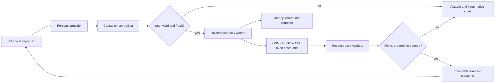

### 23.1 Export operator policy

The reference graph uses ONNX-friendly operations: `MatMul/Gemm`, `Add`, `Mul`, `Div`, `Sqrt`,
`ReduceMean`, `Exp`, `Log`, `Sin`, `Cos`, `Sigmoid`, `Softplus`, `Tanh`, `Where`, `Softmax`, `Reshape`,
`Transpose`, `Concat`, `Gather`, and finite constant masks. Unsupported fused kernels are not required.
Export fixes opset/runtime versions, input names, shapes, dtypes, and output order.

Parity uses deterministic fixtures covering normal, sparse-mask, one-modality, one-sided-book,
all-invalid-rejected, clipping-boundary, and extreme-finite inputs. Compare training runtime, raw ONNX,
wrapped ONNX, and host reconstruction. Quantized export is a separate candidate; FP32 is the reference.

### 23.2 Package manifest

The signed/hashed candidate directory contains:

- ONNX bytes and SHA-256;
- architecture/config hash and exact parameter count;
- tensor schema, field order, shape, dtype, mask semantics, and compiler version;
- input/target scaler arrays and their independent hash;
- calibration offsets and presence thresholds;
- tick/session/instrument applicability policy;
- training code revision, dataset manifest hash, source time bounds, folds, seeds, and metrics;
- runtime/opset/provider versions and target CPU benchmark;
- model-card limitations, rejected slices, and approval identity; and
- rollback predecessor and package format version.

The host refuses unknown fields, missing hashes, oversized tensors/models, schema mismatch, unsupported
opset, non-finite constants, or an unapproved package. Loading a model is not the same as promoting it.

### 23.3 Worker isolation and backpressure

Inference runs outside the UI process in a bounded local worker. Requests contain a schema version,
monotonic request ID, instrument identity, cutoff, reference values, and fixed tensors. The worker
validates size before allocation, enforces one active model version, and returns a typed status plus
raw predictions. The provider discards late responses whose request/cutoff no longer matches the chart.

Use a latest-wins bounded queue per instrument; do not accumulate stale forecast requests during a
burst. Set a timeout below the chart's usefulness window. Worker crash, timeout, schema failure,
non-finite result, stale reference, or quality rejection produces abstention and leaves the native
Volume Footprint behavior intact.

### 23.4 Chart presentation

The median is visually distinct from realized footprint data. Uncertainty is a band or whisker, not a
solid historical bar. Buy/sell POC is absent when presence is rejected. The UI exposes model version,
forecast cutoff, horizon, age, confidence/interval, and an unavailable reason. It never labels a
forecast as an observed trade bar.

---

## 24. Runtime state machine, monitoring, and rollback

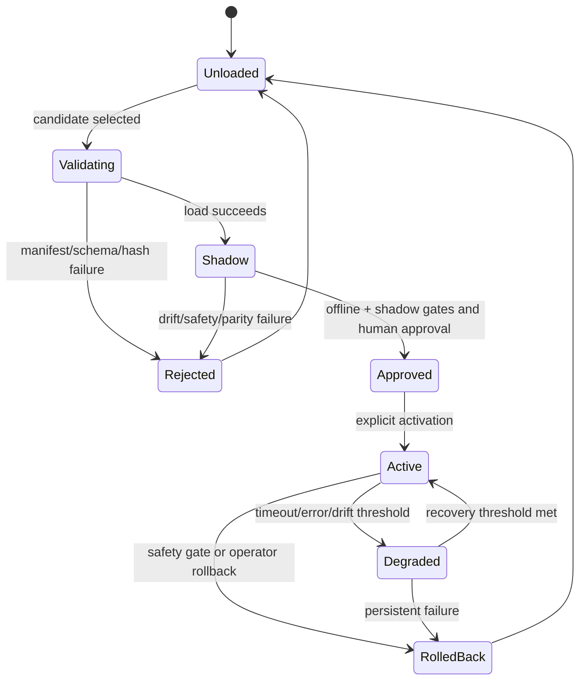

### 24.1 Live counters

Monitor request/accept/abstain counts; reason-coded input rejection; source age; valid fractions; gate
distributions; clipping rates; output quantiles/width/presence; reconstruction rejection; worker
latency p50/p95/p99; queue drops; timeouts; exceptions; memory/CPU; and active model hash. Once labels
mature, monitor masked proper scores, empirical coverage, median bias, and presence calibration by
horizon and critical slice.

Feature drift uses training-reference histograms or sketches for valid values and masks separately.
Population Stability Index or Wasserstein distance can alert, but thresholds are operational signals,
not proof of failure. Data-quality and model-quality alerts remain distinct.

### 24.2 No online weight update in v1

The active model, normalizers, calibration, and thresholds are immutable. Retraining produces a new
versioned candidate that repeats offline, holdout, parity, shadow, and approval gates. This prevents
partially matured horizons, regime shocks, data corruption, or feedback from silently rewriting the
production model.

### 24.3 Rollback

Rollback switches atomically to the previously approved package or disables the provider. It never
rebuilds a package on the UI thread. Activation history records old/new hashes, time, reason, operator,
and worker health. Forecast display failure must not block native chart rendering or data capture.

---

## 25. Implementation blueprint

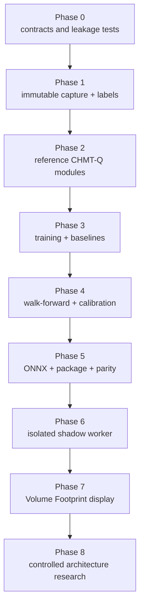

### 25.1 Phase 0: freeze contracts

Deliver the tensor schema, cutoff convention, timestamp semantics, masks, target definitions, tape
completeness policy, session/roll rules, reconstruction order, package manifest, and acceptance tests.
Create golden event-to-tensor and tape-to-label fixtures, including adversarial late and missing data.
No model training begins until these are deterministic.

### 25.2 Phase 1: capture and dataset

Implement append-only capture adapters and provenance, continuity diagnostics, the causal grid builder,
label builder, dataset shard format, split manifest, fold-only scaler fitter, and reproduction CLI.
Build data-quality reports before model metrics. Confirm legal retention/training scope.

### 25.3 Phase 2: reference model from primitives

Implement and unit-test RMSNorm, Q/K normalization, safe masked softmax, time bias, attention,
SwiGLU, LayerScale block, masked patch pool, L2 level encoder, fusion gates, decoder, monotone quantile
transform, masked losses, and exact parameter ledger. Tests compare selected tensor operations against
small NumPy references and finite differences where appropriate.

### 25.4 Phase 3: trainer and baselines

Implement deterministic seeds, fold-aware loaders, mixed precision, accumulation, optimizer/scheduler,
checkpoint/resume including RNG state, metric denominators, TensorBoard/structured logs, baseline
models, and synthetic overfit/smoke tests. A tiny dataset must overfit; random targets should not show
spurious validation gain.

### 25.5 Phase 4: evaluation and calibration

Run development folds, three-seed finalists, slice/stress reports, registered ablations, learning
curves, and calibration. Freeze architecture, recipe, thresholds, and candidate before the single outer
holdout. Generate a model card that includes negative results.

### 25.6 Phase 5: export and packaging

Export FP32 ONNX, run operator audit and parity fixtures, benchmark the declared CPU, construct the
manifest, hash every component, and verify fail-closed loading. Only then investigate dynamic/static
quantization as a separate candidate with its own parity, calibration, and latency results.

### 25.7 Phase 6: shadow worker

Build the bounded loopback protocol and isolated worker, but do not restore forbidden lower-layer
project references. Shared lower layers remain clean; protocol DTOs and adapters live at an allowed
composition boundary. Replay historical and live shadow tensors, compare outputs, inject failures,
and measure end-to-end cutoff-to-result latency.

### 25.8 Phase 7: chart integration

Add the provider at the Pro composition/UI boundary, immutable forecast snapshots, latest-wins update,
clear prediction styling, availability reasons, toggles, diagnostics, and rollback. The UI never awaits
inference synchronously and does not own Python or training dependencies.

### 25.9 Phase 8: research backlog

In order: overlapping patches; causal convolution stem; group/feature mixer; MTP auxiliary ablation;
larger context; Gated DeltaNet; KDA; Mamba; Muon; bounded regime experts; offline merging. A mechanism
enters only because the preceding experiment identifies its bottleneck.

---

## 26. Failure modes and design responses

| Failure | Why it happens | Design response |
|---|---|---|
| Beautiful validation, failed live | random/overlapping split or future normalization | nested chronological folds, purge/embargo, availability timestamps |
| Model predicts feed artifacts | gaps/carry/adapter changes correlate with target | explicit quality/masks, adapter slices, continuity policy |
| NaN from missing book | all keys masked before softmax | safe softmax and invalid-query zeroing |
| Missing L2 looks like empty depth | zero-filled rows treated as observations | nested masks and hard modality availability |
| Quantile crossing | independent heads | center plus positive softplus gaps |
| Great F1, poor execution | mid-price/class metric ignores spread/fills | proper scores plus executable downstream test |
| Live prediction arrives late | UI-thread inference or unbounded queue | isolated worker, timeout, latest-wins backpressure |
| Wrong price after roll/tick change | stale reference metadata | versioned metadata, applicability policy, host validation |
| Calibration collapses in regime shift | nonexchangeable data | rolling reports, delayed calibrator research, abstention/rollback |
| Recurrent state contaminates symbols | shared or unreset state | no state in v1; later per-instrument/venue/epoch reset contract |
| Architecture overfits paper fashion | mechanism solves another scale | scale-fit test and ablation entry gates |
| Model silently changes | online update or mutable package | immutable hashes, explicit promotion, audit log |

---

## 27. Practical questions

### Is this architecture really “from scratch”?

Yes. Its parameters are newly initialized and trained only on the authorized numeric task. Research
ideas and mathematical primitives are reused, as all serious architecture work does; no pretrained
language weights, tokenizer, embeddings, or text data are loaded.

### Why not feed raw numbers into one flat Transformer?

Because a rank-3 bid level, an L1 quote frame, and a one-minute bar do not have the same geometry. A
flat sequence either loses side/rank identity or creates thousands of tokens. The hierarchy encodes
the book as a book before encoding its evolution.

### Why only 128 dimensions and four heads?

Four 32-wide heads are enough to learn several retrieval patterns while keeping the CPU graph small.
The initial data/label uncertainty is a larger risk than model capacity. Width grows only after
learning curves demonstrate underfitting.

### Why predict five horizons directly?

Every horizon is conditioned on the same known past. Direct queries avoid feeding an uncertain
one-step prediction into the next step, remove serial latency, and let horizon self-attention learn a
coherent curve.

### Why quantiles instead of mean and variance?

Market residuals are skewed, heavy-tailed, discrete at ticks, and often heteroscedastic. Quantiles do
not assume a Gaussian likelihood, train with a proper loss, and give chart-usable intervals. They are
still marginal and require calibration.

### Why not DeepSeek MLA or MoE?

MLA saves autoregressive KV cache; CHMT-Q does not generate a long token stream. MoE supplies enormous
total capacity with sparse activation; CHMT-Q has two million parameters. Both add failure modes while
solving absent bottlenecks.

### Why not Kimi Linear or Mamba immediately?

Their value appears when context is very long and state memory is cheaper than pairwise attention.
CHMT-Q's 60-64-token branches make full attention cheap. Fixed recurrent state can collide, forget
rare events, and complicate resets and ONNX state handling.

### Can Sakana-style adaptation handle regimes?

Possibly offline, after the dense baseline proves that one model cannot cover regimes. Runtime weight
mutation is not acceptable in v1. Pre-exported experts or bounded activation modulation are easier to
audit, quantize, replay, and roll back.

### Can the model train without genuine trade tape?

Not for the stated footprint targets. It can train auxiliary quote/book objectives, but POC, executed
volume, and delta labels require complete genuine tape under explicit classification semantics.

### Does attention show why the market moved?

No. Attention and modality gates show internal routing, not causal explanation. Use them for debugging
alongside ablation, permutation, counterfactual, and stability analysis; do not present them as market
causes.

### Can the model place trades?

Not by this specification. It returns forecasts to a chart provider. Execution needs a separate
policy, risk engine, approval, kill switch, and executable-price evaluation.

### When is the work actually complete?

When capture and labels are proven causal, the model beats serious baselines on frozen chronological
evaluation, uncertainty is calibrated, ONNX parity/latency/safety gates pass, shadow behavior is
stable, the chart fails safely, and promotion is explicitly approved. A compiling neural network is
only the middle of the project.

---

## 28. Final architecture decision record

**Selected:** CHMT-Q v1 as specified: hierarchical L2 level attention; separate bar/L1/L2 causal
encoders; four-frame micro patches; width 128; full dense attention; quality-aware gated fusion; five
direct horizon queries; monotone marginal quantiles; AdamW; fixed ONNX inference.

**Adopted evidence:** Transformer attention, relative-position principles, RMSNorm, SwiGLU, PatchTST
patching, TFT direct quantiles/information contracts, and LOB spatial-temporal hierarchy.

**Adapted evidence:** actual-time bias instead of text positions; hard-aware quality gates; grouped
feature/level mixing instead of full iTransformer inversion; intermediate multi-horizon deep
supervision instead of future-token teacher input; chronological conformal calibration reported as
empirical coverage.

**Deferred:** convolution stem, overlapping patches, robust past-window RevIN, Gated DeltaNet, KDA,
Mamba, Muon, pre-exported regime experts, and same-base offline merging.

**Rejected for v1:** MLA, MoE, NSA/DSA, autoregressive future decoding, runtime weight mutation,
online training, layer Frankenmerging, text reasoning, PnL-only loss, and L1/L2-derived pseudo-tape
labels.

**Reason:** this is the smallest architecture that respects market geometry, causal timing,
missingness, multi-horizon uncertainty, CPU/ONNX serving, and safe chart integration without importing
long-context or giant-model machinery unsupported at the target scale.

---

## 29. Primary-source bibliography

The dates and venue labels below distinguish peer-reviewed papers from technical reports. An arXiv
paper is cited as evidence for what it reports, not as independent validation of transfer to markets.

1. **[R01]** Vaswani et al. “Attention Is All You Need.” NeurIPS 2017. [arXiv:1706.03762](https://arxiv.org/abs/1706.03762).
2. **[R02]** Shaw, Uszkoreit, and Vaswani. “Self-Attention with Relative Position Representations.” NAACL 2018. [arXiv:1803.02155](https://arxiv.org/abs/1803.02155).
3. **[R03]** Zhang and Sennrich. “Root Mean Square Layer Normalization.” NeurIPS 2019. [arXiv:1910.07467](https://arxiv.org/abs/1910.07467).
4. **[R04]** Shazeer. “GLU Variants Improve Transformer.” 2020 technical report. [arXiv:2002.05202](https://arxiv.org/abs/2002.05202).
5. **[R05]** Dai et al. “DeepSeekMoE: Towards Ultimate Expert Specialization in Mixture-of-Experts Language Models.” 2024 technical report. [arXiv:2401.06066](https://arxiv.org/abs/2401.06066).
6. **[R06]** DeepSeek-AI. “DeepSeek-V2: A Strong, Economical, and Efficient Mixture-of-Experts Language Model.” 2024 technical report. [arXiv:2405.04434](https://arxiv.org/abs/2405.04434).
7. **[R07]** DeepSeek-AI. “DeepSeek-V3 Technical Report.” 2024/2025 technical report. [arXiv:2412.19437](https://arxiv.org/abs/2412.19437).
8. **[R08]** Gloeckle et al. “Better & Faster Large Language Models via Multi-token Prediction.” ICML 2024. [arXiv:2404.19737](https://arxiv.org/abs/2404.19737), [OpenReview](https://openreview.net/forum?id=pEWAcejiU2).
9. **[R09]** Yuan et al. “Native Sparse Attention: Hardware-Aligned and Natively Trainable Sparse Attention.” 2025 technical report. [arXiv:2502.11089](https://arxiv.org/abs/2502.11089).
10. **[R10]** Kimi Team. “Kimi Linear: An Expressive, Efficient Attention Architecture.” 2025 technical report. [arXiv:2510.26692](https://arxiv.org/abs/2510.26692), [official code](https://github.com/MoonshotAI/Kimi-Linear).
11. **[R11]** Yang et al. “Gated Delta Networks: Improving Mamba2 with Delta Rule.” ICLR 2025. [arXiv:2412.06464](https://arxiv.org/abs/2412.06464).
12. **[R12]** Nie et al. “A Time Series is Worth 64 Words: Long-term Forecasting with Transformers.” ICLR 2023. [arXiv:2211.14730](https://arxiv.org/abs/2211.14730).
13. **[R13]** Liu et al. “iTransformer: Inverted Transformers Are Effective for Time Series Forecasting.” ICLR 2024. [arXiv:2310.06625](https://arxiv.org/abs/2310.06625).
14. **[R14]** Lim et al. “Temporal Fusion Transformers for Interpretable Multi-horizon Time Series Forecasting.” *International Journal of Forecasting* 2021. [arXiv:1912.09363](https://arxiv.org/abs/1912.09363), [DOI](https://doi.org/10.1016/j.ijforecast.2021.03.012).
15. **[R15]** Kim et al. “Reversible Instance Normalization for Accurate Time-Series Forecasting against Distribution Shift.” ICLR 2022. [OpenReview](https://openreview.net/forum?id=cGDAkQo1C0p).
16. **[R16]** Zeng et al. “Are Transformers Effective for Time Series Forecasting?” AAAI 2023. [arXiv:2205.13504](https://arxiv.org/abs/2205.13504), [DOI](https://doi.org/10.1609/aaai.v37i9.26317).
17. **[R17]** Wu et al. “TimesNet: Temporal 2D-Variation Modeling for General Time Series Analysis.” ICLR 2023. [arXiv:2210.02186](https://arxiv.org/abs/2210.02186).
18. **[R18]** Zhang, Zohren, and Roberts. “DeepLOB: Deep Convolutional Neural Networks for Limit Order Books.” *IEEE Transactions on Signal Processing* 2019. [arXiv:1808.03668](https://arxiv.org/abs/1808.03668), [DOI](https://doi.org/10.1109/TSP.2019.2907260).
19. **[R19]** Wallbridge. “Transformers for Limit Order Books.” 2020 technical report. [arXiv:2003.00130](https://arxiv.org/abs/2003.00130).
20. **[R20]** Berti and Kasneci. “TLOB: A Novel Transformer Model with Dual Attention for Price Trend Prediction with Limit Order Book Data.” 2025 technical report. [arXiv:2502.15757](https://arxiv.org/abs/2502.15757).
21. **[R21]** Zhang and Zohren. “Multi-Horizon Forecasting for Limit Order Books: Novel Deep Learning Approaches and Hardware Acceleration using Intelligent Processing Units.” 2021 technical report. [arXiv:2105.10430](https://arxiv.org/abs/2105.10430).
22. **[R22]** Gu and Dao. “Mamba: Linear-Time Sequence Modeling with Selective State Spaces.” COLM 2024. [arXiv:2312.00752](https://arxiv.org/abs/2312.00752).
23. **[R23]** Sun, Cetin, and Tang. “Learning to Predict Structural Adaptations of Large Language Models.” 2025 technical report. [arXiv:2501.06252](https://arxiv.org/abs/2501.06252), [official code](https://github.com/SakanaAI/self-adaptive-llms).
24. **[R24]** Akiba et al. “Evolutionary Optimization of Model Merging Recipes.” Nature Machine Intelligence 2025. [arXiv:2403.13187](https://arxiv.org/abs/2403.13187), [DOI](https://doi.org/10.1038/s42256-024-00975-8).
25. **[R25]** Liu et al. “Muon is Scalable for LLM Training.” 2025 technical report. [arXiv:2502.16982](https://arxiv.org/abs/2502.16982).
26. **[R26]** DeepSeek-AI. “DeepSeek-V3.2: Pushing the Frontier of Open Large Language Models.” 2025 technical report. [arXiv:2512.02556](https://arxiv.org/abs/2512.02556).
27. **[R27]** Wang et al. “Auxiliary-Loss-Free Load Balancing Strategy for Mixture-of-Experts.” 2024 technical report. [arXiv:2408.15664](https://arxiv.org/abs/2408.15664).
28. **[R28]** Kimi Team. “Kimi K2: Open Agentic Intelligence.” 2025/2026 technical report. [arXiv:2507.20534](https://arxiv.org/abs/2507.20534).
29. **[R29]** Ntakaris et al. “Benchmark Dataset for Mid-Price Forecasting of Limit Order Book Data with Machine Learning Methods.” *Journal of Forecasting* 2018. [arXiv:1705.03233](https://arxiv.org/abs/1705.03233), [DOI](https://doi.org/10.1002/for.2543).
30. **[R30]** Kolm, Turiel, and Westray. “Deep Order Flow Imbalance: Extracting Alpha at Multiple Horizons from the Limit Order Book.” *Mathematical Finance* 2023. [DOI](https://doi.org/10.1111/mafi.12413). Claims in this review were checked against the accessible 2021 SSRN manuscript because the 2023 version of record was inaccessible.
31. **[R31]** Lucchese, Pakkanen, and Veraart. “The Short-Term Predictability of Returns in Order Book Markets: a Deep Learning Perspective.” International Journal of Forecasting 2024. [arXiv:2211.13777](https://arxiv.org/abs/2211.13777), [DOI](https://doi.org/10.1016/j.ijforecast.2024.02.001).
32. **[R32]** Prata et al. “LOB-Based Deep Learning Models for Stock Price Trend Prediction: A Benchmark Study.” Artificial Intelligence Review 2024. [arXiv:2308.01915](https://arxiv.org/abs/2308.01915), [DOI](https://doi.org/10.1007/s10462-024-10715-4).
33. **[R33]** Briola, Bartolucci, and Aste. “Deep Limit Order Book Forecasting: A Microstructural Guide.” *Quantitative Finance* 2025. [arXiv:2403.09267](https://arxiv.org/abs/2403.09267), [DOI](https://doi.org/10.1080/14697688.2025.2522911).
34. **[R34]** Romano, Patterson, and Candès. “Conformalized Quantile Regression.” NeurIPS 2019. [arXiv:1905.03222](https://arxiv.org/abs/1905.03222).
35. **[R35]** Gibbs and Candès. “Adaptive Conformal Inference Under Distribution Shift.” NeurIPS 2021. [arXiv:2106.00170](https://arxiv.org/abs/2106.00170).
36. **[R36]** Salinas et al. “DeepAR: Probabilistic Forecasting with Autoregressive Recurrent Networks.” International Journal of Forecasting 2020. [arXiv:1704.04110](https://arxiv.org/abs/1704.04110), [DOI](https://doi.org/10.1016/j.ijforecast.2019.07.001).
37. **[R37]** Eisenach et al. “MQTransformer: Multi-Horizon Forecasts with Context Dependent and Feedback-Aware Attention.” arXiv v4, 2022; first posted 2020. [arXiv:2009.14799](https://arxiv.org/abs/2009.14799).
38. **[R38]** Gneiting and Raftery. “Strictly Proper Scoring Rules, Prediction, and Estimation.” JASA 2007. [DOI](https://doi.org/10.1198/016214506000001437).
39. **[R39]** Yang et al. “Gated Linear Attention Transformers with Hardware-Efficient Training.” ICML 2024. [arXiv:2312.06635](https://arxiv.org/abs/2312.06635).
40. **[R40]** Katharopoulos et al. “Transformers are RNNs: Fast Autoregressive Transformers with Linear Attention.” ICML 2020. [arXiv:2006.16236](https://arxiv.org/abs/2006.16236).
41. **[R41]** Yang, Wang, Zhang, Shen, and Kim. “Parallelizing Linear Transformers with the Delta Rule over Sequence Length.” NeurIPS 2024. [arXiv:2406.06484](https://arxiv.org/abs/2406.06484).
42. **[R42]** Sirignano and Cont. “Universal Features of Price Formation in Financial Markets: Perspectives from Deep Learning.” Quantitative Finance 2019. [arXiv:1803.06917](https://arxiv.org/abs/1803.06917).
43. **[R43]** Wang et al. “TimeMixer: Decomposable Multiscale Mixing for Time Series Forecasting.” ICLR 2024. [arXiv:2405.14616](https://arxiv.org/abs/2405.14616).
44. **[R44]** Wang et al. “Is Mamba Effective for Time Series Forecasting?” *Neurocomputing* 619, 2025. [arXiv:2403.11144](https://arxiv.org/abs/2403.11144), [DOI](https://doi.org/10.1016/j.neucom.2024.129178).
45. **[R45]** DeepSeek-AI. “DeepSeek-R1: Incentivizing Reasoning Capability in LLMs via Reinforcement Learning.” arXiv v2, 2026; first posted 2025. [arXiv:2501.12948](https://arxiv.org/abs/2501.12948).
46. **[R46]** Zhang et al. “Darwin Gödel Machine: Open-Ended Evolution of Self-Improving Agents.” ICLR 2026. [arXiv:2505.22954](https://arxiv.org/abs/2505.22954).

---

## Appendix A. Symbol table

| Symbol | Meaning |
|---|---|
| `B` | training batch size; fixed to one for exported inference |
| `c` | forecast decision cutoff |
| `F_c` | information available by cutoff |
| `H` | number of direct forecast horizons, five |
| `q` | instrument tick size; also used contextually for an attention query |
| `p_ref` | fresh causal cutoff reference price |
| `ℓ_ref` | causal trailing log-volume reference |
| `d`, `d_h`, `d_ff` | model, head, and SwiGLU hidden widths |
| `m` | boolean validity mask |
| `α_m` | normalized modality gate |
| `Q_τ` | conditional quantile at probability `τ` |
| `ρ_τ` | pinball loss |
| `θ` | all learned model parameters |

## Appendix B. Non-negotiable invariants

1. No feature with availability after cutoff enters a sample.
2. Footprint labels use complete genuine future tape, never quote/book pseudo-volume.
3. Masks are separate from numeric zeros and propagate through every block.
4. Missing modalities cannot receive attention through learned gates.
5. All-masked softmax returns zero, never NaN.
6. Quantiles are ordered by construction and checked after reconstruction.
7. Scalers, calibration, thresholds, and selection use only the permitted chronological past.
8. The outer holdout is used once after the design is frozen.
9. Training and UI dependencies do not enter shared lower layers.
10. Live inference failure abstains and preserves native Volume Footprint behavior.

## Appendix C. Deliverable status

This document finalizes the researched architecture and implementation workflow. The existing
prototype demonstrates primitive numeric attention and synthetic smoke training, but it is not proof
of real-data correctness. Remaining engineering begins with capture/label contracts, not with adding a
larger neural network.
