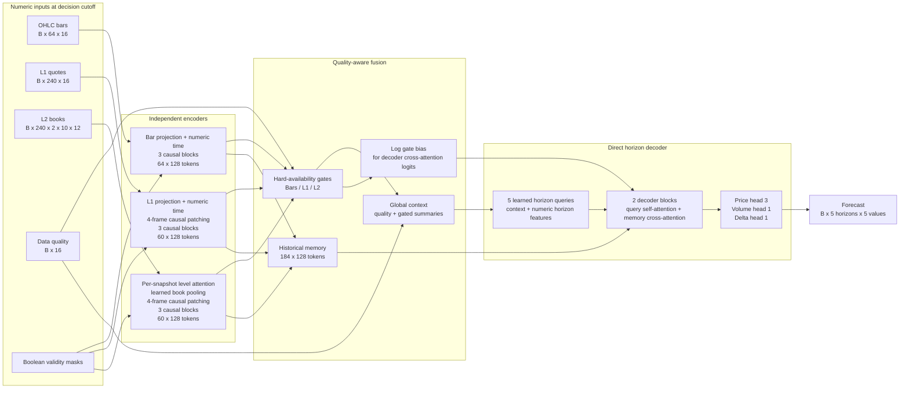
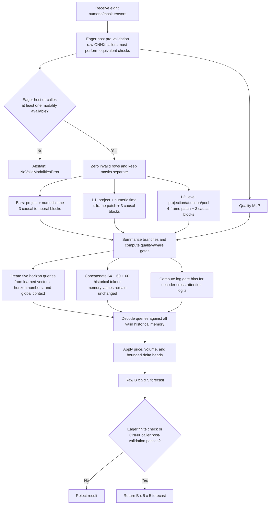
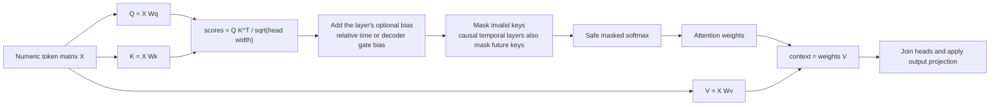
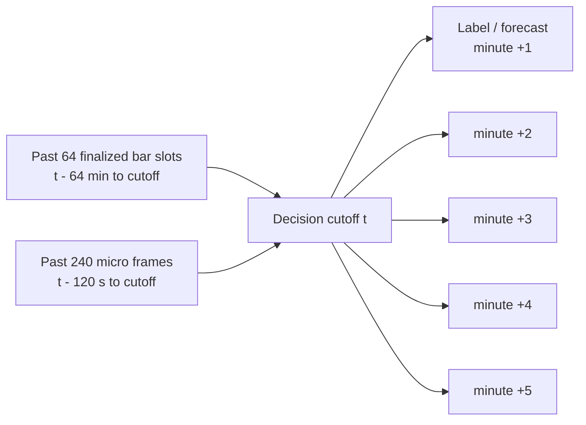
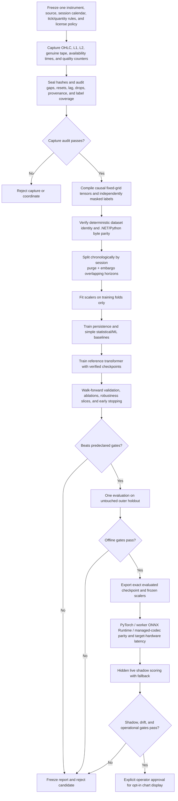
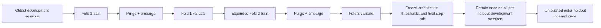

# Numeric Market Transformer — Visual Guide

**Status:** The custom model and synthetic smoke-training path are implemented as a Pro-private
prototype. Real-data capture, production training, packaging, inference serving, and Volume Footprint
integration are proposed and are clearly marked below.

This guide is the short visual entry point. The authoritative feature definitions, causality rules,
operational policies, and delivery gates remain in the
[architecture and delivery specification](architecture/numeric-market-transformer-architecture.md).

## 1. What exists today?

| Capability | Status | Meaning |
|---|---|---|
| Fixed numeric tensor contracts | Implemented | Bars, L1, L2, quality, masks, targets, and forecasts have validated shapes. |
| Custom transformer | Implemented | Attention is built from Q/K/V projections, matrix multiplication, masking, and softmax. |
| Hierarchical L2 encoder | Implemented | Each book snapshot is encoded across price levels before temporal encoding. |
| Synthetic training smoke test | Implemented | A tiny model can run forward/backward optimization on deterministic artificial data. |
| Fixed-shape ONNX smoke export | Implemented | Batch-one FP32 export and optional ONNX Runtime parity checks exist. |
| Real market-data capture and dataset compiler | Proposed | The prototype does not ingest or train on broker data. |
| Production `train`, `evaluate`, and `inspect` commands | Proposed | These command names are designs, not currently callable commands. |
| Signed package, isolated inference worker, and registry | Proposed | No prototype artifact is promotable or loadable by the terminal. |
| Volume Footprint forecast display | Proposed | The chart is not connected to this prototype. |

The prototype proves software mechanics, not predictive skill or trading value.

## 2. Architecture at a glance



The model does not convert numbers into words or token IDs. Every external value is either `float32`
market data or a boolean validity mask. Learned embeddings exist only internally for modality, book
side, price rank, and forecast horizon. Modality gates leave memory values unchanged and contribute
`log(gate + epsilon)` only to decoder cross-attention score logits.

## 3. Fixed input and output contract

| Tensor | Training shape | What it represents |
|---|---:|---|
| `bars` | `[B, 64, 16]` | Sixty-four consecutive one-minute bar slots, oldest first. |
| `bars_mask` | `[B, 64]` | Which finalized bar slots were genuinely available at the cutoff. |
| `l1` | `[B, 240, 16]` | Two minutes of quotes sampled on a 500 ms grid. |
| `l1_mask` | `[B, 240]` | Which quote grid rows are valid and fresh enough. |
| `l2` | `[B, 240, 2, 10, 12]` | Two sides, ten ranked levels, twelve engineered values per level. |
| `l2_level_mask` | `[B, 240, 2, 10]` | Validity of every individual book level. |
| `l2_snapshot_mask` | `[B, 240]` | Validity of each depth snapshot. It must agree with the level mask. |
| `quality` | `[B, 16]` | Coverage, staleness, gaps, approximation, and session-quality features. |
| `targets` | `[B, 5, 5]` | Training-only future values for five one-minute horizons. |
| `target_mask` | `[B, 5, 5]` | Independent validity for every future horizon/head cell. |
| `forecast` | `[B, 5, 5]` | Five transformed numeric predictions for each of five horizons. |

The ONNX graph fixes `B = 1`. Training may use larger batches. Zero is a valid numeric value and never
means “missing”; only masks carry missingness.

## 4. What happens during one forward pass?



The temporal branches are causal: a token may attend only to its own time or earlier history. Horizon
queries may read the complete encoded history because every memory token is already at or before the
decision cutoff. The validation and rejection boxes show responsibility boundaries, not nodes embedded
in every exported graph: eager `MarketBatch` checks inputs and availability, while a raw ONNX caller
must enforce equivalent pre-inference and post-inference validation.

## 5. How the custom attention works



Unlike a pretrained language transformer, this implementation contains no vocabulary, tokenizer,
text embeddings, `nn.MultiheadAttention`, `nn.Transformer`, or fused scaled-dot-product-attention call.
An all-masked attention row produces exactly zero rather than `NaN`.

Each main transformer block is pre-normalized:

```text
u = x + dropout(custom_attention(layer_norm(x)))
z = u + dropout(GEGLU(layer_norm(u)))
z = z * query_valid_mask
```

## 6. Why L2 needs a hierarchy

Flattening all depth values would create `240 x 2 x 10 = 4,800` temporal tokens and would blur the
meaning of side and price rank. The model first understands one book, then how books change over time.

```mermaid
flowchart LR
  S["One L2 snapshot<br/>2 sides x 10 levels x 12 features"] --> FLAT["20 level rows"]
  FLAT --> PROJ["Project each level<br/>12 to 32"]
  PROJ --> EMB["Add side, rank, and snapshot-age encodings"]
  EMB --> LA["1 masked non-causal level-attention block"]
  LA --> POOL["Learned query pools valid levels"]
  POOL --> FRAME["One depth frame<br/>width 128"]
  FRAME --> REPEAT["Repeat for 240 snapshots"]
  REPEAT --> PATCH["Causal groups of 4 frames"]
  PATCH --> TOK["60 depth-time tokens"]
  TOK --> TEMP["3 causal temporal blocks"]
```



Level attention is non-causal because all levels belong to the same accepted snapshot. Temporal depth
attention remains causal.

## 7. What does the output mean?

Each row is one future one-minute horizon. The five columns are fixed:

| Column | Output | Meaning before runtime reconstruction |
|---:|---|---|
| 0 | `poc_offset` | Total POC offset from the cutoff reference price, measured in ticks. |
| 1 | `buy_poc_offset` | Buy POC offset in ticks. |
| 2 | `sell_poc_offset` | Sell POC offset in ticks. |
| 3 | `log_volume_residual` | Future log-volume difference from a causal volume reference. |
| 4 | `delta_fraction` | Expected delta divided by volume; the model bounds it with `tanh` to `[-1, 1]`. |

```text
forecast[B, horizon, value]

              POC       Buy POC    Sell POC   Log volume   Delta fraction
minute +1   [ value 0,  value 1,   value 2,   value 3,     value 4 ]
minute +2   [ value 0,  value 1,   value 2,   value 3,     value 4 ]
minute +3   [ value 0,  value 1,   value 2,   value 3,     value 4 ]
minute +4   [ value 0,  value 1,   value 2,   value 3,     value 4 ]
minute +5   [ value 0,  value 1,   value 2,   value 3,     value 4 ]
```

A future runtime must clamp and reconstruct transformed values with the package tick size, reference
price, and volume reference. It must reject the whole forecast if any value or invariant is invalid.

## 8. Time, labels, and causality



For future real-data examples, the proposed compiler will accept an observation only when its
availability time is no later than the cutoff. Event time alone is insufficient: a late bar or delayed
book update must not be inserted into an earlier example. Future labels are designed to come from
genuine completed tape intervals with independent validity masks; the synthetic prototype does not yet
build those examples or labels.

## 9. How to train the implemented prototype

The current command deliberately trains only a tiny model on one deterministic synthetic batch. It is
a forward/backward and gradient-safety check, not a research experiment.

```mermaid
flowchart LR
  SEED["Set deterministic seed"] --> SYN["Generate artificial batch<br/>B = 2"]
  SYN --> MODEL["Create tiny model<br/>78,646 parameters"]
  MODEL --> FWD["Forward pass"]
  FWD --> LOSS["Masked weighted Huber loss"]
  LOSS --> BACK["Backpropagate"]
  BACK --> CHECK["Require finite loss and gradients"]
  CHECK --> CLIP["Clip gradient norm to 1.0"]
  CLIP --> OPT["AdamW step<br/>learning rate 0.0003"]
  OPT --> FWD
  OPT --> REPORT["Report initial/final loss<br/>promotable = false"]
```



### 9.1 Environment

From `tools/numeric-transformer/`:

```powershell
python -m venv .venv
.venv\Scripts\python -m pip install -e ".[dev]"
```

Optional ONNX tooling:

```powershell
.venv\Scripts\python -m pip install -e ".[dev,onnx]"
```

### 9.2 Run synthetic smoke training

```powershell
.venv\Scripts\python -m daxalgo_numeric_transformer smoke --device cpu --seed 17 --steps 3
```

Expected output is JSON containing the device, seed, step count, parameter count, initial loss, final
loss, and `"promotable": false`. A lower final loss proves that this tiny batch can be optimized; it
does not estimate out-of-sample market performance.

### 9.3 Run the tests

```powershell
.venv\Scripts\python -m pytest
.venv\Scripts\python -m ruff check .
```

### 9.4 Export a non-promotable smoke model

```powershell
.venv\Scripts\python -m daxalgo_numeric_transformer export-smoke `
  --device cpu `
  --seed 17 `
  --steps 1 `
  --output artifacts\smoke.onnx
```

Export uses fixed batch-one shapes, FP32, ONNX opset 17, immutable input/output names, and a 12 MiB
artifact ceiling. The identity scaler only proves the future scaler boundary. The generated file must
never be registered or displayed by the terminal.

## 10. How real training should work later

No real-data `train`, `evaluate`, `inspect`, capture, or registration command exists yet. The intended
workflow is gated so a model cannot move directly from a training loop to the chart.



### 10.1 Proposed starting configuration

These are experiment defaults, not proven optimums:

| Area | Proposed reference value |
|---|---:|
| Main width / level width | `128 / 32` |
| Main / level attention heads | `4 / 4` |
| Bar / L1 / L2 temporal blocks | `3 / 3 / 3` |
| L2 level / decoder blocks | `1 / 2` |
| Main / level feed-forward width | `256 / 64` |
| Dropout | `0.10` |
| Optimizer | AdamW |
| Learning rate / weight decay | `0.0003 / 0.01` |
| Schedule | 5% linear warmup, then cosine decay |
| Gradient clip | `1.0` |
| Batch size / maximum epochs | `64 / 100` |
| Early-stop patience | `10` validation epochs |
| Precision | Deterministic FP32 reference first |

The reference implementation contains 2,093,518 parameters, below its 2.25 million ceiling. Any
change to contract, architecture, scaler policy, split policy, or thresholds creates a new run identity.

## 11. Preventing train/test leakage



Rules that matter more than random seed choice:

1. Never randomly split rows from overlapping market windows.
2. Keep complete sessions in one partition.
3. Purge examples whose lookback or five-minute label windows cross a split boundary.
4. Fit normalization statistics on the active training fold only.
5. Choose epochs and hyperparameters from validation folds, never the final holdout.
6. If holdout results cause any change, start a new candidate cycle with new untouched evidence.

## 12. Loss and optimizer behavior

The implemented loss is a masked Huber mean. It first averages each valid horizon/head cell across the
batch and then applies weights:

- horizon weight: `1 / sqrt(horizon)`;
- POC, buy POC, sell POC weights: `1.0` each;
- volume and delta weights: `0.5` each;
- invalid targets: excluded, never filled with guessed values;
- no valid positively weighted target: controlled `NoValidTargetsError`, so the optimizer and scheduler
  must not count a successful step.

The production trainer must stop on non-finite input, loss, or gradient. It may skip an isolated empty
target batch with a counter, but an excessive skip rate means the dataset audit failed.

## 13. Evaluation and promotion questions

A low training loss is not enough. A candidate should be rejected unless it satisfies all predeclared
gates:

| Gate | Evidence required |
|---|---|
| Data | Proven source continuity, acceptable label coverage, no unexplained drops or source mixing. |
| Skill | Out-of-sample MAE/error improvement over persistence and simpler baselines. |
| Robustness | No unacceptable regressions by session, volatility, spread, data quality, or missing modality. |
| Ablation | Bars/L1/L2 contributions are measured; the model is not silently relying on leakage or one bad feature. |
| Parity | PyTorch, exported ONNX, and worker outputs agree within frozen tolerance. |
| Runtime | Startup, memory, queueing, and inference latency pass on target Windows hardware. |
| Shadow | Live hidden scoring agrees with offline direction and never produces stale chart updates. |
| Operations | Signed package, rollback, fallback, circuit-breaker, and audit evidence all pass. |
| Approval | An operator explicitly promotes one immutable package hash for one exact coordinate. |

## 14. Proposed Volume Footprint runtime

This diagram is the target architecture, not current behavior.

```mermaid
flowchart LR
  FEEDS["Canonical bars, L1, L2, and tape streams"] --> RINGS["Bounded availability-stamped rings"]
  CLOCK["Monotonic one-minute decision clock"] --> SNAP["Snapshot at feature cutoff"]
  RINGS --> SNAP
  SNAP --> BUILDER["Private deterministic tensor builder"]
  BUILDER --> MAIL["Capacity-one latest-wins mailbox"]
  MAIL --> CLIENT["Managed worker client"]
  CLIENT --> WORKER["Isolated loopback worker<br/>one validated ONNX session"]
  WORKER --> VALIDATE["Identity, shape, finiteness, and invariant checks"]
  VALIDATE --> RECON["Reconstruct tick prices, volume, and delta"]
  RECON --> PROVIDER["Forecast provider session"]
  PROVIDER --> UI["Post small result through UI dispatcher"]
  UI --> CHART["Volume Footprint ghost bars<br/>target timestamps +1 to +5 minutes"]
  CLIENT -. failure or stale identity .-> FALLBACK["Null or existing baseline path"]
  VALIDATE -. invalid result .-> FALLBACK
  FALLBACK --> UI
```



Inference, tensor building, package loading, retries, and scoring must never run on the UI thread. The
model remains a chart forecast only; it does not introduce live order execution.

## 15. Frequently asked questions

### Why build a transformer from scratch instead of fine-tuning a pretrained model?

Pretrained language models learn text-token statistics. This problem has fixed numeric tensors,
physical market units, explicit missingness, multiple time scales, and book geometry. A small custom
architecture gives a stable contract, bounded inference cost, and inspectable mask/causality behavior.

### Why not put OHLC, L1, and L2 into one long sequence?

They have different shapes and clocks. Bars describe slower context, quotes describe short-term top-of-
book dynamics, and L2 contains a side/rank structure inside every snapshot. Independent encoders retain
those meanings before fusion and avoid a very expensive flat depth sequence.

### Can the model run when one modality is missing?

Yes at the model-mechanics level. Missing branches receive a hard-zero gate and the remaining gates are
renormalized. A sample with all three modalities missing abstains. Whether a partially missing pattern
is acceptable in production must be measured in validation and declared by the model package.

### Can I train it using OHLC only?

The masks permit that experiment, but it becomes a different evidence question. Train and evaluate the
same availability pattern, compare it with simpler bar-only baselines, and do not claim L1/L2 capability.
Changing the intended input policy requires a versioned configuration and new holdout evidence.

### Where do the target POC, volume, and delta values come from?

They must come from complete future genuine-tape intervals using the same tick bucketing, aggressor
classification, and tie rules as the chart. L1 or L2 snapshots cannot substitute for tape labels.

### How much historical data is required?

There is no honest fixed row count before auditing the chosen instrument and source. Coverage must span
enough independent sessions and regimes for chronological folds, an untouched holdout, sparse buy/sell
POC heads, and robustness slices. Start with a licensed pilot capture and measure label/quality coverage
before setting a duration target.

### Does a falling smoke loss mean the model predicts the market?

No. It only shows that the implementation can optimize an artificial batch with finite gradients.
Predictive evidence begins with immutable real datasets, valid baselines, walk-forward validation, and
an untouched holdout.

### What hardware is required?

The tiny smoke test runs on CPU. Reference-model training should be benchmarked on the intended research
hardware; the architecture does not promise a specific GPU requirement. Exported serving is fixed at
batch one and must pass measured CPU, memory, and latency budgets on the target Windows machine.

### Why use five direct horizon queries instead of predicting recursively?

Every horizon can attend to the same historical memory while learning its own horizon representation.
This avoids feeding the minute-one prediction back as input to minute two, which would accumulate error
and complicate deterministic runtime behavior.

### How are missing buy or sell POC labels handled?

Each horizon/head has its own mask. A missing buy POC is excluded from that loss cell; it is not replaced
with total POC or zero. Other valid heads in the same example can still train.

### How do we know the model is not looking into the future?

Today, model tests verify temporal causality and masked-value isolation on synthetic inputs. The future
dataset compiler must additionally enforce availability timestamps, fixed cutoffs, future-shift tests,
chronological splits, purge/embargo rules, and train-only scalers. Causality must eventually pass in both
the builder and the model; a causal attention mask cannot repair a leaked feature.

### Can we add another feature or use more depth levels?

Not silently. The implemented Python contract fixes current tensor shapes. The proposed production
system will hash shapes and feature meanings across builder, trainer, package, worker, and runtime. A
change must then create a new schema/configuration, parity fixtures, dataset, and evaluation cycle.

### Why export ONNX?

ONNX gives the prototype a fixed numeric interface separated from the Python model definition. The
current exporter enforces graph structure and size; optional tests check eager/Python-ONNX-Runtime
parity. A future production package must also pass worker and managed-codec parity before acceptance.

### When can forecasts appear on the chart?

Only after real capture and compiler work, offline gates, immutable packaging, isolated-worker checks,
and hidden shadow evaluation pass. Display promotion is explicit and reversible; it is not triggered by
training completion.

### Will this model place trades?

No. Its planned scope is Volume Footprint visualization and research. The terminal invariant prohibiting
a new live order-execution path remains unchanged.

## 16. Troubleshooting the prototype

| Symptom | Likely cause | Action |
|---|---|---|
| `NoValidModalitiesError` | Bars, L1, and L2 masks are all false for a sample. | Fix the example or intentionally abstain; do not fabricate tokens. |
| `NoValidTargetsError` | No valid target cell has a positive loss weight. | Skip that optimizer/scheduler step and count it; audit if frequent. |
| L2 mask validation error | `l2_snapshot_mask` does not equal the presence of valid side/rank levels. | Rebuild the nested masks from one canonical rule. |
| Shape or dtype error | Input does not match the fixed contract or masks are not boolean. | Compare against the table in Section 3. |
| Non-finite loss or gradient | Invalid preprocessing, unstable batch, or numerical failure. | Stop the run and retain example/diagnostic identity; do not export. |
| ONNX import error | Optional packages are absent. | Install `.[dev,onnx]` in the environment. |
| ONNX artifact rejected | Dynamic/wrong shapes, wrong names/dtypes, invalid graph, or size at least 12 MiB. | Use the fixed export wrapper and inspect the structural validation error. |
| Smoke loss differs across machines | Dependency/runtime differences or nondeterministic backend behavior. | Record versions and device; compare with declared deterministic tolerance rather than assuming bit identity. |
| Mermaid boxes do not render | The Markdown viewer lacks Mermaid support. | Use GitHub or a Mermaid-enabled preview; the tables and numbered steps remain authoritative. |

## 17. Suggested reading order

1. Sections 1–7 and 9 for the implemented model and smoke workflow; Section 8 describes the proposed
   real-data time/label contract.
2. Sections 10–14 for the proposed real-data, evaluation, and runtime path.
3. [Research specification](research-spec.md) for the exact selected tensor, loss, and training contract.
4. [Architecture specification](architecture/numeric-market-transformer-architecture.md) for feature formulas,
   manifests, leakage controls, packaging, worker protocol, lifecycle, and delivery gates.
5. [Session context](SESSION-CONTEXT.md) for the historical task lineage and current evidence boundary.

Before authorizing real-data work, resolve the blocking decisions in architecture Section 42: source,
instrument, license, calendar, availability/label policy, worker distribution, signing, target hardware,
retention, promotion thresholds, and any shared public API change.
