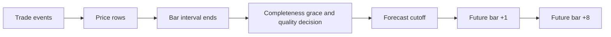
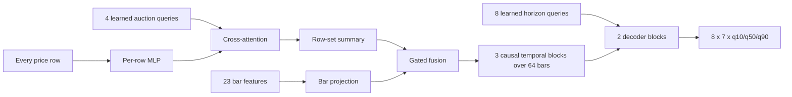

# FDT-N: Direct Multi-Horizon Quantile Forecasting from Full Volume-Footprint Auctions

**Document status:** final source narrative; detailed empirical tables are generated from the
validated multi-seed results and selected export metadata  
**Model name:** FDT-N (Footprint Distribution Transformer for next-N bars)  
**Default task:** 64 sealed footprint bars in, 8 future footprint bars out  
**Date:** 2026-07-28  
**Companion evidence record:** [evidence-ledger.md](evidence-ledger.md)

> **Safety statement.** FDT-N is a research forecaster and chart-visualization candidate. It does
> not create an order, position, or execution signal. A trained checkpoint is not evidence of
> predictive value, calibration, robustness, or profitability.

## Abstract

**Observed.** A sealed volume-footprint bar is richer than an ordinary open-high-low-close bar. It
retains the executed buy and sell volume at every traded price row, row delta, diagonal imbalance and
zero-volume flags, together with bar-level auction summaries such as point of control (POC), side
POCs, volume centroids, range, value area, total and side volume, delta, cumulative volume delta
(CVD), stacked imbalance, feed quality, and time. The shared terminal contract defensively snapshots
the complete row collections of completed bars.

**Implemented.** FDT-N is a compact hierarchical transformer. A per-row multilayer perceptron embeds
each observed price row. Four learned auction queries cross-attend to all rows in a bar. A learned
gate fuses that row-set summary with deterministic bar aggregates. Three pre-RMSNorm causal temporal
blocks with SwiGLU feed-forward layers and LayerScale process a 64-bar history. Eight learned horizon
queries then decode all future horizons in parallel. Seven target families each emit ordered
q10/q50/q90 values: total POC, low, high, buy POC, and sell POC as direct offsets from the
last-context POC, plus relative log-volume and delta fraction. Monotone output constraints enforce
low ≤ every POC ≤ high at each quantile. No forecast is fed back into the model.

**Design hypothesis.** Full executed-volume shape may preserve auction information discarded by a
small aggregate feature vector, while learned query pooling may summarize a variable-size row set
without quadratic row-to-row attention. Parallel horizon queries may avoid the error propagation of
autoregressive rollout. These are hypotheses, not findings.

**Observed dataset facts.** The frozen development corpus is now identified and checksummed: 14
contiguous days of official Binance Data Vision BTCUSDT spot individual trades, matching the live
`@trade` event granularity, produce 20,160 one-minute bars and 357,676 retained price rows. This
establishes corpus structure, not forecast quality.

**Empirical result — artifact-bound.** Three declared seeds completed under an identical frozen
protocol. Seed 17 was selected solely because its validation loss was lowest. On the held-out period,
its pooled normalized q50-forecast MAE was 0.23587, 7.25% below persistence (0.25430) but 2.68% above the
train-only direct ridge (0.22972). All three seeds showed the same pooled ordering. The selected
model's central 80% coverage was 0.7898, and its total-POC direction hit rate was 0.5490. These are
development measurements, not evidence of a robust directional or tradable edge.

## 1. How to read the truth labels

This paper uses four labels so that architecture facts cannot quietly turn into performance claims.

| Label | Meaning |
|---|---|
| **Observed** | A property or identity measurement of available market data or shared terminal contracts. |
| **Implemented** | Behavior directly present in the current FDT-N research code or shared forecast seam. |
| **Design hypothesis** | A plausible reason for a design choice that still requires an experiment. |
| **Empirical result** | A model, baseline, calibration, or runtime measurement admitted only from the validated frozen result/export bundle and rendered in the final PDF. |

The literature is treated the same way. A mechanism can motivate an experiment without proving that
it transfers from language or generic time series to an executed-volume auction.

## 2. The market object, from first principles

### 2.1 A footprint row

Suppose a market trades at several prices during one minute. At price row (j) in bar (t), define

\[
r_{t,j}=(p_{t,j}, v^+_{t,j}, v^-_{t,j}, I^{bid}_{t,j}, I^{ask}_{t,j},
z^{bid}_{t,j}, z^{ask}_{t,j}),
\]

where \(p\) is the snapped price, \(v^+\) is buy-initiated volume, and \(v^-\) is sell-initiated
volume. In the shared schema, buy volume is ask-lifting flow and sell volume is bid-hitting flow.

The two simplest derived quantities are

\[
v_{t,j}=v^+_{t,j}+v^-_{t,j},
\qquad
\Delta_{t,j}=v^+_{t,j}-v^-_{t,j}.
\]

The first says how much traded. The second says which aggressor side dominated. A positive delta is
not automatically bullish; it is only an executed-flow observation.

The shared extractor also records diagonal imbalances. With a configured ratio (lambda), currently
3:1 by default,

\[
I^{bid}_{t,j}=1
\quad\text{if}\quad
v^-_{t,j}\geq \lambda v^+_{t,j-1},
\]

where (j-1) is the next higher price row, and

\[
I^{ask}_{t,j}=1
\quad\text{if}\quad
v^+_{t,j}\geq \lambda v^-_{t,j+1}.
\]

The zero flags record no sell-initiated volume (`ZeroBid`) or no buy-initiated volume (`ZeroAsk`) in
that row. They are explicit binary facts, not tiny numerical volumes.

### 2.2 A footprint bar

Let \(R_t=\{r_{t,1},\ldots,r_{t,n_t}\}\) be every observed row in a sealed bar, ordered high to low.
The bar totals are

\[
V^+_t=\sum_j v^+_{t,j},
\quad
V^-_t=\sum_j v^-_{t,j},
\quad
V_t=V^+_t+V^-_t,
\quad
\Delta_t=V^+_t-V^-_t.
\]

Total POC is the price row with maximum total volume:

\[
p^{POC}_t=p_{t,j^*},
\qquad
j^*=\arg\max_j v_{t,j}.
\]

Buy and sell POCs replace \(v_{t,j}\) with \(v^+_{t,j}\) and \(v^-_{t,j}\). Tie handling must be
deterministic and versioned. Volume centroids answer a different question: where was the average
unit of volume located?

\[
c_t=\frac{\sum_jp_{t,j}v_{t,j}}{V_t},
\quad
c^+_t=\frac{\sum_jp_{t,j}v^+_{t,j}}{V^+_t},
\quad
c^-_t=\frac{\sum_jp_{t,j}v^-_{t,j}}{V^-_t}.
\]

POCs are argmax rows; centroids are weighted means. They must not be described as the same object.

The value area is the deterministic contiguous price region grown around total POC until it contains
the configured fraction, normally 70%, of bar volume. Its exact expansion and tie policy belong in
the data schema. High and low are the extreme observed rows. CVD is a running sum,

\[
CVD_t=CVD_{t-1}+\Delta_t,
\]

so its reset policy is part of the model coordinate, not an incidental implementation detail.

### 2.3 Sealed means causally available

**Observed.** The shared forecast request accepts completed `FootprintBar` values with UTC start and
end times and makes defensive copies of every row collection. It rejects non-UTC bars, wrong bar
durations, and overlapping chronology.

**Design requirement.** A bar is eligible only when its end and required feed-completeness decision
were available at the forecast cutoff. Event time alone is insufficient. The production dataset must
retain event, receive, availability, source epoch, sequence, and acceptance-policy identity wherever
the feed supplies them.

No event whose availability lies after (C) may influence an input, normalization reference, model
selection decision, or calibration parameter at (C).

## 3. Forecasting task

For default lookback (L=64) and horizon count (H=8), FDT-N estimates

\[
\widehat{Y}_{t+1:t+H}
=F_\theta(B_{t-L+1},\ldots,B_t),
\]

where each \(B_s\) contains the ragged row set \(R_s\), bar features, quality, and time. The model
returns three marginal quantiles for seven target families at every horizon, giving shape

\[
[\text{batch},8,7,3].
\]

The seven normalized targets are:

1. future total-POC offset from the cutoff total POC;
2. future low offset from the same cutoff total POC;
3. future high offset from the same cutoff total POC;
4. future buy-POC offset from the same cutoff total POC;
5. future sell-POC offset from the same cutoff total POC;
6. future log-volume relative to a context-only reference;
7. future delta fraction.

The intended research questions are:

- **RQ1:** Does the full row distribution improve held-out proper scores over aggregate-only inputs?
- **RQ2:** Do four learned auction queries improve on mean, max, single-query, or convolutional pooling?
- **RQ3:** Do parallel horizon queries improve on separate heads, recurrent decoders, and strong naive baselines?
- **RQ4:** Are q10/q50/q90 empirically calibrated overall and conditionally by horizon and regime?
- **RQ5:** Does any gain survive instruments, sessions, volatility states, feed quality, and realistic runtime constraints?

The final PDF reports the observed held-out behavior. The ablation, transfer, and broader-generality
parts of these questions remain open until their registered experiments are run.

## 4. Data representation and exact-row policy

### 4.1 Shared input contract

**Observed.** A shared footprint row contains price, buy and sell volume, diagonal bid/ask imbalance,
and zero flags. A shared completed bar contains the full row collection, total POC, total/buy/sell
centroids, buy/sell/total volume, delta, CVD, stacked imbalance, feed quality, and UTC boundaries.
High, low, side POCs, and value area can be derived deterministically from the retained rows.

Feed quality currently distinguishes real tape, synthetic L1-derived pseudo-prints, and no usable
feed. A quality feature is not permission to treat synthetic flow as equivalent to genuine tape.
Primary labels for qualification must come from complete executed trades.

### 4.2 Ragged storage without silent compaction

**Implemented.** The encoded series stores all row features in one flat array with an offset table.
For a bar with \(n_t\) rows, its slice is

\[
E[\text{offset}_t:\text{offset}_{t+1}],
\qquad
n_t=\text{offset}_{t+1}-\text{offset}_t.
\]

Windows pad only to their widest bar; a training batch then pads only to its widest window. Boolean
masks prevent padding from participating in attention. Training batches are additionally bounded by
both item count and padded row width: with current defaults, at most 64 windows and at most
(64\times64=4{,}096) padded width-items are admitted. Wide-candle windows therefore form smaller
batches rather than losing rows. ONNX export marks the row axis dynamic.

The current explicit safety bound is 1,024 rows per bar. Exceeding it raises an error; rows are not
silently truncated or compacted in the active encoded-series path. Therefore the precise claim is:

> FDT-N retains every observed row for accepted bars up to an explicit 1,024-row reject limit.

It is not an unbounded-row claim. The current package has no `compact_rows` helper. Introducing any
overflow approximation would change the scientific input and require a separately reviewed
implementation, frequency report, ablation, and updated wording.

### 4.3 Continuous windows

**Implemented.** A training window is valid only when every timestamp difference across all 64
context bars and 8 label bars equals the configured interval. Windows crossing a missing or
irregular interval are rejected.

The shared request seam also requires exact contiguity: every history bar must have the coordinate
duration, each start must equal the prior end, and the cutoff must equal the final history end. FDT-N
adds its 64-context-plus-8-label continuity check during dataset construction. Any discontinuity is
rejected rather than treated as elapsed adjacent market time.

### 4.4 Row features

Let \(\delta_p\) be the configured row size and let \(S_g=32\) ticks be the current gap scale. For row
(j) in bar (t), the implemented feature vector contains:

| Feature | Implemented transform |
|---|---|
| price offset | \(\operatorname{clip}((p_{t,j}-p^{POC}_t)/S_g,-2,2)\) in row ticks |
| buy/sell/total shares | \(v^+/V_t,\ v^-/V_t,\ v/V_t\) |
| delta share | \(\Delta_{t,j}/V_t\) |
| log buy/sell ratios | \(\log(1+v^+)/\log(1+V_t)\), likewise for sell |
| imbalance and zero flags | binary values |

Price normalization first converts physical price to integer row coordinates. “Ticks” in this paper
means configured footprint-row increments unless instrument tick size is explicitly named.

### 4.5 Bar features

The implemented 23-dimensional bar vector contains:

- total POC relative to the cutoff anchor;
- buy/sell POC offsets from bar POC;
- total/buy/sell centroid offsets;
- low/high and value-area gaps around POC;
- relative log-volume;
- buy and sell fractions and delta fraction;
- context-relative CVD change;
- stacked-buy and stacked-sell fractions;
- log-scaled row count;
- feed quality;
- sine/cosine encodings of minute-of-day and weekday.

The price anchor is the last context bar's POC. The volume reference is the median of
\(\log(1+V)\) over at most the final 16 context bars. No future value enters either reference.

**Implemented audit.** Several normalized coordinates are clipped. The final PDF computes the
strict pre-clip lower/upper fractions for every bounded bar input and target over all valid windows.
The frozen NPZ retains only the already encoded row-price offset, so it reports boundary saturation
there and explicitly marks the exact row pre-clip fraction unimplemented. This distinction prevents
“robust scaling” from hiding meaningful tail loss.

### 4.6 Observed frozen development corpus

**Observed.** The frozen development input was built from the 14 official Binance Data Vision
BTCUSDT spot daily individual-`trades` archives dated 2024-01-01 through 2024-01-14. This matches the
terminal connector's live `@trade` event granularity. The source archives are recoverable from the
[official BTCUSDT individual-trade directory](https://data.binance.vision/?prefix=data/spot/daily/trades/BTCUSDT/).
The manifest freezes the original byte length and SHA-256 of each expected ZIP: 374,843,570 bytes in
total across 14 archives. After successful encoding, the local ZIP copies were truncated to zero
bytes for disk space. Raw bytes are therefore external and recoverable, not locally retained.

Using a 2.5-USDT footprint row and one-minute interval produced a contiguous sequence from
2024-01-01 00:00 through 2024-01-14 23:59 UTC:

| Observed corpus fact | Value |
|---|---:|
| One-minute bars | 20,160 |
| Exact encoded price rows | 357,676 |
| Rows per bar, p50 / p95 / p99 / maximum | 13 / 47 / 94.41 / 605 |
| Valid 64+8 windows | 20,089 |
| Train / validation / test windows | 13,990 / 2,869 / 2,942 |
| Purge at each split boundary | 72 bars |
| Row-bound rejects | 0; maximum 605 is below 1,024 |

Base-asset quantities use the terminal connector's `SizeScale=1000`: each trade quantity is scaled,
rounded to the nearest integer with ties-to-even behavior, and dropped if the result is zero. This
parity rule is part of the frozen data identity.

The chronological split is 70%/15%/15% before the two-sided 72-bar purges. There is no separate
calibration partition in this development split. The source manifest SHA-256 is
`b88d89565febb97dbe56151fe447e3952fa844b8c433ecb86cb747e11e4ce412`; the 9,963,548-byte encoded NPZ
SHA-256 is `d83f78894af08b65123d2bf9f4fbef8ca28e901a552d3af2c61f6e37513bf6cc`.

These are **Observed dataset facts**, not an FDT-N empirical result. They establish the identity and
shape of one short, single-venue development corpus. They do not establish label correctness,
generalization, calibration, or predictive value.

## 5. Architecture

### 5.1 Final trained mechanical specification

| Item | Final trained value |
|---|---:|
| Lookback bars | 64 |
| Horizon bars | 8 |
| Row safety bound | 1,024 |
| Model width | 64 |
| Attention heads | 4 |
| Learned row queries | 4 |
| Temporal blocks | 3 |
| Horizon decoder blocks | 2 |
| Temporal feed-forward multiplier | 3 |
| Dropout | 0.10 |
| Trainable parameters | 371,861 |

These values come from the completed schema-v2 result bundle. The PDF generator reads them from
`results.json`, verifies that every declared seed used the same configuration and parameter count,
and never substitutes a prose default. Parameter count is a mechanical property, not a performance
result.

### 5.2 Per-row encoder

Each row is independently projected to model width (d):

\[
e_{t,j}=\operatorname{RMSNorm}
\left(W_2\operatorname{GELU}(W_1x_{t,j}+b_1)+b_2\right).
\]

The row MLP does not mix rows. Relative price, side shares, and flags tell the later attention layer
where and what each row is.

### 5.3 Four learned auction queries

For query \(q_k,\ k=1,\ldots,4\), one attention head computes

\[
\alpha_{t,k,j}
=\operatorname{softmax}_j\left(
\frac{(W_Qq_k)^\top(W_Ke_{t,j})}{\sqrt{d_h}}+m_{t,j}
\right),
\]

\[
a_{t,k}=\sum_j\alpha_{t,k,j}W_Ve_{t,j}.
\]

Multi-head attention repeats this with separate projections and concatenates the results. The mask
\(m_{t,j}\) excludes padded rows.

**Implemented.** Four query vectors are learned. Their intended roles are total auction, buy-side
auction, sell-side auction, and imbalance structure.

**Design hypothesis.** Those semantic names are an inductive intent, not an interpretation result.
Attention pictures alone cannot prove that a query represents “buy” or “imbalance.” Query-swap,
feature-permutation, intervention, and stability tests are required.

Because queries attend to rows without row-to-row self-attention, the score-count term is
\(O(Kn_t)\), not \(O(n_t^2)\), for \(K=4\). The row projections still cost \(O(n_td^2)\).

### 5.4 Gated row/aggregate fusion

The four query outputs are flattened and projected to \(\bar a_t\in\mathbb R^d\). The aggregate vector
is separately projected to \(\bar b_t\in\mathbb R^d\). The implemented fusion is

\[
g_t=\sigma(W_g[\bar a_t;\bar b_t]+b_g),
\]

\[
u_t=g_t\odot\bar a_t+(1-g_t)\odot\bar b_t
+W_r[\bar a_t;\bar b_t].
\]

**Design hypothesis.** The gate may learn when detailed row shape is more useful than robust bar
aggregates, while the residual projection prevents a forced convex mixture. This must be tested
against concatenation, addition, row-only, and aggregate-only ablations.

### 5.5 Causal temporal stack

A learned 64-position embedding is added to the fused bar tokens. Each temporal block uses
pre-normalization, masked self-attention, SwiGLU, and LayerScale.

RMSNorm is

\[
\operatorname{RMSNorm}(x)
=g\odot\frac{x}{\sqrt{d^{-1}\sum_i x_i^2+\epsilon}}.
\]

SwiGLU is

\[
\operatorname{SwiGLU}(x)
=W_o\left[\operatorname{SiLU}(W_gx)\odot W_ux\right].
\]

For temporal state (H),

\[
Z=H+\gamma_A\odot
\operatorname{MHA}(\operatorname{RMSNorm}(H),M),
\]

\[
H'=Z+\gamma_F\odot
\operatorname{SwiGLU}(\operatorname{RMSNorm}(Z)).
\]

The mask is

\[
M_{ij}=\begin{cases}
0,&j\le i,\\
-\infty,&j>i.
\end{cases}
\]

LayerScale vectors start at \(10^{-2}\). All 64 tokens are historical at inference, so a full
history encoder would not itself leak a target; the causal mask instead preserves a strict online
interpretation for every intermediate token and supports causal ablations.

### 5.6 Parallel horizon decoder

For horizon (h), the initial decoder token is a learned query plus learned horizon embedding:

\[
z^{(0)}_h=q^{hor}_h+e^{hor}_h.
\]

Each decoder block first lets the eight horizon queries attend to one another and then cross-attend
to all causal history memory. Horizon self-attention has no causal triangle because no future
realization or prior prediction is present in a query.

The complete output is

\[
(\widehat Y_1,\ldots,\widehat Y_8)=F_\theta(X_{t-63:t}),
\]

not

\[
\widehat Y_h=f_\theta(X_{t-63:t},\widehat Y_{1:h-1}).
\]

This removes forecast-as-input error propagation. It does not make horizon errors independent.

### 5.7 Why dense attention is proportionate

With average row count \(\bar n\), row queries \(K=4\), history \(L=64\), horizon count \(H=8\),
temporal layers \(N_T\), and decoder layers \(N_D\), the attention score complexity is approximately

\[
O(LK\bar n)+O(N_TL^2)+O(N_DHL)+O(N_DH^2).
\]

The temporal sequence has only \(64^2=4,096\) position pairs per layer and head. This scale is central
to the decision not to import giant-model cache compression, sparse attention, recurrence, or expert
routing.

## 6. Direct targets, ordered quantiles, and physical units

### 6.1 Normalized targets

Let \(p^{POC}_t\) be the last-context anchor POC, \(S_p=64\) row ticks, \(S_v=4\), and
\(\widetilde\ell_t\) the context-only median of recent \(\log(1+V)\). Let

\[
\mathcal P=\{POC,low,high,buyPOC,sellPOC\}.
\]

For every future horizon \(h\) and price target \(k\in\mathcal P\), the final target is direct in one
anchor-relative coordinate:

\[
y^k_h
=\operatorname{clip}\left(
\frac{p^k_{t+h}-p^{POC}_t}{S_p},-2,2
\right),
\]

where prices have first been expressed in configured footprint-row ticks. Low, high, and side POCs
are not future-POC-relative gap targets. This direct construction avoids composing two separately
forecast random variables to obtain an absolute price.

\[
y^V_h
=\operatorname{clip}\left(
\frac{\log(1+V_{t+h})-\widetilde\ell_t}{S_v},-2,2
\right),
\]

\[
y^\Delta_h
=\operatorname{clip}\left(
\frac{V^+_{t+h}-V^-_{t+h}}{V^+_{t+h}+V^-_{t+h}},-1,1
\right).
\]

Buy- and sell-POC loss cells are independently masked when the relevant side has no volume.

### 6.2 Non-crossing output parameterization

For each target and horizon, the head produces raw center \(m_0\) and two spread logits \(a,b\):

\[
Q_{.50}=m_0,
\quad
Q_{.10}=m_0-\operatorname{softplus}(a)-10^{-4},
\quad
Q_{.90}=m_0+\operatorname{softplus}(b)+10^{-4}.
\]

All five price targets are signed anchor-relative offsets. After ordering each target internally, the
head applies pointwise monotone minimum, maximum, and clamp operations. If
\(\widetilde L_\tau,\widetilde H_\tau,\widetilde P_\tau,\widetilde B_\tau,\widetilde S_\tau\) are the
pre-constraint low, high, total-POC, buy-POC, and sell-POC values at quantile \(\tau\), the implemented
constraint is

\[
P_\tau=\widetilde P_\tau,
\quad
L_\tau=\min(\widetilde L_\tau,P_\tau),
\]

\[
H_\tau=\max(\widetilde H_\tau,P_\tau),
\]

followed by

\[
B_\tau=\operatorname{clamp}(\widetilde B_\tau,L_\tau,H_\tau),
\quad
S_\tau=\operatorname{clamp}(\widetilde S_\tau,L_\tau,H_\tau).
\]

These coordinatewise monotone operations preserve within-target quantile order while guaranteeing

\[
L_\tau\leq P_\tau,B_\tau,S_\tau\leq H_\tau
\qquad\text{for each }\tau\in\{.10,.50,.90\}.
\]

Low and high are expanded only when necessary to contain total POC. Raw side-POC predictions are
clamped into that total-POC-consistent range; they do not expand it.

Delta-fraction quantiles pass through monotone \(\tanh\), preserving order and bounding them to
\([-1,1]\).

This guarantees quantile order by construction. It does not guarantee calibration.

### 6.3 Pinball loss

For target \(y\), predicted quantile \(\widehat q_\tau\), and residual
\(e=y-\widehat q_\tau\),

\[
\rho_\tau(e)=\max(\tau e,(\tau-1)e).
\]

Under-predicting a q90 value is penalized nine times more per unit than over-predicting it. The
implemented loss is

\[
\mathcal L=
\frac{\sum_{b,h,k,\tau}
m_{b,h,k}w_hw_k\rho_\tau(y_{b,h,k}-\widehat q_{b,h,k,\tau})}
{\sum_{b,h,k,\tau}m_{b,h,k}w_hw_k},
\]

where \(m\) is a target-validity mask, \(w_h=1/\sqrt h\), and current target weights are

\[
(1.0,0.7,0.7,0.8,0.8,0.5,0.7).
\]

Weighted training is an implementation choice. Evaluation must also publish unweighted scores for
every horizon and target so the weighting cannot hide weak long-horizon behavior.

### 6.4 Marginal quantiles are not a joint candle

This distinction is essential.

For each direct target \(k\), FDT-N estimates a marginal statement such as

\[
P(Y_k\leq Q_{k,.10}\mid X)\approx0.10.
\]

It does not estimate dependence among low, high, the three POCs, volume, and delta fraction.
Quantilewise physical ordering is therefore not a joint sampled candle distribution. In particular:

- independently valid 80% intervals do not form an 80% joint candle region;
- q50 volume times q50 delta fraction is only a plug-in point diagnostic, not necessarily median delta;
- multiplying marginal interval endpoints does not create a calibrated delta interval;
- the rate at which cross-target constraints alter raw marginals must be measured because constraints
  can affect marginal calibration.

The five price targets require only a deterministic affine inverse,

\[
p^k_{h,\tau}=p^{POC}_t+S_p\delta_p Q^k_{h,\tau},
\]

which preserves their marginal quantile meaning. Relative log-volume likewise has a monotone inverse,

\[
V_{h,\tau}=\exp(\widetilde\ell_t+S_vQ^V_{h,\tau})-1.
\]

**Implemented shared contract.** Runtime results require finite ordered quantiles for absolute high,
low, total POC, buy POC, sell POC, volume, and delta fraction. The contract also enforces low
\(\leq\) high, every POC inside the range, nonnegative volume, and delta fraction inside \([-1,1]\).
Side-POC quantiles are required.

**Open integration gate.** The direct price and monotone log-volume inverses do not require uncertain
quantity composition. Physical delta is different: the shared seam can expose the optional plug-in
point `q50(volume) × q50(delta fraction)`, but explicitly does not call it a product-distribution
quantile. Any future physical-delta interval needs a separately validated direct head, joint model,
or calibrated conservative mapping. Same-quantile multiplication must not be presented as exact
probability mathematics.

## 7. Worked example

Assume a footprint row size of 0.25 price units.

| Price | Buy | Sell | Total | Delta | ZeroBid | ZeroAsk |
|---:|---:|---:|---:|---:|---:|---:|
| 100.50 | 8 | 0 | 8 | +8 | 1 | 0 |
| 100.25 | 32 | 6 | 38 | +26 | 0 | 0 |
| 100.00 | 20 | 30 | 50 | -10 | 0 | 0 |
| 99.75 | 5 | 22 | 27 | -17 | 0 | 0 |
| 99.50 | 0 | 7 | 7 | -7 | 0 | 1 |

Totals are \(V^+=65\), \(V^-=65\), \(V=130\), and \(\Delta=0\). Total POC is 100.00, buy POC is
100.25, and sell POC is 100.00. The total centroid is

\[
\frac{100.50(8)+100.25(38)+100.00(50)+99.75(27)+99.50(7)}{130}
=100.025.
\]

The buy and sell centroids are approximately 100.1654 and 99.8846. Starting at POC volume 50, a
70% value-area target is (0.70(130)=91). Adding the 38-volume row above and 27-volume row below
produces a 115-volume value area from 99.75 to 100.25.

For the 100.25 row, its offset is one row tick and

\[
v^+/V=32/130=0.2462,
\quad
v^-/V=6/130=0.0462,
\]

\[
v/V=38/130=0.2923,
\quad
\Delta/V=26/130=0.2000.
\]

Suppose an illustrative one-step median forecast, all relative to cutoff POC 100.00, has total-POC
offset \(+1\) tick, low offset \(-1\) tick, high offset \(+4\) ticks, buy-POC offset \(+1\) tick,
sell-POC offset 0, relative log-volume 0.2, and delta fraction 0.10. The direct medians are POC 100.25,
low 99.75, high 101.00, buy POC 100.25, sell POC 100.00, and

\[
\widehat V=101e^{0.2}-1\approx122.36.
\]

The plug-in delta (0.10(122.36)=12.24) is not a derived delta quantile.

If illustrative POC q10/q50/q90 offsets are ((-1,1,3)) ticks and the realization is 2 ticks, the
pinball terms are 0.3, 0.5, and 0.1, averaging 0.3 tick. These numbers teach the arithmetic; they are
not model results.

## 8. Training implementation and qualification protocol

### 8.1 Current training implementation

**Implemented.** The research trainer currently uses:

| Setting | Default |
|---|---:|
| Optimizer | AdamW |
| Peak learning rate | \(3\times10^{-4}\) |
| Weight decay | \(10^{-3}\) |
| Warm-up | 8% of steps |
| Decay | cosine to 10% of peak |
| Global gradient clip | 1.0 |
| Maximum batch items | 128 |
| Maximum padded width-items | 8,192 (128 items × reference width 64) |
| Maximum epochs | 30 |
| Early-stop patience | 8 validations |
| Default seed | 17 |

Deterministic algorithms are requested; memory-efficient and flash scaled-dot-product kernels are
disabled on CUDA in favor of the math implementation. Best validation pinball loss selects the saved
checkpoint.

The current split is chronological 70% train, 15% validation, and 15% test, with a purge of
(L+H=72) bars around boundaries. The trainer records split indices and checkpoint configuration.
Its exact-row sampler sorts training windows by observed maximum width, caps both item count and
padded width-items, and reduces the number of windows when wide candles would exceed that budget.
It never satisfies the budget by dropping an observed row.

### 8.2 What is implemented but not sufficient for a paper result

The current evaluator reports every horizon-target cell, including q10/q50/q90 normalized pinball,
q50-forecast MAE and bias, central-80% coverage, interval width, and total-POC directional hit rate, plus
pooled summaries. Two point baselines are implemented: causal persistence and an independent direct
ridge model for every horizon/target. Ridge features are latest, context-mean, and context-trend bar
aggregates; all standardization and fitting use training windows only.

For the test partition, absolute error of the model q50 forecast is paired against each baseline using 2,000
whole-block bootstrap resamples by default. The current block definition is contiguous four-hour
blocks (240 one-minute examples, larger than the 72-bar context-plus-horizon span). Adjacent windows
across block boundaries still overlap, so the outputs are dependence-aware descriptive sensitivity
intervals, not independent-block confidence intervals or formal generalization bounds. These
mechanics are materially stronger than smoke metrics, but one short development corpus, one split,
and declared seeds still do not constitute final scientific qualification. Point baselines also do
not supply quantile calibration comparisons.

### 8.3 Required frozen protocol

Before opening the final holdout:

1. Freeze source files, checksums, instrument, venue, row size, bar interval, timezone/session policy,
   side-classification rule, value-area rule, feed-quality policy, and gap handling.
2. Freeze train/validation/calibration/test boundaries in wall-clock time.
3. Ensure no input-label interval or normalization observation overlaps a later partition.
4. Select architecture, optimization, loss weights, early stopping, and any calibration only on
   train/validation/calibration data.
5. Run at least three declared seeds; preserve every run, not only the best seed.
6. Open the outer test once for the selected candidate and all frozen baselines.
7. Report all target/horizon cells, missing-label counts, clipping rates, and failures.

For a broader study, use anchored walk-forward development folds and retain one later untouched outer
period. Random row or window shuffling must never define partitions.

### 8.4 Required baselines

All baselines receive the same causal information, labels, partitions, and tuning budget appropriate
to their capacity.

| Family | Required comparator |
|---|---|
| Naive | zero-change persistence, last bar, rolling median, time-of-day seasonal |
| Classical | ridge/elastic-net quantile or point models; quantile regression where supported |
| Trees | gradient-boosted quantile trees on aggregate features |
| Small neural | aggregate MLP; GRU/LSTM or causal TCN |
| Existing product | current online linear footprint predictor, clearly separated from FDT-N |
| Structural | DeepLOB-like convolution plus temporal model |
| Time-series transformer | adapted PatchTST, iTransformer, Crossformer, or TFT-style baseline |
| Exogenous/foundation | TimeXer and Moirai only when a fair causal adapter and compute budget are documented |

No language model is a meaningful numeric forecasting baseline merely because it contains attention.

### 8.5 Prior negative evidence: why CHMT-Q is not the FDT-N baseline

**Observed prior result.** The earlier
[CHMT-Q June 2026 development study](../../chmt-q/okx-june-2026-development-backtest-report.md)
is useful negative evidence, but it is not a task-matched comparator. CHMT-Q consumed aggregate
one-minute bar tokens, half-second L1 tokens, fixed-depth L2 snapshots, and data-quality features. It
did **not** consume FDT-N's exact ragged footprint rows. It predicted five horizons and five target
families rather than FDT-N's eight horizons and seven families, and used a different OKX period,
coordinate, source contract, and restricted research dataset.

Its forward total-POC q50-forecast MAE was worse than the empirical baseline at horizons 1–3 and effectively
tied at horizons 4–5. Its five-minute anchor-close direction proxy reached 52.67% accuracy with MCC
0.0475. Every uncertainty-qualified POC interval straddled zero, so the preregistered uncertainty
policy made zero trades. The study concluded **do not deploy and allocate no capital**. Its
2026-06-25 through 2026-06-30 period was unused in the historical study but was later process-accessed
by a target-bearing projection, so it is retired from confirmatory use; no values were retained or
analyzed.

The transferable lesson is narrow: a modest proper-score improvement for footprint-related
marginals does not imply useful point accuracy, candle direction, trades, or economic value. CHMT-Q's
restricted data must not be opened, copied, or reused for FDT-N. Its scores must not appear beside
FDT-N as if both models had received the same inputs, labels, period, venue, or evaluation protocol.

### 8.6 Required ablations

- aggregates only versus full rows;
- full rows only versus gated fusion;
- one query, four queries, mean pooling, and max pooling;
- query semantics under feature permutation and interventions;
- causal transformer versus causal TCN/GRU;
- learned time embedding versus fixed relative-age encoding;
- parallel decoder versus independent horizon heads;
- equal versus \(1/\sqrt h\) horizon weights;
- feed quality and calendar features removed;
- imbalance, zero, centroid, value-area, CVD, and stacked-run groups removed;
- lookbacks 16/32/64/128 where data permits;
- exact rows versus a separately disclosed mass-preserving overflow approximation;
- width/layer capacity controls under matched parameter budgets.

## 9. Evaluation

### 9.1 Proper probabilistic scores

Primary evaluation is per target (k) and horizon (h):

- pinball loss at q10, q50, and q90;
- weighted interval score or the central interval score;
- empirical quantile calibration \(P(Y\leq\widehat Q_\tau)\);
- central 80% coverage and mean interval width.

For lower (l), upper (u), realization (y), and (alpha=0.20), interval score is

\[
IS_\alpha(l,u;y)
=(u-l)+\frac{2}{\alpha}(l-y)\mathbf1[y<l]
+\frac{2}{\alpha}(y-u)\mathbf1[y>u].
\]

Coverage without width rewards uselessly wide intervals; width without coverage rewards dangerous
narrowness. Report both and the proper interval score.

### 9.2 Point and domain metrics

- q50-forecast MAE and signed q50 bias for POC and side-POC offsets, in row ticks;
- within-one-tick and within-two-tick POC rates;
- q50-forecast MAE and signed q50 bias for direct low/high offsets in ticks;
- log-volume MAE and physical-volume error by volume decile;
- delta-fraction MAE and signed bias;
- physical-invariant violation and abstention rates;
- side-POC label availability and invalid/missing required-output counts.

Directional accuracy is secondary. It cannot replace a proper score and must not be translated into
trading performance.

### 9.3 Dependence-aware descriptive sensitivity

Forecast errors overlap in time and are serially dependent. **Implemented:** test comparisons use a
paired whole-block bootstrap of model-q50-minus-baseline absolute error, preserving pairing within
each contiguous four-hour block and reporting every horizon-target cell. Its 2,000 resamples and seed
are recorded. Windows adjacent to block boundaries still overlap, so these are descriptive
sensitivity intervals rather than independent-block confidence intervals or formal generalization
bounds. They do not prove that 240-minute blocks capture all market dependence.

For a later confirmatory study, select the dependence unit before the outer test and justify it with
the sampling design and diagnostics. If a Diebold-Mariano-style test is used, state its loss
differential, horizon correction, and multiplicity policy. Publish effect sizes and intervals, not
only p-values.

### 9.4 Conditional slices

At minimum, slice by horizon, volatility, bar volume, absolute delta, trend, session, time of day,
feed quality, clipping status, instrument, venue, and calendar regime. Report continuity rejection
counts separately. Small slices
must show counts and wide uncertainty rather than confident rankings.

### 9.5 Artifact-derived result contract

| Item | Required final value |
|---|---|
| Dataset / venue / instrument | **Observed development corpus:** official Binance Data Vision spot BTCUSDT individual `trades` |
| Source interval and row size | 1 minute; 2.5 USDT; quantity `SizeScale=1000` |
| Capture start/end | 2024-01-01 00:00 / 2024-01-14 23:59 UTC |
| Accepted bars / exact rows / valid windows | 20,160 / 357,676 / 20,089 |
| Train / validation / calibration / test counts | 13,990 / 2,869 / none / 2,942; 72-bar purges |
| Missing-label and rejection counts | Per-cell valid-label counts are rendered from final JSON; exact upstream exclusion audit remains unimplemented |
| FDT-N per-horizon pinball scores | Rendered for every seed, horizon, target, and quantile from schema-v2 results |
| Baseline scores and paired intervals | Persistence/direct-ridge point comparisons plus dependence-aware descriptive sensitivity intervals |
| q10/q50/q90 calibration | Rendered from held-out result cells |
| Central 80% coverage and width | Rendered together from held-out result cells |
| Exact-row saturation / clipping rates | Maximum 605/1,024 rows; final PDF computes all raw bar/target bound fractions and encoded row-bound saturation; exact row pre-clip loss is unimplemented because the frozen NPZ does not retain that raw coordinate |
| Seed stability | Every declared seed is reported; primary selected only by validation loss |
| Batch-one CPU p50/p95/p99 latency | Required from selected export metadata over exactly 50 CPU runs |
| Peak memory | Not measured by the selected export metadata; explicitly unimplemented |
| PyTorch/ONNX runtime parity | Required to pass recorded maximum-error tolerance and bind to the selected checkpoint |

The schema field `median_mae_normalized` means the mean absolute error of the model's q50 (median)
forecast. It is not the median of the absolute-error sample. Tables use “q50-forecast MAE” to avoid
that ambiguity.

The completed bundle selected seed 17 at validation loss 0.11263 (test pinball loss 0.07039). Its
median beat persistence in 27 of 56 horizon-target cells by point estimate and in 21 cells under the
paired descriptive interval, but beat direct ridge in only 1 of 56 cells by point estimate and in no
cell under that interval. The honest result is therefore mixed versus a naive baseline and negative
versus the stronger linear control; it does not establish that full rows or transformer structure add
forecasting value.

No result cell may be replaced with an estimate or interim value. The PDF is fail-closed: it renders
only after the complete result and selected deployment bundles pass schema, lineage, and finiteness
checks.

## 10. Runtime contract and safety

### 10.1 Shared forecast seam

**Implemented.** `FootprintForecastCoordinate` binds instrument identity, source, timeframe, and row
size. Requests are immutable, bounded to 4,096 history bars and 256 requested horizon bars, and expose
cutoff and target interval. FDT-N's model-specific provider must still require its trained 64-bar
lookback, supported horizon, coordinate, and preprocessing schema.

Results distinguish `Available`, `Unavailable`, `InsufficientHistory`, and `Failed`. Available results
carry provider/model/version identity and ordered q10/q50/q90 distributions for total POC, low, high,
buy POC, sell POC, volume, and delta fraction. Side-POC quantiles are required, not optional. A null
provider returns `Unavailable` without fabricating values.

### 10.2 Fail-closed conditions

The provider must abstain on at least:

- model, schema, feature-order, instrument, source, timeframe, row-size, or tick-size mismatch;
- insufficient or discontinuous history;
- stale cutoff, incomplete seal, rejected feed quality, or unknown sequence continuity;
- more than 1,024 rows under the current schema;
- non-finite tensors or outputs;
- unordered quantiles;
- low above high, POC outside range, negative volume, or delta beyond the volume envelope;
- unqualified delta-fraction-to-delta-volume marginal reconstruction;
- runtime timeout, cancellation, worker crash, or artifact-hash mismatch.

Native footprint display must continue without a forecast.

### 10.3 Export and lineage

**Implemented.** Export writes an ONNX graph with dynamic batch and row axes, feature/target metadata,
checkpoint and ONNX SHA-256 hashes, a PyTorch reference fixture, PyTorch-versus-ONNX Runtime error,
representative sample width, and 50-run CPU latency when a dataset is supplied. Metadata marks the
artifact `shadow-only-research` with `creates_order_signals=false`.

The final PDF accepts this evidence only when parity passed its declared tolerance and metadata binds
the validation-selected result and checkpoint hashes. Artifact-level parity/timing still does not
establish live end-to-end provider latency or production safety.

### 10.4 Monitoring and governance

- retain data, code, configuration, split, checkpoint, export, and report hashes;
- record training environment and dependency lock;
- monitor feature saturation, row counts, feed quality, abstention, latency, and calibration drift;
- prohibit online weight updates and runtime model merging;
- require a reversible model/version switch and safe null-provider fallback;
- label forecast bars and uncertainty as predictions, never realized history;
- expose cutoff, horizon, model identity, age, and unavailable reason;
- preserve the product invariant that no live order-execution path is introduced.

## 11. Related work and transfer boundaries

### 11.1 Time-series forecasting

TFT separates observed-past, known-future, and static information, uses gates, and predicts multiple
quantiles directly [S07]. FDT-N transfers those principles, not TFT's full architecture. Calendar
position may be known; future market state and feed quality are not.

PatchTST converts regular histories into temporal patches and uses channel-independent processing
[S08]. A sealed footprint bar already acts as a domain-defined patch, and buy/sell/price/imbalance
channels interact structurally, so strict channel independence is rejected.

iTransformer treats variable histories as tokens and attends across variables [S09]. Crossformer
uses dimension-segment embeddings and staged cross-time/cross-dimension interaction [S10]. These
support testing explicit cross-feature structure, but neither directly represents a ragged set of
executed price rows. They are comparators, not validations.

TimeXer distinguishes endogenous targets from exogenous series and joins them through patch-wise and
variate-wise attention [S11]. FDT-N should adopt such a branch only after each external stream has a
causal availability contract. Moirai trains a universal probabilistic transformer across frequencies
and arbitrary variate counts [S12]. It is a valuable foundation-model baseline, but zero-shot success
on generic archives does not establish transfer to footprint row sets.

### 11.2 Limit-order-book models

DeepLOB combines local price/volume structure with temporal modeling [S13]. TransLOB combines causal
dilated convolutions with masked transformer blocks [S14]. TLOB separately attends across temporal and
feature/spatial axes [S15]. Together they motivate structural processing before temporal processing.

Their common targets are usually smoothed future mid-price direction on displayed limit-order-book
states. FDT-N predicts marginal quantiles of future executed-volume footprint primitives. Displayed
liquidity and executed flow are related but not interchangeable; those papers cannot establish FDT-N
accuracy or profitability.

### 11.3 Transformer block components

Scaled dot-product attention supplies the basic relationship mechanism [S01]. RMSNorm removes mean
centering while normalizing root-mean-square magnitude [S02]. GLU variants motivate SwiGLU [S03].
These are component precedents, not market evidence.

Qwen2 and Qwen3 show RMS-normalized, gated transformer components operating in large language models
[S20–S21]. FDT-N uses mature block ingredients but does not transfer their language reasoning,
grouped-query cache optimization, long-context generation, or MoE claims.

### 11.4 Rejected giant-model mechanisms

DeepSeekMoE, DeepSeek-V2, and DeepSeek-V3 address expert specialization, giant-model capacity, and
autoregressive KV-cache cost [S16–S18]. Multi-head latent attention reduces cached key/value width; it
does not reduce the number of history positions attended. FDT-N has no long generated token stream and
only 64 temporal tokens. MoE would add routing, load balance, inactive parameters, export complexity,
and data demand without a demonstrated capacity bottleneck.

Native Sparse Attention targets hardware-efficient very-long-context selection [S19]. At 64 bars,
selection overhead and specialized kernels are less proportionate than exact dense attention.

Kimi Linear combines Kimi Delta Attention with periodic full attention for very long sequences [S24].
A recurrent state creates additional reset, reconnect, and stale-regime semantics. It remains a later
control only if raw-event context grows by orders of magnitude. Kimi K2's agentic/MoE results and
training-stability techniques [S25] do not define a supervised footprint forecaster.

Transformer-Squared learns task-conditioned singular-value scaling [S22], while evolutionary model
merging searches recipes over existing experts [S23]. Runtime weight mutation conflicts with fixed
hash lineage and deterministic ONNX behavior. Offline same-base merging can be reconsidered only
after multiple independently qualified experts exist.

### 11.5 Probabilistic calibration

Conformalized quantile regression can calibrate intervals on a held-out calibration set under its
assumptions [S26]. Markets are serially dependent and nonstationary, so any conformal coverage must be
reported as empirical coverage under the exact chronological procedure, not a universal guarantee.

The companion [evidence ledger](evidence-ledger.md) records primary URLs, the exact claim transferred,
and what each source does not establish.

## 12. Limitations and threats to validity

1. **Frozen development results are not broad qualification.** Counts, date coverage, hashes, and
   held-out measurements establish evidence only for this short corpus and declared split/seeds.
2. **Direct marginals are not a joint distribution.** The five price heads are already direct
   anchor-relative marginals and obey quantilewise physical ordering, but they do not define joint
   candle coverage. Delta-volume quantiles still need a separately validated mapping.
3. **The 1,024-row bound is explicit.** The observed development maximum is below the bound, but that
   does not establish acceptance on other instruments or volatility regimes.
4. **Clipping discards tails.** The final PDF reports per-bound bar/target pre-clip fractions and
   encoded row-bound saturation. Exact row pre-clip loss and sensitivity to alternative scales remain
   unimplemented.
5. **Side labels depend on trade classification.** Buyer-is-maker, exchange aggressor flags, and
   inferred tick rules have different error profiles.
6. **Synthetic L1 pseudo-prints are not genuine footprint labels.** Quality weighting cannot restore
   information that was never observed.
7. **One instrument and one short period cannot establish generality.** Venue, instrument, session, and regime
   transfer require separate tests.
8. **Attention weights are not explanations.** Query semantics require interventions.
9. **Overlapping horizons create dependent errors.** IID confidence intervals are invalid.
10. **Current evaluation remains preliminary.** It reports horizon-target-quantile cells, train-only
    direct ridge and persistence, and descriptive four-hour block sensitivity intervals, but it is
    still one short corpus, one chronological split, and declared seeds.
11. **Runtime provider integration is not complete evidence.** Selected artifact parity and
    representative CPU timing do not establish live end-to-end provider latency or production safety.
12. **CHMT-Q is cautionary, not comparable.** Its negative development evidence came from different
    inputs, targets, venue, dates, and restricted data; neither its scores nor data transfer to FDT-N.
13. **Forecast accuracy is not economic value.** Fees, latency, fills, impact, and a prespecified
    decision rule would be required for any separate economic study.

## 13. Claims held beyond the current development results

The final paper must not say that FDT-N:

- beats persistence, the existing linear predictor, or any learned baseline;
- benefits from retaining full rows;
- learns interpretable total/buy/sell/imbalance queries;
- is calibrated;
- predicts a coherent joint candle;
- generalizes across symbols, venues, intervals, or regimes;
- is robust to feed gaps, synthetic data, manipulation, or distribution shift;
- meets production latency or memory targets;
- creates a directional, tradable, profitable, or risk-adjusted edge;
- is state of the art, production-ready, or safe for capital allocation.

The paper may state only mechanically tested facts: the current model is direct, uses the described
causal and masked architecture, emits structurally and physically ordered direct marginals, retains
every accepted
row under the explicit safety bound, has exact-row row-token-bounded batching, reports the described
cell-level development metrics and baseline comparisons, and has no autoregressive forecast feedback.

## 14. Reproducibility and final artifact binding

| Artifact | Required SHA-256 / identity |
|---|---|
| Source data manifest | `tmp/volume-footprint-transformer/btcusdt-1m-fourteen-days.manifest.json`; `b88d89565febb97dbe56151fe447e3952fa844b8c433ecb86cb747e11e4ce412` |
| Raw source archives | 14 official individual-trade ZIPs; original total 374,843,570 bytes; per-file byte lengths and SHA-256 values in manifest; local copies truncated after encoding; recoverable from Binance Data Vision |
| Encoded dataset | `tmp/volume-footprint-transformer/btcusdt-1m-fourteen-days.npz`; 9,963,548 bytes; `d83f78894af08b65123d2bf9f4fbef8ca28e901a552d3af2c61f6e37513bf6cc` |
| Split file | Every declared seed's `splits.npz` is byte-hashed; arrays must be identical |
| Training configuration | Read from every schema-v2 result; all fields except seed must match |
| Selected checkpoint | Bound to the minimum-validation-loss primary and selected metadata SHA-256 |
| ONNX graph | `fdt-n.onnx`; content hash must match selected metadata |
| Runtime parity fixture | Selected metadata must record passed PyTorch/ORT maximum error, tolerance, representative width, and 50-run CPU latency |
| Results JSON | Every declared result is byte-hashed; selected metadata lineage must bind the primary result |
| Environment/dependency record | Python/platform/PyTorch/NumPy and ONNX/ORT versions are carried by selected metadata |
| Final research PDF | `output/pdf/fdt-n-volume-footprint-transformer-research-paper.pdf`; generated only after all gates pass |

The development bundle records every random seed, device class, software/platform versions, elapsed
training time, and one post-selection test evaluation per seed. It does not contain a separate outer
holdout. Exact training GPU model, original command lines, and a clean repository revision snapshot
were not frozen; the worktree contained extensive concurrent unrelated user changes. Those are
explicit reproducibility limitations and must be corrected before a confirmatory run.

## 15. Conclusion

**Implemented conclusion.** FDT-N is a compact, hierarchical, direct multi-horizon transformer that
maps exact accepted footprint-row sets and bar aggregates into ordered marginal quantiles for seven
direct future auction targets. Its architecture is deliberately smaller and more auditable than the
giant-model mechanisms reviewed here.

**Empirical conclusion — artifact-bound.** Across seeds, pooled normalized q50-forecast MAE ranged from
0.23587 to 0.23724: 6.71%–7.25% below persistence but 2.68%–3.27% above train-only direct ridge.
For the validation-selected seed, the apparent persistence improvement was concentrated in delta
fraction and relative log-volume; low/high price structure was worse, total-POC gains were small, and
the stronger ridge control won nearly every horizon-target point comparison. The ONNX artifact passed
PyTorch parity (maximum absolute error 2.38e-7 versus tolerance 1e-4) and measured 11.41 ms p50 / 14.64
ms p95 / 17.24 ms p99 over 50 representative CPU runs. It remains shadow-only. Whether full rows help
under registered ablation, whether the result survives a later outer period, and whether the model can
safely serve a live chart remain unanswered.

## References

Reference identifiers and transfer notes are maintained in [evidence-ledger.md](evidence-ledger.md).
Primary links used by this paper include:

- **[S01]** Vaswani et al., [Attention Is All You Need](https://arxiv.org/abs/1706.03762), 2017.
- **[S02]** Zhang and Sennrich, [Root Mean Square Layer Normalization](https://arxiv.org/abs/1910.07467), 2019.
- **[S03]** Shazeer, [GLU Variants Improve Transformer](https://arxiv.org/abs/2002.05202), 2020.
- **[S04]** Shaw, Uszkoreit, and Vaswani, [Self-Attention with Relative Position Representations](https://arxiv.org/abs/1803.02155), NAACL 2018.
- **[S05]** Zeng et al., [Are Transformers Effective for Time Series Forecasting?](https://arxiv.org/abs/2205.13504), [DOI](https://doi.org/10.1609/aaai.v37i9.26317), AAAI 2023.
- **[S06]** Kim et al., [Reversible Instance Normalization](https://openreview.net/forum?id=cGDAkQo1C0p), ICLR 2022.
- **[S07]** Lim et al., [Temporal Fusion Transformers](https://arxiv.org/abs/1912.09363),
  [DOI](https://doi.org/10.1016/j.ijforecast.2021.03.012).
- **[S08]** Nie et al., [A Time Series is Worth 64 Words](https://arxiv.org/abs/2211.14730), 2023.
- **[S09]** Liu et al., [iTransformer](https://arxiv.org/abs/2310.06625), 2024.
- **[S10]** Zhang and Yan, [Crossformer](https://openreview.net/forum?id=vSVLM2j9eie), 2023.
- **[S11]** Wang et al., [TimeXer](https://arxiv.org/abs/2402.19072), 2024.
- **[S12]** Woo et al., [Unified Training of Universal Time Series Forecasting Transformers](https://arxiv.org/abs/2402.02592), 2024.
- **[S13]** Zhang, Zohren, and Roberts, [DeepLOB](https://arxiv.org/abs/1808.03668),
  [DOI](https://doi.org/10.1109/TSP.2019.2907260).
- **[S14]** Wallbridge, [Transformers for Limit Order Books](https://arxiv.org/abs/2003.00130), 2020.
- **[S15]** Berti and Kasneci, [TLOB](https://arxiv.org/abs/2502.15757), 2025.
- **[S16]** Dai et al., [DeepSeekMoE](https://arxiv.org/abs/2401.06066), 2024.
- **[S17]** DeepSeek-AI, [DeepSeek-V2](https://arxiv.org/abs/2405.04434), 2024.
- **[S18]** DeepSeek-AI, [DeepSeek-V3 Technical Report](https://arxiv.org/abs/2412.19437), 2024/2025.
- **[S19]** Yuan et al., [Native Sparse Attention](https://arxiv.org/abs/2502.11089), 2025.
- **[S20]** Yang et al., [Qwen2 Technical Report](https://arxiv.org/abs/2407.10671), 2024.
- **[S21]** Qwen Team, [Qwen3 Technical Report](https://arxiv.org/abs/2505.09388), 2025.
- **[S22]** Sun, Cetin, and Tang, [Learning to Predict Structural Adaptations of Large Language Models](https://arxiv.org/abs/2501.06252), 2025.
- **[S23]** Akiba et al., [Evolutionary Optimization of Model Merging Recipes](https://arxiv.org/abs/2403.13187),
  [DOI](https://doi.org/10.1038/s42256-024-00975-8).
- **[S24]** Kimi Team, [Kimi Linear](https://arxiv.org/abs/2510.26692), 2025.
- **[S25]** Kimi Team, [Kimi K2](https://arxiv.org/abs/2507.20534), 2025/2026.
- **[S26]** Romano, Patterson, and Candès, [Conformalized Quantile Regression](https://arxiv.org/abs/1905.03222), 2019.
- **[S27]** Ntakaris et al., [Benchmark Dataset for Mid-Price Forecasting of Limit Order Book Data](https://arxiv.org/abs/1705.03233), [DOI](https://doi.org/10.1002/for.2543), Journal of Forecasting 2018.
- **[S28]** Kolm, Turiel, and Westray, [Deep Order Flow Imbalance](https://doi.org/10.1111/mafi.12413), Mathematical Finance 2023.
